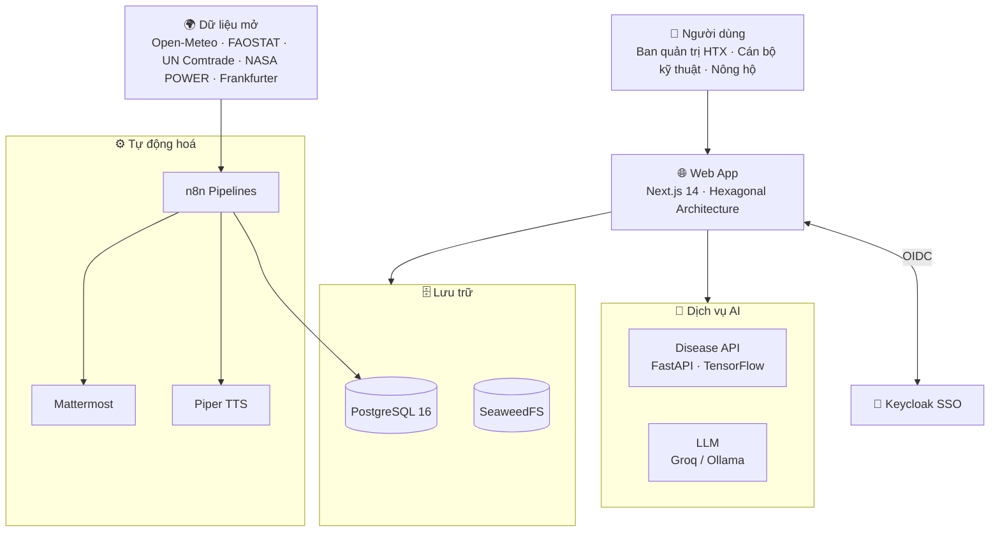

<div align="center">

  <h1>🍃 OpenTea DX-OS</h1>

  <p><strong>Nền tảng Chuyển đổi Số và Vận hành cho Hợp tác xã Nông nghiệp</strong></p>

  <p><em>"Kết nối Nông hộ — Tối ưu Sản xuất — Minh bạch Thị trường"</em></p>

  <br>

  [](./LICENSE)
  [](./CONTRIBUTING.md)
  [](./docker/docker-compose.yml)
  [](./apps/web)
  [](./apps/disease-api)
  [](./apps/web/prisma/schema.prisma)
  [](./docker/keycloak)
  [](./workflows)

  <br>

  [Tầm nhìn](#-tầm-nhìn--sứ-mệnh) •
  [Tính năng](#-tính-năng-chính) •
  [Kiến trúc](#-kiến-trúc-hệ-thống) •
  [Cài đặt](#-bắt-đầu-nhanh-quick-start) •
  [Tài liệu](#-hệ-thống-tài-liệu-documentation) •
  [Đóng góp](#-báo-lỗi--đóng-góp) •
  [Giấy phép](#-giấy-phép--bản-quyền)

</div>

---

## 🌟 Tầm nhìn & Sứ mệnh

**OpenTea DX-OS** là hệ điều hành nông nghiệp số dành cho các Hợp tác xã (HTX) tại Việt Nam. Hệ thống xoá bỏ rào cản thông tin giữa **Ban quản trị HTX**, **Cán bộ kỹ thuật** và **Nông hộ**, số hoá toàn bộ vòng đời sản xuất — từ thửa đất, nhật ký canh tác đến lô hàng truy xuất nguồn gốc — và đưa Trí tuệ Nhân tạo vào từng khâu ra quyết định.

Dự án được xây dựng **100% trên nền tảng mã nguồn mở**, với kiến trúc **Hexagonal (Ports & Adapters)** ở tầng nghiệp vụ và thiết kế **Feature-based** ở tầng giao diện.

## ✨ Tính năng chính

| Phân hệ | Mô tả |
| --- | --- |
| 🗺️ **Bản đồ vùng trồng** | Số hoá thửa đất nông hộ trên nền GIS (Leaflet), theo dõi sức khoẻ đất theo từng thửa. |
| 📝 **Nhật ký đồng ruộng** | Ghi nhận quy trình canh tác, phê duyệt theo vai trò và tự động tính thời gian cách ly (withdrawal days). |
| 🏷️ **Truy xuất nguồn gốc** | Quản lý lô hàng, xuất mã QR và chứng nhận cho từng lô sản phẩm. |
| 🤖 **Nhận diện bệnh hại** | Chẩn đoán bệnh cây trồng qua ảnh bằng dịch vụ Computer Vision (FastAPI + TensorFlow). |
| 💬 **Trợ lý thị trường** | Chatbot LLM (Groq, dự phòng Ollama) trả lời dựa trên dữ liệu có trích dẫn nguồn. |
| 📰 **Bản tin âm thanh** | Tổng hợp tin tức nông sản tự động bằng n8n và đọc bằng Piper TTS. |
| 🔔 **Thông báo & nhắc việc** | Thông báo thời gian thực trong ứng dụng và đẩy nhắc việc qua Mattermost. |

Hệ thống phân quyền theo ba vai trò: **Ban quản trị (`manager`)**, **Cán bộ kỹ thuật (`officer`)** và **Nông hộ (`farmer`)**, đăng nhập một lần (SSO) qua Keycloak.

## 🧭 Kiến trúc Hệ thống



**Nguyên tắc thiết kế (Invariants):**

1. **Hexagonal Architecture** — Domain logic độc lập hoàn toàn với framework (Next.js, Prisma). API Route chỉ đóng vai trò Inbound Adapter cho giao tiếp HTTP.
2. **AI Invariant** — Trợ lý AI chỉ trình bày sự thật có trích dẫn nguồn, **không** ra quyết định thay HTX và **không** đưa khuyến nghị cảm tính.
3. **Data Pipelines tách biệt** — Việc thu thập thời tiết, giá nông sản, tỷ giá và tin thị trường chạy trên n8n, không làm tăng tải cho Web App.

## 🧰 Ngăn xếp Công nghệ (Tech Stack)

| Tầng | Công nghệ |
| --- | --- |
| **Web App** | Next.js 14 (App Router), React 18, TypeScript, Tailwind CSS 4, Zod, Leaflet |
| **Xác thực** | Keycloak 24 (OIDC), NextAuth.js v5 |
| **Dữ liệu** | PostgreSQL 16 (PostGIS, pgvector), Prisma ORM 5, SeaweedFS (S3-compatible), Hasura |
| **AI** | FastAPI + TensorFlow (Computer Vision), Groq LLM, Ollama (tuỳ chọn) |
| **Tự động hoá** | n8n, Piper TTS, Mattermost |
| **Kiểm thử** | Jest, Playwright |
| **Hạ tầng** | Docker Compose, GitHub Actions, GitHub Container Registry |

## 🚀 Bắt đầu Nhanh (Quick Start)

**Yêu cầu:** Docker và Docker Compose v2.

1. **Clone mã nguồn:**
   ```bash
   git clone https://github.com/maiychrus25/OpenTea-DX-OS.git
   cd OpenTea-DX-OS
   ```

2. **Tạo file cấu hình môi trường:**
   ```bash
   cp .env.example .env.local
   cp docker/.env.local.example docker/.env.local
   ```
   > [!NOTE]
   > Điền `GROQ_API_KEY` trong `.env.local` để bật trợ lý LLM. Với môi trường production, hãy thay toàn bộ mật khẩu và secret mặc định.

3. **Khởi chạy hệ thống:**
   ```bash
   docker compose -f docker/docker-compose.yml up -d
   bash scripts/smoke-test.sh   # kiểm tra sức khoẻ các dịch vụ
   ```

4. **Truy cập dịch vụ:**

   | Dịch vụ | Địa chỉ |
   | --- | --- |
   | 🌐 Web App | http://localhost:3000 |
   | 🔐 Keycloak Admin | http://localhost:8080 |
   | ⚙️ n8n | http://localhost:5678 |
   | 🚪 API Gateway (APISIX) | http://localhost:9080 |
   | 🗄️ SeaweedFS S3 | http://localhost:9000 |

Các bước thiết lập bổ sung (bucket S3, import n8n workflows, Ollama model) và tài khoản mặc định xem tại **[Hướng dẫn cài đặt môi trường phát triển](./docs/dev-setup.md)**.

## 🧱 Tier 1: Nền tảng lõi (Headless Core)

Tier 1 gồm PostgreSQL (PostGIS, pgvector), SeaweedFS S3, Keycloak, Hasura (chỉ đọc, phân quyền theo `htx_code`), n8n, cổng API APISIX, ClamAV và `dxos-scanner` (kiểm dịch file), cùng Mosquitto (MQTT), `dxos-ingest`, `dxos-lifecycle` (kho lạnh Parquet) và Ollama (LLM nội bộ).

**Yêu cầu:** Docker + Compose ≥ 2.24, GNU make, bash, Node ≥ 20 (kèm npm), `jq`, `curl`, Python 3.

```bash
(cd apps/web && npm install --no-audit --no-fund)   # thư viện `minio` cho bước kiểm thử S3
make platform-up      # postgres -> platform-init -> migrate -> platform-init -> các dịch vụ còn lại -> ollama-init (kéo model)
make platform-smoke   # kiểm tra postgres, storage, identity, gateway, data, audit, quarantine, pins
make platform-down
python3 platform/tests/test_realm_policy.py   # kiểm tra chính sách realm Keycloak
```

Mọi truy cập API đi qua gateway `http://localhost:9080`:

| Route | Đích | Xác thực |
| --- | --- | --- |
| `/api/data/graphql` | Hasura GraphQL (chỉ đọc) | JWT Keycloak |
| `/api/workflow/*` | n8n webhook (`/webhook/*`) | JWT Keycloak |
| `/api/ai/disease/*` | disease-api | JWT Keycloak |
| `/api/ai/llm/v1/chat/completions` | Ollama (chỉ `POST`, giới hạn 30 yêu cầu/phút) | JWT Keycloak |
| `/storage/*` | SeaweedFS S3 | Không (pass-through) |

> [!WARNING]
> Hasura coi vai trò tên `admin` là siêu quản trị và lấy danh sách vai trò từ `realm_access.roles`: không bao giờ tạo realm role tên `admin` (hoặc `hasura-admin`) trong Keycloak. Gateway luôn gỡ header `x-hasura-admin-secret` do client gửi.

> [!NOTE]
> Giới hạn đã biết: route `/storage/*` chưa xác thực được chữ ký SigV4 của S3 (chờ Tầng 2). `/api/workflow/*` và `/api/ai/disease/*` yêu cầu audience `dx-os-core` ngay tại gateway (`claim_schema` của plugin `openid-connect`).

### Kiểm dịch file và nhật ký kiểm toán

- **Kiểm dịch:** `dxos-scanner` quét các bucket `agrimarket-docs` và `agrimarket-private` mỗi 5 giây bằng ClamAV (`clamav`, không mở cổng ra host). File nhiễm được sao chép sang `dxos-quarantine/<bucket>/<key>` rồi xóa khỏi bucket gốc. File lớn hơn 50 MiB (`CLAMD_CONF_StreamMaxLength=50M`) không quét được nên bị cách ly như `unscannable` mà không đọc nội dung. Archive đặt mật khẩu hoặc vượt giới hạn quét (độ sâu lồng, kích thước, thời gian 25 giây) bị ClamAV báo `FOUND` nên cũng bị cách ly; tài liệu đặt mật khẩu (không phải archive, ví dụ PDF) vẫn được chấp nhận. Mọi kết luận ghi vào bảng `audit.file_scans`.
- **Nhật ký kiểm toán:** 9 bảng nghiệp vụ có trigger `dxos_audit_row` ghi vào `audit.events`, một chuỗi băm chỉ-thêm (append-only; UPDATE/DELETE bị chặn). Kiểm tra toàn vẹn: `select * from audit.verify_chain();` (phát hiện dòng bị sửa, xóa giữa chuỗi hoặc xóa đuôi).

> [!NOTE]
> Giới hạn đã biết: (1) file có thể truy cập được trong khoảng ngắn trước vòng quét kế tiếp; (2) giữa bước sao chép và xóa có cửa sổ race (SeaweedFS không có DELETE có điều kiện); (3) phiên bản nhiễm mới cùng key ghi đè bản sao cách ly trước đó (sự kiện kiểm toán vẫn giữ etag/signature); (4) mọi thao tác ghi có kiểm toán được tuần tự hóa bởi một khóa chuỗi: giữ transaction ngắn, ứng dụng nên thử lại khi gặp SQLSTATE `40P01`/`40001`; (5) superuser ghi lại toàn bộ chuỗi với hash tính lại thì không phát hiện được nếu không neo hash đầu chuỗi ra bên ngoài; (6) `verify_chain()` chứng minh toàn vẹn của chuỗi, không chứng minh mọi thay đổi đều được ghi: superuser (`agrimarket`, dùng chung cho ứng dụng và scanner) có thể tắt trigger `dxos_audit_row`; `audit.chain_head` chỉ cho tiến lên, không lùi. Vai trò CSDL đặc quyền tối thiểu là hạng mục Tầng 2.

### Dữ liệu cảm biến, kho lạnh và LLM nội bộ

- **MQTT:** broker `mosquitto` không mở cổng ra host, chỉ nhận kết nối có mật khẩu. Mỗi HTX có một tài khoản thiết bị (`DXOS_MQTT_DEVICES=TC:mật_khẩu,LB:mật_khẩu`) chỉ được ghi vào topic của HTX mình; `dxos-ingest` (`DXOS_MQTT_INGEST_PASSWORD`) kiểm tra từng bản tin rồi ghi vào `telemetry.sensor_readings`, bản tin bị từ chối được lưu kèm lý do trong `telemetry.ingest_rejects`.
- **Kho lạnh:** `dxos-lifecycle` chạy mỗi giờ, chuyển bản ghi cũ hơn 30 ngày sang Parquet (ZSTD) trong bucket `dxos-lake` theo nguyên ngày UTC (mốc cắt làm tròn xuống 00:00 UTC nên bản ghi có thể nằm ở kho nóng thêm tối đa khoảng một ngày), kiểm tra lại SHA-256 và số dòng rồi mới xóa bản nóng; mỗi lần chuyển ghi vào `telemetry.lifecycle_runs` và `audit.events` (phả hệ). Truy vấn cả kho lạnh: `docker compose -f docker/docker-compose.yml exec dxos-lifecycle python -m dxos_dataops query "SELECT ..."` (view `sensor_readings_cold`).
- **LLM nội bộ:** Ollama chạy `qwen2.5:0.5b` (Apache-2.0), không mở cổng ra host; chỉ đường chat đi qua gateway (route ở bảng trên, API quản trị của Ollama không được route).
- **Demo:** `docker compose -f docker/docker-compose.yml --profile demo up -d dxos-simulator` bật bộ mô phỏng cảm biến cho các thửa mẫu.

> [!NOTE]
> Giới hạn đã biết: (1) view kho lạnh chỉ giữ bản được ghi nhận sớm nhất của một khóa bị xuất trùng; (2) Mosquitto ghi trạng thái xuống đĩa mỗi 60 giây (`autosave_interval 60`) nên bản tin đang xếp hàng trong tối đa 60 giây cuối có thể mất nếu broker sập; (3) `make platform-up` lần đầu trên máy sạch rất chậm vì phải kéo image Ollama và model (397 MB), các lần sau dùng volume `ollama_data`; (4) `ollama-init` cần mạng ra ngoài một lần; (5) `dxos-ingest` và `dxos-lifecycle` dùng chung tài khoản database `agrimarket` như `dxos-scanner` (tách vai trò thuộc Tầng 2); (6) mật khẩu database chứa ký tự dành riêng của URL (ví dụ `@`) làm hỏng `DXOS_DB_URL` của `dxos-ingest`, `dxos-lifecycle`, `dxos-scanner` và URL database của Hasura, vì chỉ `migrate` mã hóa mật khẩu.

**Nâng cấp môi trường dev cũ:**

- Postgres đổi từ alpine sang bookworm (collation khác): tạo lại volume Postgres, hoặc chạy `REINDEX DATABASE agrimarket;`.
- Tier 1b: `make platform-up` nay tự chạy `migrate` (image dựng sẵn, không cần `npx prisma migrate deploy` trên máy chủ) rồi `platform-init` lần nữa để gắn trigger kiểm toán; tạo lại các container `seaweedfs` (`-volume.max=100`, cần khi có hơn một bucket), `clamav` và `dxos-scanner`. Trên stack nâng cấp, object lớn hơn 50 MiB đang nằm trong bucket được theo dõi sẽ bị chuyển sang `dxos-quarantine` ở các vòng quét đầu tiên.
- Tier 1c: thêm `DXOS_MQTT_DEVICES` và `DXOS_MQTT_INGEST_PASSWORD` vào `docker/.env.local` (xem `docker/.env.local.example`); chạy `migrate` và `platform-init` (đã nằm trong `make platform-up`) để tạo bảng `telemetry.*`; tạo các container mới `mosquitto`, `dxos-ingest`, `dxos-lifecycle`, `ollama`, rồi chạy `ollama-init`.
- Keycloak chỉ import realm khi database mới: tạo lại realm (xoá volume) để nhận chính sách TOTP, audience `dx-os-core` và claim `htx_code`.
- Dữ liệu MinIO cũ không được chuyển sang SeaweedFS; container `agrimarket-minio` cũ còn chiếm cổng 9000, hãy chạy `docker compose -f docker/docker-compose.yml down --remove-orphans` trước khi dựng lại.
- Bảng n8n trước đây nằm ở schema `public`; n8n nay dùng schema `n8n` nên cần chạy `docker compose down -v` một lần (hoặc chuyển bảng thủ công). Lệnh `down -v` chỉ dành cho **môi trường dev**, tuyệt đối không chạy trên dữ liệu production.

## 🌱 Tier 2: Ứng dụng dùng lõi

Đợt 2a nối `apps/web` vào nền tảng lõi bằng danh tính của từng người dùng; mỗi người chỉ thấy và chỉ sửa được dữ liệu của HTX mình.

- **Phiên đăng nhập:** `access_token` và `refresh_token` của Keycloak chỉ nằm trong cookie phiên đã mã hóa, phía server đọc qua `getCoreToken()`; `/api/auth/session` không trả về token. Token còn dưới 30 giây thì middleware tự làm mới và ghi lại cookie; làm mới thất bại thì người dùng được đưa về `/login`. Phiên ứng dụng và phiên SSO đều dài 8 giờ.
- **HTX của người dùng:** lấy từ thuộc tính `htx_code` của tài khoản Keycloak (claim `htx_code` trong token). Tài khoản thiếu mã, hoặc mã không có trong `htx_profiles`, nhận lỗi `NO_HTX` và thấy thông báo liên hệ quản trị.
- **Đọc và ghi:** đọc parcel, nông hộ, lô, nhật ký, báo cáo bệnh đi qua gateway tới Hasura bằng token của người dùng. Ghi vẫn dùng Prisma, trước đó `TenantGuard` kiểm tra bản ghi thuộc HTX của người gọi; khác HTX trả **404**. Khi lõi lỗi, trang báo lỗi tiếng Việt và không quay về đọc Prisma. Dashboard vẫn đọc Prisma, có lọc theo HTX.
- **Cổng nội bộ:** container `web` gọi gateway qua `http://apisix:9081` (`CORE_GATEWAY_URL`), cổng này không chịu giới hạn theo IP vì mọi yêu cầu từ server có chung một IP; JWT và phân quyền vẫn áp dụng như trên `9080`. Chẩn đoán bệnh và chatbot (khi không có khóa Groq) cũng đi qua đây.
- **URL công khai:** đặt `AUTH_URL` trong `docker/.env.local` khi web không chạy ở `http://localhost:3000`, và thêm URL đó vào Redirect URIs của client `nextjs-web`; luồng release đọc biến này qua `--env-file`.

> [!WARNING]
> Không publish cổng `9081` ra ngoài mạng Docker. Cổng này không có giới hạn tần suất theo IP, chỉ an toàn khi chỉ có container `web` gọi được.

### Dữ liệu demo chè và tài khoản

`npm run seed` tạo hai HTX chè Thái Nguyên: Tân Cương (`TC`) và La Bằng (`LB`), mỗi HTX vài nông hộ và thửa giống Trung du, LDP1, Kim Tuyên. Tên, số điện thoại và toạ độ đều là dữ liệu giả (toạ độ nằm trong vùng chè, không phải ranh giới đất thật). Thửa `TC-A3` có lịch sử tính theo ngày chạy seed: bón phân, phun thuốc còn 4 ngày cách ly (cách ly 7 ngày), lứa trước đã thu hoạch và lô `TC-CHE-A3-001` đã xuất QR (trang công khai `/q/TC-CHE-A3-001`), một ảnh bệnh chè chờ cán bộ duyệt.

```bash
cd apps/web && DATABASE_URL="postgresql://agrimarket:<POSTGRES_PASSWORD>@localhost:5432/agrimarket" npm run seed
bash platform/tests/seed-test.sh   # seed hai lần trên database tạm, kiểm tra dữ liệu TC/LB và dữ liệu HTX khác không đổi
```

Chạy lại seed được nhiều lần và chỉ đổi dữ liệu của `TC`, `LB` (cùng bảng thị trường, bản tin, đối tác dùng chung): lịch sử của các thửa do seed tạo (nhật ký, lứa, lô, báo cáo bệnh, thời tiết) được xoá rồi tạo lại theo ngày mới, nên chỉ chạy trên database demo.

| Tài khoản | Vai trò | HTX | Mật khẩu | TOTP |
| --- | --- | --- | --- | --- |
| `manager_tc` | Quản lý | TC | `Test1234!` | Bắt buộc |
| `officer_tc` | Cán bộ kỹ thuật | TC | `Test1234!` | Bắt buộc |
| `farmer_tc` | Nông hộ (Hoàng Văn Tâm, chủ thửa `TC-A3`) | TC | `Test1234!` | Không |
| `manager_lb` | Quản lý | LB | `Test1234!` | Bắt buộc |
| `officer_lb` | Cán bộ kỹ thuật | LB | `Test1234!` | Bắt buộc |
| `farmer_lb` | Nông hộ (Ma Văn Thắng) | LB | `Test1234!` | Không |

**Cài TOTP trước buổi demo:** đăng nhập lần đầu bằng từng tài khoản quản lý và cán bộ, Keycloak hiện mã QR; quét bằng ứng dụng xác thực (Google Authenticator, Microsoft Authenticator hoặc FreeOTP), nhập mã 6 số để hoàn tất. Các lần sau Keycloak hỏi mã 6 số trên điện thoại đó, nên mang theo điện thoại đã cài khi demo. Muốn cài lại: Keycloak Admin Console > realm `agrimarket` > Users > tài khoản > tab **Credentials**, xoá OTP; tab **Details** > **Required user actions**, thêm **Configure OTP**.

Smoke test và test trình duyệt chỉ dùng tài khoản riêng tiền tố `smoke_` (`smoke_manager_tc`, `smoke_manager_lb`, `smoke_manager_none`, `smoke_farmer_tc`): chúng đặt lại mật khẩu và bỏ TOTP của tài khoản mình dùng, nên không bao giờ đụng vào tài khoản demo.

> [!NOTE]
> Keycloak chỉ import realm khi realm chưa có. Trên stack cũ, realm vẫn còn `manager1`, `officer1`, `farmer1` và các tài khoản `manager_tc`, `manager_lb`, `farmer_tc` do smoke cũ tạo (mật khẩu smoke, không TOTP). `farmer_tc` và `farmer_lb` phải có đúng `id` trong `docker/keycloak/realm-agrimarket.json` thì mới gắn với nông hộ do seed tạo; form tạo tài khoản của Admin Console không đặt được `id`, nên hãy dùng một trong hai cách sau:
>
> - **(a) Tạo lại realm:** Admin Console > realm `agrimarket` > Realm settings > **Action** > **Delete**, rồi `docker compose -f docker/docker-compose.yml restart keycloak`; lệnh khởi động có `--import-realm` nên realm thiếu sẽ được import lại từ file. Cách này xoá luôn mọi tài khoản tạo lúc chạy (thành viên được mời, tài khoản `smoke_`).
> - **(b) Chỉ nhập tài khoản:** xoá tay `manager1`, `officer1`, `farmer1`; rồi Realm settings > **Action** > **Partial import**, chọn file `docker/keycloak/realm-agrimarket.json`, chỉ đánh dấu **Users**, chọn **Overwrite** khi tài khoản đã tồn tại (ghi đè `manager_tc`, `manager_lb`, `farmer_tc` cũ). Partial import giữ `id` cố định, mật khẩu demo và TOTP bắt buộc.
>
> Dữ liệu Keycloak nằm trong database `keycloak` của volume Postgres dùng chung: **không bao giờ xoá `docker_pgdata`**, xoá volume này là mất toàn bộ dữ liệu ứng dụng.

Kiểm thử trên trình duyệt với stack thật (cần `make platform-up`, `make platform-smoke` và container `web` đang chạy):

```bash
docker compose -f docker/docker-compose.yml up -d --build --wait web
cd apps/web && npx playwright install chromium
E2E_CORE=1 E2E_BASE_URL=http://localhost:3000 npx playwright test tests/e2e/tenant/core-tenant.spec.ts --project=chromium --no-deps --reporter=list
```

Test này tạm đổi `accessTokenLifespan` của realm và tạm dừng Hasura rồi khôi phục, nên chỉ chạy trên môi trường dev.

> [!NOTE]
> Giới hạn đã biết: (1) `workflows/mattermost-push.json` đẩy sự kiện bệnh và thu hoạch của mọi HTX vào cùng một webhook; (2) ở production, cookie tạo trước khi nâng cấp bị chuyển về trang đăng nhập; cookie của `/api/dev-login` không có access token nên mọi đọc qua lõi đều bị từ chối; (3) đường ghi được bảo vệ ở tầng ứng dụng, không phải ở database.

**Nâng cấp lên Tier 2a:**

- Chạy `migrate` (hai migration mới: `20261109120000_sync_schema_drift`, `20261109130000_notifications_htx`) rồi `platform-init` như ở mục triển khai; `make platform-up` đã gồm cả hai.
- Với bản release đang chạy, sau `up -d --no-build` phải chạy `docker compose --env-file docker/.env.local -f docker/docker-compose.yml -f docker/docker-compose.release.yml restart hasura apisix`: cấu hình compose của hai dịch vụ này không đổi nên chúng không được tạo lại, APISIX vẫn chỉ nghe cổng 9080 và Hasura thiếu các relationship mới, khiến mọi danh sách trả 503.
- Realm đang chạy không tự cập nhật: trong Keycloak Admin Console, đặt **SSO Session Idle** và **SSO Session Max** của realm `agrimarket` là 8 giờ (Realm settings > Sessions), và khai báo các thuộc tính `fullName`, `phone`, `htxId` chỉ cho admin xem và sửa (Realm settings > User profile); nếu thiếu, Keycloak 24 âm thầm bỏ các thuộc tính này khi tạo tài khoản.
- Đặt cả `KEYCLOAK_ADMIN` lẫn `KEYCLOAK_ADMIN_PASSWORD` trong `docker/.env.local`, nếu thiếu thì các route quản trị trả 500 ở production.
- Gán thuộc tính `htx_code` cho các tài khoản cũ, nếu không họ nhận `NO_HTX`.
- Thông báo cũ không có người nhận và không có HTX sẽ không còn hiển thị; cảnh báo hệ thống của n8n vẫn hiển thị.
- Các hàng có `htx_profile_id` rỗng (nông hộ, lô hàng) trở nên không xem và không ghi được; phải gán chúng cho một HTX (tham khảo `scripts/backfill-htx-profile-id.sql`).
- Tài liệu nay nằm dưới `para/<mã HTX>/...`, trừ báo cáo thị trường do n8n ghi ở `para/Archives/Market_Reports/`: thư mục dùng chung, không chứa dữ liệu riêng của HTX, chỉ đọc cho mọi HTX. Object cũ dưới `para/Projects/`, `para/Areas/`, `para/Resources/`, `para/Archives/` không còn được liệt kê và không được tự động chuyển; muốn dùng lại phải tự chép sang thư mục của HTX tương ứng. `certificate_keys` khi tạo lô hoặc xuất QR phải thuộc thư mục của HTX, nếu không trả 400.
- Chứng nhận của lô đã xuất QR có key ngoài `para/<mã HTX>/` của HTX sở hữu lô nay trả 403 trên trang công khai, và ảnh nhật ký có key như vậy không còn hiển thị; muốn dùng lại phải chép object vào thư mục đó và cập nhật key.
- Giới hạn đã biết: giới hạn 5 yêu cầu mỗi IP trong 10 phút của `POST /api/register` chỉ tính trong từng tiến trình và tin vào `X-Forwarded-For`, các máy sau cùng một proxy hoặc NAT dùng chung hạn mức, và giá trị không phải IP hợp lệ dùng chung một nhóm `unknown`; khi `web` chạy nhiều hơn một instance phải chuyển sang gateway hoặc kho dùng chung.

## 🔨 Biên dịch từ Mã nguồn (Build from Source)

**Yêu cầu:** Node.js ≥ 20, Python ≥ 3.11, PostgreSQL ≥ 16.

**Web App (`apps/web`)**

```bash
cd apps/web
npm ci                          # Cài đặt thư viện theo package-lock.json
npx prisma generate             # Sinh Prisma Client
npx prisma migrate deploy       # Áp dụng migration vào database
npm run build                   # Biên dịch production bundle
npm run start                   # Chạy tại http://localhost:3000
```

**Disease API (`apps/disease-api`)**

```bash
cd apps/disease-api
python -m venv .venv && source .venv/bin/activate   # Windows: .venv\Scripts\activate
pip install -r requirements.txt
uvicorn app.main:app --host 0.0.0.0 --port 8000
```

> Toàn bộ công cụ biên dịch đều là phần mềm nguồn mở: Node.js (MIT), npm (Artistic-2.0), Python (PSF), pip (MIT), PostgreSQL (PostgreSQL License).

## 🧪 Kiểm thử & Chất lượng

```bash
cd apps/web
npm run check        # Validate schema → ESLint → TypeScript → Contract tests → Build
npm test             # Unit tests (Jest)
npm run test:e2e     # End-to-end tests (Playwright)
```

Mọi Pull Request vào `main` đều phải qua **CI Quality Gate** trên GitHub Actions: lint, type-check, unit test, browser smoke test, production build và Docker Compose smoke test. Chiến lược kiểm thử chi tiết tại [docs/testing-strategy.md](./docs/testing-strategy.md).

## 📂 Cấu trúc Thư mục

```text
OpenTea-DX-OS/
├── apps/
│   ├── web/                # Next.js 14 — giao diện, API routes, Prisma schema & migrations
│   └── disease-api/        # FastAPI — dịch vụ nhận diện bệnh hại cây trồng
├── ai-models/              # Script thiết lập mô hình AI
├── database/               # Schema & dữ liệu mẫu PostgreSQL
├── docker/                 # Docker Compose, Keycloak realm & theme, cấu hình hạ tầng
├── docs/                   # Tài liệu nghiệp vụ, kiến trúc và kiểm thử
├── workflows/              # n8n pipelines (thời tiết, FAOSTAT, tỷ giá, bản tin, nhắc việc…)
├── scripts/                # Script kiểm tra môi trường, cấu trúc và smoke test
└── .github/workflows/      # CI Quality Gate, Docker Publish (edge) & Release
```

## 📚 Hệ thống Tài liệu (Documentation)

Vui lòng đọc kỹ trước khi đóng góp mã nguồn:

- 📖 **[Project Context](./docs/project-context.md)** — Công nghệ, thuật ngữ nghiệp vụ (Domain Glossary) và các luật cốt lõi.
- 📋 **[Tài liệu Phân tích Nghiệp vụ (BA)](./docs/BA_Document.md)** — Yêu cầu nghiệp vụ và luồng xử lý của HTX.
- 🏛️ **[Rules and Limits](./docs/rules-and-limits.md)** — Ràng buộc nghiệp vụ (Business Rules) và tiêu chuẩn mã nguồn.
- 🔌 **[API Contract](./docs/api-contract.md)** — Đặc tả các endpoint của Web App.
- 🗄️ **[Database Schema](./docs/database-schema.md)** — Cấu trúc dữ liệu PostgreSQL.
- 🧪 **[Testing Strategy](./docs/testing-strategy.md)** — Công cụ và chiến lược kiểm thử.
- 🛠️ **[Dev Setup](./docs/dev-setup.md)** — Hướng dẫn cài đặt môi trường phát triển.
- 📝 **[Deviation Register](./docs/deviation-register.md)** — Sổ ghi nhận các điểm sai lệch so với đặc tả.
- 📦 **[Dependencies](./DEPENDENCIES.md)** — Danh mục thư viện và giấy phép phụ thuộc.
- 🤖 **[AGENTS.md](./AGENTS.md)** — Quy tắc làm việc cho AI agents và developers.

## 🐛 Báo lỗi & Đóng góp

- **Báo lỗi & đề xuất tính năng:** tạo issue tại [GitHub Issues](https://github.com/maiychrus25/OpenTea-DX-OS/issues).
- **Quy chuẩn đóng góp:** đọc [CONTRIBUTING.md](./CONTRIBUTING.md) và [CODE_OF_CONDUCT.md](./CODE_OF_CONDUCT.md) trước khi gửi Pull Request (có sẵn mẫu issue và PR).
- **Báo lỗ hổng bảo mật:** không dùng issue công khai — xem [SECURITY.md](./SECURITY.md).
- **Quy ước commit:** [Conventional Commits](https://www.conventionalcommits.org/) bằng tiếng Anh, ví dụ `feat(journal): add withdrawal-day validation`.

## 📦 Bản phát hành (Releases)

- Phiên bản được đánh số theo [Semantic Versioning](https://semver.org/) và ghi nhận trong [CHANGELOG.md](./CHANGELOG.md) theo chuẩn [Keep a Changelog](https://keepachangelog.com/).
- Các bản phát hành chính thức được công bố tại [GitHub Releases](https://github.com/maiychrus25/OpenTea-DX-OS/releases), mỗi bản gồm ghi chú phát hành, gói triển khai `opentea-dx-os-X.Y.Z.tar.gz` (kèm `SHA256SUMS`) và image trên GHCR:
  `ghcr.io/maiychrus25/opentea-dx-os-web:X.Y.Z`, `-api`, `-postgres`, `-scanner`, `-migrate` và `-dataops` (cùng tiền tố, cùng tag).

**Phát hành phiên bản mới (maintainer):**

1. Chuyển nội dung mục `[Unreleased]` trong `CHANGELOG.md` sang mục mới `## [X.Y.Z] - YYYY-MM-DD`.
2. Cập nhật `version` trong `apps/web/package.json` thành `X.Y.Z` (`npm version X.Y.Z --no-git-tag-version` trong `apps/web`).
3. Commit, sau đó gắn tag và đẩy lên:
   ```bash
   git tag vX.Y.Z && git push origin vX.Y.Z
   ```
   Workflow **Release** sẽ kiểm tra phiên bản, chạy toàn bộ CI Quality Gate, đẩy image lên GHCR và tạo GitHub Release. Tag dạng `vX.Y.Z-rc.N` tạo bản pre-release (không gắn tag `latest`).

**Triển khai một bản phát hành:**

```bash
tar -xzf opentea-dx-os-X.Y.Z.tar.gz && cd opentea-dx-os-X.Y.Z
cp .env.example .env.local && cp docker/.env.local.example docker/.env.local   # rồi điền secret production
export OPENTEA_VERSION=X.Y.Z
docker compose --env-file docker/.env.local -f docker/docker-compose.yml -f docker/docker-compose.release.yml pull web disease-api postgres migrate dxos-scanner dxos-ingest dxos-lifecycle
# Điền DXOS_MQTT_DEVICES và DXOS_MQTT_INGEST_PASSWORD (không để change_me*) trong docker/.env.local: broker từ chối khởi động nếu còn placeholder
# Điền MINIO_ACCESS_KEY và MINIO_SECRET_KEY: SeaweedFS từ chối khởi động nếu còn rỗng hoặc placeholder (your_minio*, change_me*)
# Mọi lệnh đều cần --env-file docker/.env.local: thiếu cờ này Compose dùng giá trị mặc định công khai trong repo thay vì secret của anh
# Thứ tự bắt buộc: (1) postgres  (2) platform-init  (3) migrate  (4) platform-init lần nữa (gắn trigger kiểm toán vào các bảng vừa migrate)  (5) phần còn lại  (6) ollama-init (kéo model, cần mạng ra ngoài)
docker compose --env-file docker/.env.local -f docker/docker-compose.yml -f docker/docker-compose.release.yml up -d --wait postgres
docker compose --env-file docker/.env.local -f docker/docker-compose.yml -f docker/docker-compose.release.yml run --rm platform-init
docker compose --env-file docker/.env.local -f docker/docker-compose.yml -f docker/docker-compose.release.yml --profile tools run --rm migrate
docker compose --env-file docker/.env.local -f docker/docker-compose.yml -f docker/docker-compose.release.yml run --rm platform-init
docker compose --env-file docker/.env.local -f docker/docker-compose.yml -f docker/docker-compose.release.yml up -d --no-build
docker compose --env-file docker/.env.local -f docker/docker-compose.yml -f docker/docker-compose.release.yml --profile tools run --rm ollama-init
```

> [!NOTE]
> Hasura phải khởi động sau migration (thiếu bảng thì không phục vụ dữ liệu). Cổng mở ra host: `apisix:9080`, `web:3000`, `keycloak:8080` và `seaweedfs:9000` (trình duyệt tải/xem file qua presigned URL trên cổng 9000 nên chưa thể đóng cho tới khi Tầng 2 đưa storage ra sau gateway).

> [!WARNING]
> Bắt buộc đặt `HASURA_GRAPHQL_ADMIN_SECRET` mạnh trong `docker/.env.local` trước khi triển khai: override release khiến Hasura từ chối khởi động nếu giá trị rỗng hoặc còn là placeholder `change_me*`. Cũng phải đổi `MINIO_ACCESS_KEY`, `MINIO_SECRET_KEY` (SeaweedFS từ chối khởi động nếu còn placeholder, cổng 9000 mở công khai) và `KEYCLOAK_ADMIN`, `KEYCLOAK_ADMIN_PASSWORD` (cổng 8080 mở công khai, override release khiến Keycloak từ chối khởi động nếu mật khẩu rỗng, còn là `admin` hoặc `change_me*`). Keycloak chỉ đọc hai biến này khi database còn mới, nên với hệ thống đang chạy phải đổi thêm mật khẩu admin ngay trong Keycloak.

> [!IMPORTANT]
> Nâng cấp một bản đang chạy lên Tier 1c: (1) chạy `docker compose --env-file docker/.env.local -f docker/docker-compose.yml -f docker/docker-compose.release.yml restart hasura apisix` sau `up -d --no-build`, vì Hasura chỉ nạp metadata lúc khởi động và APISIX giữ inode cũ của file route; (2) `--env-file` khiến các giá trị trong `docker/.env.local` lần đầu có hiệu lực cho `POSTGRES_PASSWORD`, `KEYCLOAK_DB_PASSWORD` và `N8N_ENCRYPTION_KEY`: chúng phải khớp với giá trị mà volume hiện có đã được khởi tạo (trước đây là mặc định trong `docker-compose.yml`), nếu không dịch vụ sẽ không kết nối được hoặc không giải mã được dữ liệu.

> [!IMPORTANT]
> Production chỉ chạy image dựng sẵn từ GHCR (`--no-build`). Để quay lại bản trước, đặt `OPENTEA_VERSION` về phiên bản cũ và chạy lại `up -d --no-build`; migration database không tự đảo ngược, hãy sao lưu database trước khi nâng cấp. Yêu cầu Docker Compose ≥ 2.24.

## 📜 Giấy phép & Bản quyền

- Dự án được phân phối theo giấy phép **[MIT License](./LICENSE)**.
- Một số dịch vụ bên thứ ba chạy kèm có giấy phép riêng (ví dụ n8n — Sustainable Use License, SeaweedFS — Apache-2.0). Xem chi tiết tại [DEPENDENCIES.md](./DEPENDENCIES.md).

---

<div align="center">
  <p>Phát triển bởi <strong>OpenTea Developers</strong> 🍃</p>
</div>
