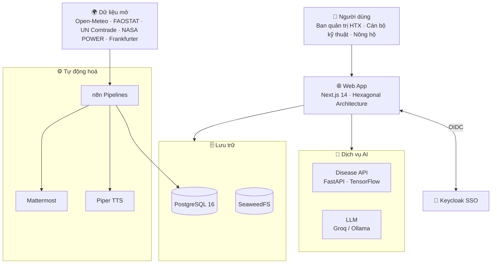

<div align="center">

  <h1>🍃 OpenTea DX-OS</h1>

  <p><strong>Nền tảng Chuyển đổi Số và Vận hành cho Hợp tác xã Nông nghiệp</strong></p>

  <p><em>"Kết nối Nông hộ — Tối ưu Sản xuất — Minh bạch Thị trường"</em></p>

  <br>

  [](./LICENSE)
  [](./CONTRIBUTING.md)
  [](./docker/docker-compose.yml)
  [](./apps/web)
  [](./apps/disease-api)
  [](./apps/web/prisma/schema.prisma)
  [](./docker/keycloak)
  [](./workflows)

  <br>

  [Tầm nhìn](#-tầm-nhìn--sứ-mệnh) •
  [Tính năng](#-tính-năng-chính) •
  [Kiến trúc](#-kiến-trúc-hệ-thống) •
  [Cài đặt](#-bắt-đầu-nhanh-quick-start) •
  [Tài liệu](#-hệ-thống-tài-liệu-documentation) •
  [Đóng góp](#-báo-lỗi--đóng-góp) •
  [Giấy phép](#-giấy-phép--bản-quyền)

</div>

---

## 🌟 Tầm nhìn & Sứ mệnh

**OpenTea DX-OS** là hệ điều hành nông nghiệp số dành cho các Hợp tác xã (HTX) tại Việt Nam. Hệ thống xoá bỏ rào cản thông tin giữa **Ban quản trị HTX**, **Cán bộ kỹ thuật** và **Nông hộ**, số hoá toàn bộ vòng đời sản xuất — từ thửa đất, nhật ký canh tác đến lô hàng truy xuất nguồn gốc — và đưa Trí tuệ Nhân tạo vào từng khâu ra quyết định.

Dự án được xây dựng **100% trên nền tảng mã nguồn mở**, với kiến trúc **Hexagonal (Ports & Adapters)** ở tầng nghiệp vụ và thiết kế **Feature-based** ở tầng giao diện.

## ✨ Tính năng chính

| Phân hệ | Mô tả |
| --- | --- |
| 🗺️ **Bản đồ vùng trồng** | Số hoá thửa đất nông hộ trên nền GIS (Leaflet), theo dõi sức khoẻ đất theo từng thửa. |
| 📝 **Nhật ký đồng ruộng** | Ghi nhận quy trình canh tác, phê duyệt theo vai trò và tự động tính thời gian cách ly (withdrawal days). |
| 🏷️ **Truy xuất nguồn gốc** | Quản lý lô hàng, xuất mã QR và chứng nhận cho từng lô sản phẩm. |
| 🤖 **Nhận diện bệnh hại** | Chẩn đoán bệnh cây trồng qua ảnh bằng dịch vụ Computer Vision (FastAPI + TensorFlow). |
| 💬 **Trợ lý thị trường** | Chatbot LLM (Groq, dự phòng Ollama) trả lời dựa trên dữ liệu có trích dẫn nguồn. |
| 📰 **Bản tin âm thanh** | Tổng hợp tin tức nông sản tự động bằng n8n và đọc bằng Piper TTS. |
| 🔔 **Thông báo & nhắc việc** | Thông báo thời gian thực trong ứng dụng và đẩy nhắc việc qua Mattermost. |

Hệ thống phân quyền theo ba vai trò: **Ban quản trị (`manager`)**, **Cán bộ kỹ thuật (`officer`)** và **Nông hộ (`farmer`)**, đăng nhập một lần (SSO) qua Keycloak.

## 🧭 Kiến trúc Hệ thống



**Nguyên tắc thiết kế (Invariants):**

1. **Hexagonal Architecture** — Domain logic độc lập hoàn toàn với framework (Next.js, Prisma). API Route chỉ đóng vai trò Inbound Adapter cho giao tiếp HTTP.
2. **AI Invariant** — Trợ lý AI chỉ trình bày sự thật có trích dẫn nguồn, **không** ra quyết định thay HTX và **không** đưa khuyến nghị cảm tính.
3. **Data Pipelines tách biệt** — Việc thu thập thời tiết, giá nông sản, tỷ giá và tin thị trường chạy trên n8n, không làm tăng tải cho Web App.

## 🧰 Ngăn xếp Công nghệ (Tech Stack)

| Tầng | Công nghệ |
| --- | --- |
| **Web App** | Next.js 14 (App Router), React 18, TypeScript, Tailwind CSS 4, Zod, Leaflet |
| **Xác thực** | Keycloak 24 (OIDC), NextAuth.js v5 |
| **Dữ liệu** | PostgreSQL 16 (PostGIS, pgvector), Prisma ORM 5, SeaweedFS (S3-compatible), Hasura |
| **AI** | FastAPI + TensorFlow (Computer Vision), Groq LLM, Ollama (tuỳ chọn) |
| **Tự động hoá** | n8n, Piper TTS, Mattermost |
| **Kiểm thử** | Jest, Playwright |
| **Hạ tầng** | Docker Compose, GitHub Actions, GitHub Container Registry |

## 🚀 Bắt đầu Nhanh (Quick Start)

**Yêu cầu:** Docker và Docker Compose v2.

1. **Clone mã nguồn:**
   ```bash
   git clone https://github.com/maiychrus25/OpenTea-DX-OS.git
   cd OpenTea-DX-OS
   ```

2. **Tạo file cấu hình môi trường:**
   ```bash
   cp .env.example .env.local
   cp docker/.env.local.example docker/.env.local
   ```
   > [!NOTE]
   > Điền `GROQ_API_KEY` trong `.env.local` để bật trợ lý LLM. Với môi trường production, hãy thay toàn bộ mật khẩu và secret mặc định.

3. **Khởi chạy hệ thống:**
   ```bash
   docker compose -f docker/docker-compose.yml up -d
   bash scripts/smoke-test.sh   # kiểm tra sức khoẻ các dịch vụ
   ```

4. **Truy cập dịch vụ:**

   | Dịch vụ | Địa chỉ |
   | --- | --- |
   | 🌐 Web App | http://localhost:3000 |
   | 🔐 Keycloak Admin | http://localhost:8080 |
   | ⚙️ n8n | http://localhost:5678 |
   | 🚪 API Gateway (APISIX) | http://localhost:9080 |
   | 🗄️ SeaweedFS S3 | http://localhost:9000 |

Các bước thiết lập bổ sung (bucket S3, import n8n workflows, Ollama model) và tài khoản mặc định xem tại **[Hướng dẫn cài đặt môi trường phát triển](./docs/dev-setup.md)**.

## 🧱 Tier 1: Nền tảng lõi (Headless Core)

Tier 1 gồm PostgreSQL (PostGIS, pgvector), SeaweedFS S3, Keycloak, Hasura (chỉ đọc, phân quyền theo `htx_code`), n8n và cổng API APISIX.

```bash
make platform-up      # dựng và chờ các dịch vụ nền tảng, chạy platform-init
make platform-smoke   # kiểm tra postgres, storage, identity, gateway, data, pins
make platform-down
```

Mọi truy cập API đi qua gateway `http://localhost:9080`:

| Route | Đích | Xác thực |
| --- | --- | --- |
| `/api/data/graphql` | Hasura GraphQL (chỉ đọc) | JWT Keycloak |
| `/api/workflow/*` | n8n webhook (`/webhook/*`) | JWT Keycloak |
| `/api/ai/disease/*` | disease-api | JWT Keycloak |
| `/storage/*` | SeaweedFS S3 | Không (pass-through) |

**Nâng cấp môi trường dev cũ:**

- Postgres đổi từ alpine sang bookworm (collation khác): tạo lại volume Postgres, hoặc chạy `REINDEX DATABASE agrimarket;`.
- Keycloak chỉ import realm khi database mới: tạo lại realm (xoá volume) để nhận chính sách TOTP, audience `dx-os-core` và claim `htx_code`.
- Dữ liệu MinIO cũ không được chuyển sang SeaweedFS.
- Bảng n8n trước đây nằm ở schema `public`; n8n nay dùng schema `n8n` nên cần chạy `docker compose down -v` một lần (hoặc chuyển bảng thủ công).

## 🔨 Biên dịch từ Mã nguồn (Build from Source)

**Yêu cầu:** Node.js ≥ 20, Python ≥ 3.11, PostgreSQL ≥ 16.

**Web App (`apps/web`)**

```bash
cd apps/web
npm ci                          # Cài đặt thư viện theo package-lock.json
npx prisma generate             # Sinh Prisma Client
npx prisma migrate deploy       # Áp dụng migration vào database
npm run build                   # Biên dịch production bundle
npm run start                   # Chạy tại http://localhost:3000
```

**Disease API (`apps/disease-api`)**

```bash
cd apps/disease-api
python -m venv .venv && source .venv/bin/activate   # Windows: .venv\Scripts\activate
pip install -r requirements.txt
uvicorn app.main:app --host 0.0.0.0 --port 8000
```

> Toàn bộ công cụ biên dịch đều là phần mềm nguồn mở: Node.js (MIT), npm (Artistic-2.0), Python (PSF), pip (MIT), PostgreSQL (PostgreSQL License).

## 🧪 Kiểm thử & Chất lượng

```bash
cd apps/web
npm run check        # Validate schema → ESLint → TypeScript → Contract tests → Build
npm test             # Unit tests (Jest)
npm run test:e2e     # End-to-end tests (Playwright)
```

Mọi Pull Request vào `main` đều phải qua **CI Quality Gate** trên GitHub Actions: lint, type-check, unit test, browser smoke test, production build và Docker Compose smoke test. Chiến lược kiểm thử chi tiết tại [docs/testing-strategy.md](./docs/testing-strategy.md).

## 📂 Cấu trúc Thư mục

```text
OpenTea-DX-OS/
├── apps/
│   ├── web/                # Next.js 14 — giao diện, API routes, Prisma schema & migrations
│   └── disease-api/        # FastAPI — dịch vụ nhận diện bệnh hại cây trồng
├── ai-models/              # Script thiết lập mô hình AI
├── database/               # Schema & dữ liệu mẫu PostgreSQL
├── docker/                 # Docker Compose, Keycloak realm & theme, cấu hình hạ tầng
├── docs/                   # Tài liệu nghiệp vụ, kiến trúc và kiểm thử
├── workflows/              # n8n pipelines (thời tiết, FAOSTAT, tỷ giá, bản tin, nhắc việc…)
├── scripts/                # Script kiểm tra môi trường, cấu trúc và smoke test
└── .github/workflows/      # CI Quality Gate, Docker Publish (edge) & Release
```

## 📚 Hệ thống Tài liệu (Documentation)

Vui lòng đọc kỹ trước khi đóng góp mã nguồn:

- 📖 **[Project Context](./docs/project-context.md)** — Công nghệ, thuật ngữ nghiệp vụ (Domain Glossary) và các luật cốt lõi.
- 📋 **[Tài liệu Phân tích Nghiệp vụ (BA)](./docs/BA_Document.md)** — Yêu cầu nghiệp vụ và luồng xử lý của HTX.
- 🏛️ **[Rules and Limits](./docs/rules-and-limits.md)** — Ràng buộc nghiệp vụ (Business Rules) và tiêu chuẩn mã nguồn.
- 🔌 **[API Contract](./docs/api-contract.md)** — Đặc tả các endpoint của Web App.
- 🗄️ **[Database Schema](./docs/database-schema.md)** — Cấu trúc dữ liệu PostgreSQL.
- 🧪 **[Testing Strategy](./docs/testing-strategy.md)** — Công cụ và chiến lược kiểm thử.
- 🛠️ **[Dev Setup](./docs/dev-setup.md)** — Hướng dẫn cài đặt môi trường phát triển.
- 📝 **[Deviation Register](./docs/deviation-register.md)** — Sổ ghi nhận các điểm sai lệch so với đặc tả.
- 📦 **[Dependencies](./DEPENDENCIES.md)** — Danh mục thư viện và giấy phép phụ thuộc.
- 🤖 **[AGENTS.md](./AGENTS.md)** — Quy tắc làm việc cho AI agents và developers.

## 🐛 Báo lỗi & Đóng góp

- **Báo lỗi & đề xuất tính năng:** tạo issue tại [GitHub Issues](https://github.com/maiychrus25/OpenTea-DX-OS/issues).
- **Quy chuẩn đóng góp:** đọc [CONTRIBUTING.md](./CONTRIBUTING.md) và [CODE_OF_CONDUCT.md](./CODE_OF_CONDUCT.md) trước khi gửi Pull Request.
- **Quy ước commit:** [Conventional Commits](https://www.conventionalcommits.org/) bằng tiếng Anh, ví dụ `feat(journal): add withdrawal-day validation`.

## 📦 Bản phát hành (Releases)

- Phiên bản được đánh số theo [Semantic Versioning](https://semver.org/) và ghi nhận trong [CHANGELOG.md](./CHANGELOG.md) theo chuẩn [Keep a Changelog](https://keepachangelog.com/).
- Các bản phát hành chính thức được công bố tại [GitHub Releases](https://github.com/maiychrus25/OpenTea-DX-OS/releases), mỗi bản gồm ghi chú phát hành, gói triển khai `opentea-dx-os-X.Y.Z.tar.gz` (kèm `SHA256SUMS`) và image trên GHCR:
  `ghcr.io/maiychrus25/opentea-dx-os-web:X.Y.Z`, `ghcr.io/maiychrus25/opentea-dx-os-api:X.Y.Z`, `ghcr.io/maiychrus25/opentea-dx-os-postgres:X.Y.Z`.

**Phát hành phiên bản mới (maintainer):**

1. Chuyển nội dung mục `[Unreleased]` trong `CHANGELOG.md` sang mục mới `## [X.Y.Z] - YYYY-MM-DD`.
2. Cập nhật `version` trong `apps/web/package.json` thành `X.Y.Z` (`npm version X.Y.Z --no-git-tag-version` trong `apps/web`).
3. Commit, sau đó gắn tag và đẩy lên:
   ```bash
   git tag vX.Y.Z && git push origin vX.Y.Z
   ```
   Workflow **Release** sẽ kiểm tra phiên bản, chạy toàn bộ CI Quality Gate, đẩy image lên GHCR và tạo GitHub Release. Tag dạng `vX.Y.Z-rc.N` tạo bản pre-release (không gắn tag `latest`).

**Triển khai một bản phát hành:**

```bash
tar -xzf opentea-dx-os-X.Y.Z.tar.gz && cd opentea-dx-os-X.Y.Z
cp .env.example .env.local && cp docker/.env.local.example docker/.env.local   # rồi điền secret production
export OPENTEA_VERSION=X.Y.Z
docker compose -f docker/docker-compose.yml -f docker/docker-compose.release.yml pull web disease-api postgres
# Thứ tự bắt buộc: (1) postgres  (2) platform-init  (3) migrate  (4) phần còn lại
docker compose -f docker/docker-compose.yml -f docker/docker-compose.release.yml up -d --wait postgres
docker compose -f docker/docker-compose.yml -f docker/docker-compose.release.yml run --rm platform-init
docker compose -f docker/docker-compose.yml -f docker/docker-compose.release.yml --profile tools run --rm migrate
docker compose -f docker/docker-compose.yml -f docker/docker-compose.release.yml up -d --no-build
```

> [!NOTE]
> Hasura phải khởi động sau migration (thiếu bảng thì không phục vụ dữ liệu). Chỉ `apisix:9080`, `web:3000` và `keycloak:8080` mở cổng ra host.

> [!IMPORTANT]
> Production chỉ chạy image dựng sẵn từ GHCR (`--no-build`). Để quay lại bản trước, đặt `OPENTEA_VERSION` về phiên bản cũ và chạy lại `up -d --no-build`; migration database không tự đảo ngược, hãy sao lưu database trước khi nâng cấp. Yêu cầu Docker Compose ≥ 2.24.

## 📜 Giấy phép & Bản quyền

- Dự án được phân phối theo giấy phép **[MIT License](./LICENSE)**.
- Một số dịch vụ bên thứ ba chạy kèm có giấy phép riêng (ví dụ n8n — Sustainable Use License, SeaweedFS — Apache-2.0). Xem chi tiết tại [DEPENDENCIES.md](./DEPENDENCIES.md).

---

<div align="center">
  <p>Phát triển bởi <strong>OpenTea Developers</strong> 🍃</p>
</div>
