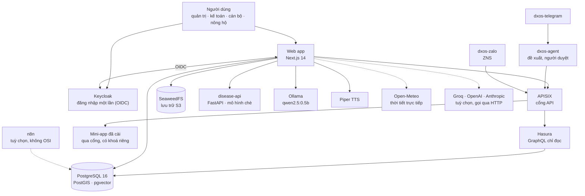

<div align="center">

  <h1>🍃 OpenTea DX-OS</h1>

  <p><strong>Hệ điều hành số mã nguồn mở cho hợp tác xã chè</strong></p>

  <p><em>Ghi nhật ký đồng ruộng · cân búp và thanh toán · truy xuất lô bằng QR · một bảng điều hành cho cả HTX</em></p>

  <p>🌐 <a href="https://maiychrus25.github.io/OpenTea-DX-OS/"><strong>Trang giới thiệu</strong></a> · <a href="https://maiychrus25.github.io/OpenTea-DX-OS/en/">English</a> · <a href="https://maiychrus25.github.io/OpenTea-DX-OS/docs/">Tài liệu trực tuyến</a></p>

  <br>

  [](./LICENSE)
  [-2E7D32?style=for-the-badge)](./DEPENDENCIES.md)
  [](./docker/docker-compose.yml)
  [](./apps/web)
  [](./apps/disease-api)
  [](./apps/web/prisma/schema.prisma)
  [](./docker/keycloak)

  <br>

  [Vì sao](#-vì-sao-mã-nguồn-mở) •
  [Tính năng](#-tính-năng) •
  [Vai trò](#-vai-trò-và-chuyển-vai-trò) •
  [Kiến trúc](#-kiến-trúc-hệ-thống) •
  [Bắt đầu](#-bắt-đầu-nhanh) •
  [Mini-app](#-mini-app) •
  [Phát hành](#-bản-phát-hành-releases) •
  [Giấy phép](#-giấy-phép-và-thành-phần-osi)

</div>

---

## 🌱 Vì sao mã nguồn mở

OpenTea DX-OS là hệ điều hành số cho hợp tác xã chè tại Việt Nam. Nó nối **ban quản trị HTX**, **kế toán**, **cán bộ kỹ thuật** và **nông hộ** trên cùng một bộ dữ liệu: thửa chè, nhật ký canh tác, phiếu cân, kỳ thanh toán, lô hàng và mã QR truy xuất.

Mã nguồn được phát hành theo **MIT**. Các thành phần làm nên lõi của hệ thống đều có giấy phép OSI, nên một HTX hay một đơn vị khác có thể tự chạy, kiểm tra và sửa đổi toàn bộ phần lõi. Phần không phải OSI chỉ là các tích hợp tuỳ chọn, và hệ thống chạy đầy đủ khi không có chúng.

Kiến trúc theo hướng **Hexagonal (Ports & Adapters)** ở tầng nghiệp vụ, và **mini-app** ở tầng mở rộng: một app được cài bằng `./dxos` mà không sửa lõi.

## ✨ Tính năng

Danh sách theo phiên bản trong [CHANGELOG.md](./CHANGELOG.md). Lộ trình và các giai đoạn GĐ0–GĐ4 nằm trong [docs/product-roadmap.md](./docs/product-roadmap.md).

**Từ v1.18.0 đến v1.20.0 (GĐ1–GĐ2): sổ sách và truy xuất**

| Phân hệ | Đã có |
| --- | --- |
| ⚖️ **Cân búp và giá thu mua** | Trưởng HTX công bố giá theo từng loại búp trong ngày. Kế toán ghi phiếu cân theo hộ, thửa và loại (trừ mưa và tạp chất, tính kg và tiền). Thửa đang cách ly không cân được. Phiếu in 80 mm. |
| 💰 **Vật tư, sổ thành viên, quyết toán** | Ghi vật tư ứng trước cho hộ. Trưởng HTX chốt kỳ với bảng tổng; mỗi hộ nhận `Tiền búp − Nợ vật tư = Thực lĩnh`. Phiếu A5 có mã VietQR để chuyển khoản. Sổ chỉ ghi thêm; sửa bằng dòng điều chỉnh. |
| 🏭 **Mẻ sao sấy và lô hàng** | Mẻ gom các phiếu cân, ghi khối lượng chè khô theo cấp. Tỉ lệ tươi/khô 4,50–5,00 : 1; mẻ ngoài khoảng phải có giải trình. Lô được đóng từ tồn chè khô của mẻ đã xong. |
| 📜 **Chứng nhận** | Lưu VietGAP, OCOP, hữu cơ và chứng nhận khác (PDF, JPG, PNG tới 10 MB). Thu hồi được; trang công khai hiện trạng thái thu hồi. |
| 🏷️ **Một trang QR công khai** | `/q/<mã lô>` hiện bốn lớp: nguồn gốc, an toàn thuốc theo từng phiếu, mẻ sao và chứng nhận. Tên người được ẩn trừ khi trưởng HTX cho hiện. |

**Từ v1.21.0 (GĐ3): điều hành và bán hàng**

- **Bảng điều hành cho trưởng HTX** (`/manager/dashboard`): sản lượng cân hôm nay so với hôm qua, giá, số tiền còn nợ thành viên, tồn chè khô theo cấp, công nợ thương lái và các cảnh báo đỏ. Kế toán có bảng điều hành riêng cho các khối tiền.
- **Bán hàng từ tồn kho lô**: đơn bán buôn cho đối tác theo kg và giá, trừ tồn theo gam, thanh toán không vượt đơn, hạn thanh toán mặc định 30 ngày. Chỉ trưởng HTX huỷ được đơn, và chỉ khi chưa thanh toán.
- **Báo cáo mùa vụ và năm** (`/manager/reports`): in A4, mỗi mục tải được dạng CSV.

**Từ v1.22.0 và v1.23.0 (GĐ4): đối soát, dự báo, trợ lý và nhận diện sâu bệnh**

- **Agent đối soát** (chạy 05:45 mỗi sáng): đề xuất hai cảnh báo cho cán bộ và trưởng HTX, mỗi cảnh báo kèm bằng chứng. Agent không đổi dữ liệu. Hai ngưỡng gồm: ứng thuốc mà không có nhật ký phun trong 10 ngày; phiếu cân vượt 1.800 kg/ha × 1,35 trên một thửa trong một lứa.
- **Dự báo 14 ngày** cho xưởng sao sấy: kg búp tươi và chè khô theo tuần và theo thửa. Thửa không có lịch sử được tính theo định mức.
- **Trợ lý kỹ thuật đọc PDF**: đọc các tệp PDF có lớp chữ trong thư viện HTX; câu trả lời dựa trên bốn đoạn khớp nhất và nêu tên tệp. PDF quét không được đọc.
- **Nghe**: nút đọc to giá, hướng dẫn nhật ký, kế hoạch chăm sóc và số dư. Nút không đọc số tài khoản ngân hàng.
- **Zalo ZNS cho thành viên**: bốn loại tin (giá búp, phiếu cân, hết thời gian cách ly, kết quả quyết toán) qua một Official Account chung của nền tảng và relay `dxos-zalo`. Mỗi HTX bật, chọn loại tin, giờ im lặng và hạn mức tháng. Hộ không đồng ý thì không nhận tin.
- **Nhận diện sâu bệnh**: 14 nhãn (năm dịch hại chủ lực, lá khoẻ, không phải lá chè, khác). Cán bộ chọn nhãn khi xác nhận báo cáo. Mô hình có sổ đăng ký phiên bản và sha256; mô hình không khớp sổ thì không được nạp. Trưởng HTX bật hoặc tắt việc dùng ảnh đã xác nhận để huấn luyện.
- **Tổng hợp chất lượng mô hình**: các cổng kiểm định nêu rõ trong [ai-models/tea/MODEL_CARD.md](./ai-models/tea/MODEL_CARD.md). Với ảnh chè Thái Nguyên, độ chính xác thực tế chưa được đo đầy đủ.

## 🧭 Vai trò và chuyển vai trò

| Vai trò | Ai | Làm gì chính |
| --- | --- | --- |
| `platform_admin` | Quản trị nền tảng | Quản lý HTX, danh mục thuốc BVTV, cấu hình AI và ngân sách từng HTX, mẫu tin và token Zalo. |
| `manager` | Trưởng HTX | Công bố giá, duyệt nhật ký và đơn, chốt quyết toán, bảng điều hành, bán buôn, chứng nhận, thành viên, Kho ứng dụng. |
| `accountant` | Kế toán (bàn cân) | Ghi phiếu cân, vật tư ứng trước, sổ thành viên, phiếu chuyển khoản, bảng điều hành về tiền. |
| `officer` | Cán bộ kỹ thuật | Duyệt nhật ký, xác nhận báo cáo bệnh, lịch thu hoạch, mẻ sao sấy, lô hàng. |
| `farmer` | Nông hộ | Nhật ký, lịch thu hoạch và thời gian cách ly, chẩn đoán bệnh, số dư và phiếu cân của mình, nhận tin Zalo. |

Một tài khoản có thể giữ nhiều vai trò trong cùng một HTX và chuyển vai trò từ menu. Dữ liệu được lọc theo mã HTX trong token của người dùng: mỗi HTX chỉ thấy dữ liệu của mình.

## 🧭 Kiến trúc hệ thống



Nguyên tắc:

1. **Hexagonal** — logic nghiệp vụ không phụ thuộc Next.js hay Prisma. Route API chỉ là adapter vào của HTTP.
2. **Người duyệt quyết định** — agent chỉ đề xuất. Mọi thay đổi dữ liệu do người bấm duyệt; trợ lý chỉ nêu nguồn.
3. **Mini-app chỉ tin cổng** — app chỉ nhận yêu cầu đi qua APISIX mang khoá riêng của app; mọi yêu cầu khác bị từ chối (fail closed).

## 🧰 Ngăn xếp và giấy phép

| Lớp | Thành phần | Giấy phép |
| --- | --- | --- |
| Lõi | PostgreSQL 16 | PostgreSQL License (OSI) |
| Lõi | PostGIS · pgvector | GPL-2.0-or-later · PostgreSQL License (OSI) |
| Lõi | Keycloak 24 · APISIX 3.19 · Hasura 2.51 · SeaweedFS 4.50 | Apache-2.0 (OSI) |
| Lõi | Ollama · mô hình qwen2.5:0.5b | MIT · Apache-2.0 (OSI) |
| Lõi | Piper · whisper.cpp | MIT · MIT (OSI) |
| Lõi | `dxos-agent`, `dxos-telegram`, `dxos-zalo` | MIT (dự án) |
| Ứng dụng | Next.js 14 · React 18 · Prisma 5 · Zod · Leaflet | MIT · MIT · Apache-2.0 · MIT · BSD-2-Clause |
| AI | FastAPI · TensorFlow · Keras | MIT · Apache-2.0 · Apache-2.0 |
| Tuỳ chọn, không OSI | **n8n** (workflow) | Sustainable Use License |
| Tuỳ chọn, HTTP | Groq · OpenAI · Anthropic | dịch vụ bên ngoài, cần khoá API |

Danh sách đầy đủ, kèm phiên bản và giấy phép từng gói, nằm trong [DEPENDENCIES.md](./DEPENDENCIES.md). Hệ thống chạy không cần n8n và không cần khoá của Groq, OpenAI hay Anthropic: khi không có khoá, trợ lý dùng mô hình cục bộ qua Ollama.

## 🚀 Bắt đầu nhanh

**Yêu cầu:** Docker và Docker Compose ≥ 2.24, khoảng 4 GB RAM cho stack đầy đủ (xem bảng RAM bên dưới để chạy phần lõi).

1. **Lấy mã nguồn và tạo file cấu hình:**
   ```bash
   git clone https://github.com/maiychrus25/OpenTea-DX-OS.git
   cd OpenTea-DX-OS
   cp .env.example .env.local
   cp docker/.env.local.example docker/.env.local
   ```
   Thay mọi mật khẩu và secret mặc định trong `docker/.env.local` trước khi dùng cho dữ liệu thật.

2. **Khởi tạo nền tảng và gateway** (một lần đầu, chạy lại khi có migration mới):
   ```bash
   make platform-up      # postgres, platform-init, migrate, gateway với các route của app đã cài
   make web-up           # web và disease-api
   ```
   `make platform-up` là đường chính. Lệnh `docker compose up` trực tiếp chỉ dựng lõi mà không nạp route của mini-app.

3. **Nạp dữ liệu demo cho HTX Tân Cương (TC) và tạo tài khoản:**
   ```bash
   cd apps/web && npm run seed          # dữ liệu mẫu hai HTX TC và LB (cần DATABASE_URL, xem docs/dev-setup.md)
   cd ../.. && make demo-seed           # dữ liệu cho buổi trình diễn: giá hôm nay, phiếu cân, mẻ, lô A3, kỳ quyết toán, cảnh báo đối soát
   ./dxos demo accounts                 # đưa năm tài khoản demo về trạng thái dùng được, không yêu cầu hành động lần đầu
   ```
   `make demo-seed` và `./dxos demo accounts` được thêm trong v1.24.0. Năm tài khoản là `platform_admin`, `manager_tc`, `accountant_tc`, `officer_tc` và `farmer_tc`. Lệnh không đổi mật khẩu trừ khi có `--password`, và `--reset-otp` xoá mã OTP đã đăng ký. Trước mỗi buổi trình diễn trên sân khấu, chạy lại `./dxos demo accounts`. Các bước bấm theo từng vai trò nằm trong [docs/dev-setup.md](./docs/dev-setup.md).

4. **Mở dịch vụ:**

   | Dịch vụ | Địa chỉ |
   | --- | --- |
   | 🌐 Web app | http://localhost:3000 |
   | 🔐 Keycloak (quản trị) | http://localhost:8080 |
   | 🚪 API Gateway (APISIX) | http://localhost:9080 |
   | 🗄️ SeaweedFS S3 | http://localhost:9000 |
   | ⚙️ n8n (chỉ khi bật `make up-workflow`) | http://localhost:5678 |

Các bước thiết lập chi tiết (bucket S3, mô hình Ollama, Telegram, Zalo) nằm trong [docs/dev-setup.md](./docs/dev-setup.md).

### Chạy stack nhỏ hơn khi máy ít RAM

Phần lõi tối thiểu để đăng nhập, dùng bảng điều hành và Kho ứng dụng:

```bash
make platform-up     # lần đầu
make up-core         # postgres, keycloak, hasura, apisix, web
make stop-extras     # dừng (không xoá) các nhóm tuỳ chọn; dữ liệu còn nguyên
```

| Lệnh bật lại | Dịch vụ | Khi tắt nhóm này |
| --- | --- | --- |
| `make up-docs` | seaweedfs, clamav, dxos-scanner, dxos-lifecycle | Không tải được ảnh nhật ký và chứng nhận |
| `make up-sensors` | mosquitto, dxos-ingest | Không nhận số đo cảm biến |
| `make up-ai` | disease-api, ollama | Chẩn đoán bệnh và chatbot không trả lời |
| `make up-voice` | piper, dxos-stt | Không có giọng đọc; tin thoại Telegram không được chép lại |
| `make up-workflow` | n8n | Các workflow tuỳ chọn không chạy |
| `make up-chat` | mattermost | Không có thông báo sang Mattermost (chỉ máy x86) |
| `make up-agent` | dxos-agent, dxos-telegram | Agent đề xuất và Telegram không chạy; không ảnh hưởng chức năng khác |

Số RAM đo bằng `docker stats` trên máy phát triển, thay đổi theo tải.

## 🧩 Mini-app

Mini-app là app cài thêm qua `app.yaml` và `./dxos`, không sửa lõi. Bản đang được quảng bá trong v1.24.0:

| App | Phiên bản | Việc làm |
| --- | --- | --- |
| `tea-shop` (Cửa hàng chè) | 0.4.0 | Bán lẻ; lấy hàng từ tồn kho lô qua Core Action API |
| `tea-tour` (Đặt tour đồi chè) | 0.2.0 | Tour và đặt chỗ trên đồi chè |
| `custom-books` (Sổ tự tạo) | 0.3.0 | Sổ ghi chép trưởng HTX tự tạo từ mẫu, không cần lập trình |
| `hello` (Xin chào) | 0.1.0 | App mẫu tối giản để bắt đầu |

Các app `leaf-purchase`, `farm-supply` và `htx-dashboard` đã đóng băng: vẫn nằm trong repo, không được quảng bá. Nghiệp vụ của chúng đã chuyển vào lõi.

**Bảo mật của app.** Mỗi app đã cài có một khoá riêng, ghi trong tệp env của app. APISIX gắn khoá đó vào header `X-Dxos-App-Gateway` trên mọi route của app. App trả 403 cho mọi yêu cầu không mang đúng khoá, trừ `/healthz` dùng cho kiểm tra sức khoẻ. Thiếu khoá thì app từ chối mọi yêu cầu (fail closed) và ghi lý do một lần vào log.

```bash
./dxos validate miniapps/tea-shop    # chỉ kiểm tra manifest
./dxos install miniapps/tea-shop     # cài; lỗi ở bước nào thì hoàn tác các bước trước
./dxos upgrade miniapps/tea-shop     # nâng cấp app đã cài, giữ việc bật theo HTX
./dxos remove tea-shop               # gỡ, giữ dữ liệu
./dxos remove tea-shop --purge       # gỡ và xoá toàn bộ dữ liệu của app
./dxos list                          # các app đã cài
```

Trưởng HTX bật và tắt app cho HTX của mình tại **Kho ứng dụng** (`/manager/app-store`). Thao tác cài và gỡ cần `./dxos worker` đang chạy. Chi tiết và ràng buộc của từng app: [docs/miniapps.md](./docs/miniapps.md).

Các tính năng thử nghiệm (mini-app factory, autopilot, agent chiến lược, MCP, đồng bộ nhân sự) chỉ chạy khi bật `DXOS_LABS=1` (ADR 0005). Mặc định tắt.

## 📦 Bản phát hành (Releases)

- Phiên bản theo [Semantic Versioning](https://semver.org/), ghi trong [CHANGELOG.md](./CHANGELOG.md) theo [Keep a Changelog](https://keepachangelog.com/).
- Mỗi bản trên [GitHub Releases](https://github.com/maiychrus25/OpenTea-DX-OS/releases) có ghi chú, gói `opentea-dx-os-X.Y.Z.tar.gz` (kèm `SHA256SUMS`) và các image GHCR cùng tag `X.Y.Z`:

  | Image | Ghi chú |
  | --- | --- |
  | `ghcr.io/maiychrus25/opentea-dx-os-web` | giao diện và API |
  | `…-api` | `disease-api`, nhận diện bệnh |
  | `…-postgres` | PostgreSQL với PostGIS và pgvector |
  | `…-scanner` | kiểm dịch tệp |
  | `…-migrate` | migration cơ sở dữ liệu |
  | `…-dataops` | đường dữ liệu cảm biến |
  | `…-agent` | `dxos-agent` |
  | `…-telegram` | `dxos-telegram` |
  | `…-zalo` | `dxos-zalo` |

**Triển khai một bản phát hành:**

```bash
tar -xzf opentea-dx-os-X.Y.Z.tar.gz && cd opentea-dx-os-X.Y.Z
cp .env.example .env.local && cp docker/.env.local.example docker/.env.local   # rồi điền secret production
export OPENTEA_VERSION=X.Y.Z
COMPOSE="docker compose --env-file docker/.env.local -f docker/docker-compose.yml -f docker/docker-compose.release.yml"
$COMPOSE pull web disease-api postgres migrate dxos-scanner dxos-ingest dxos-lifecycle dxos-agent dxos-telegram dxos-zalo
$COMPOSE up -d --wait postgres
$COMPOSE run --rm platform-init
$COMPOSE --profile tools run --rm migrate
$COMPOSE run --rm platform-init          # lần hai: gắn trigger kiểm toán vào các bảng vừa migrate
$COMPOSE up -d --no-build
$COMPOSE --profile tools run --rm ollama-init   # kéo mô hình, cần mạng ra ngoài
```

> [!WARNING]
> Trước khi triển khai, đặt `HASURA_GRAPHQL_ADMIN_SECRET` mạnh trong `docker/.env.local`: Hasura từ chối khởi động nếu còn giá trị rỗng hoặc `change_me*`. Đổi `MINIO_ACCESS_KEY` và `MINIO_SECRET_KEY` (SeaweedFS từ chối khởi động nếu còn placeholder; cổng 9000 mở ra ngoài). Đổi `KEYCLOAK_ADMIN_PASSWORD` (cổng 8080 mở ra ngoài). Đặt `DXOS_MQTT_DEVICES` và `DXOS_MQTT_INGEST_PASSWORD`: broker không khởi động khi mật khẩu còn bắt đầu bằng `change_me`.

> [!IMPORTANT]
> Thứ tự khởi động là bắt buộc: postgres, platform-init, migrate, platform-init lần hai, các dịch vụ còn lại. Hasura chỉ nạp metadata lúc khởi động, nên sau khi nâng cấp hãy `restart hasura apisix`. Production chỉ chạy image dựng sẵn (`--no-build`). Để quay lại, đặt `OPENTEA_VERSION` về bản cũ và chạy lại `up -d --no-build`. Migration không tự đảo: sao lưu database trước khi nâng cấp.

Ghi chú nâng cấp từng bản nằm trong mục "Upgrade notes" của CHANGELOG.

## 🧪 Kiểm thử và chất lượng

```bash
cd apps/web
npm run check        # schema → ESLint → TypeScript → contract test → build
npm test             # unit test (Jest)
npm run test:e2e     # end-to-end (Playwright)

make platform-smoke  # kiểm tra nền tảng trên stack đang chạy
make apps-smoke      # kiểm tra mini-app đã cài (sau npm run seed)
```

Mọi Pull Request vào `main` đi qua **CI Quality Gate** trên GitHub Actions: lint, type-check, unit test, smoke trình duyệt, production build và smoke Docker Compose. Chiến lược chi tiết: [docs/testing-strategy.md](./docs/testing-strategy.md).

## 📂 Cấu trúc thư mục

```text
OpenTea-DX-OS/
├── apps/
│   ├── web/                # Next.js 14: giao diện, API, schema Prisma và migration
│   ├── disease-api/        # FastAPI: nhận diện bệnh hại cây trồng
│   ├── staff-desktop/      # C# WPF: nhân sự và chấm công cho chủ HTX
│   └── staff-mobile/       # Kotlin Compose: ứng dụng nhận việc cho nhân viên (Android)
├── miniapps/               # Mini-app cắm thêm qua app.yaml và ./dxos
├── platform/               # Dịch vụ nền: gateway, agent, telegram, zalo, scanner, dataops, cli
├── ai-models/              # Mô hình AI và registry của mô hình chè
├── database/               # Dữ liệu và script PostgreSQL
├── docker/                 # Docker Compose, realm Keycloak, cấu hình hạ tầng
├── docs/                   # Tài liệu nghiệp vụ, kiến trúc và kiểm thử
├── workflows/              # Workflow n8n tuỳ chọn
├── site/                   # Trang giới thiệu (tiếng Việt và tiếng Anh)
├── scripts/                # Kiểm tra cấu trúc, smoke test, build trang
└── .github/workflows/      # CI Quality Gate, Pages và Release
```

## 📚 Tài liệu

- 🗂️ **[Mục lục tài liệu](./docs/README.md)** — bản đồ tài liệu theo vai trò.
- 📖 **[Project context](./docs/project-context.md)** — công nghệ, thuật ngữ ngành chè và các luật cốt lõi.
- 🧭 **[Lộ trình sản phẩm](./docs/product-roadmap.md)** — giai đoạn GĐ0–GĐ4 và các chỉ số.
- 🏛️ **[Rules and limits](./docs/rules-and-limits.md)** — ràng buộc nghiệp vụ và giới hạn đã biết.
- 🔌 **[API contract](./docs/api-contract.md)** — endpoint của web app và gateway.
- 🗄️ **[Database schema](./docs/database-schema.md)** — cấu trúc PostgreSQL, đối chiếu với `schema.prisma`.
- 🧩 **[Mini-app](./docs/miniapps.md)** — cách viết, cài và gỡ app.
- 🧪 **[Testing strategy](./docs/testing-strategy.md)** — công cụ và chiến lược kiểm thử.
- 🛠️ **[Dev setup](./docs/dev-setup.md)** — môi trường phát triển và demo sân khấu 10 phút.
- 📝 **[Deviation register](./docs/deviation-register.md)** — các sai lệch kỹ thuật đã ghi nhận.
- 🤝 **[Lớp AI vận hành có người duyệt](./docs/specs/2026-11-23-agentic-layer-design.md)** — agent đề xuất, người duyệt, bằng chứng SHA-256.
- 🎨 **[DESIGN.md](./DESIGN.md)** — hệ thiết kế giao diện.

## 🐛 Báo lỗi và đóng góp

- **Báo lỗi và đề xuất:** tạo issue tại [GitHub Issues](https://github.com/maiychrus25/OpenTea-DX-OS/issues).
- **Đóng góp:** đọc [CONTRIBUTING.md](./CONTRIBUTING.md) và [CODE_OF_CONDUCT.md](./CODE_OF_CONDUCT.md) trước khi gửi Pull Request.
- **Lỗ hổng bảo mật:** không mở issue công khai; xem [SECURITY.md](./SECURITY.md).
- **Commit:** [Conventional Commits](https://www.conventionalcommits.org/) bằng tiếng Anh, ví dụ `feat(journal): add withdrawal-day validation`.

## 📜 Giấy phép và thành phần OSI

- Mã nguồn của dự án theo giấy phép **[MIT](./LICENSE)**.
- Các thành phần lõi đều có giấy phép OSI (MIT, Apache-2.0, PostgreSQL License, BSD, GPL): PostgreSQL với PostGIS và pgvector, Keycloak, APISIX, Hasura, SeaweedFS, Ollama với `qwen2.5:0.5b`, Piper, whisper.cpp, và các dịch vụ `dxos-agent`, `dxos-telegram`, `dxos-zalo`.
- **Không phải OSI và không bắt buộc:** n8n (Sustainable Use License). Groq, OpenAI và Anthropic là tích hợp HTTP tuỳ chọn, cần khoá API riêng.
- Giấy phép từng gói, kèm phiên bản: [DEPENDENCIES.md](./DEPENDENCIES.md).

---

<div align="center">
  <p>Phát triển bởi <strong>OpenTea Developers</strong> 🍃</p>
</div>
