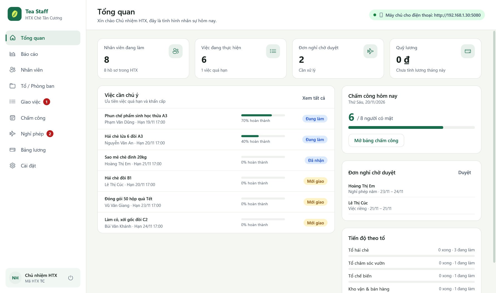
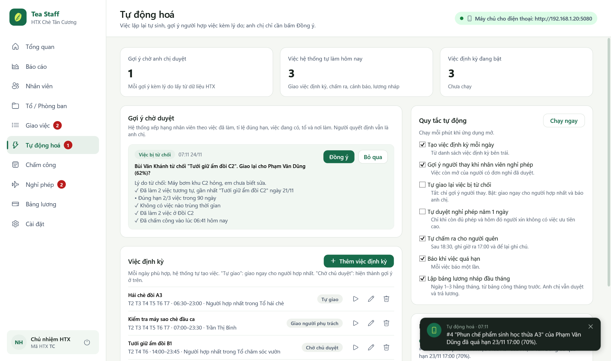
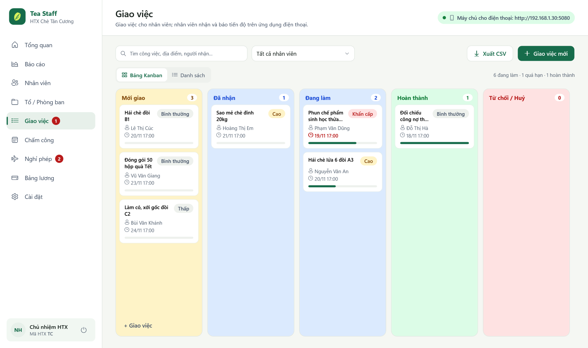
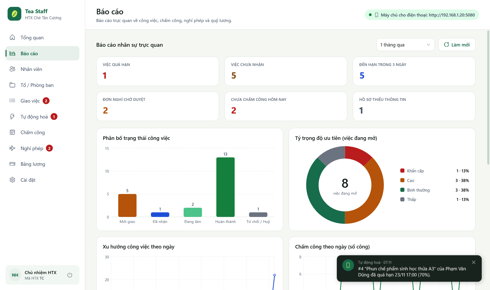
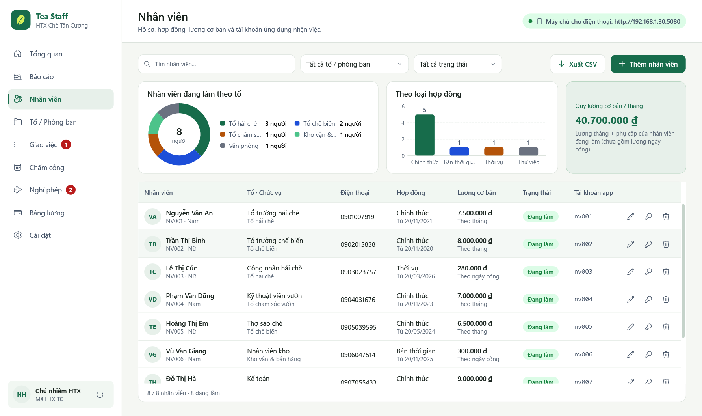
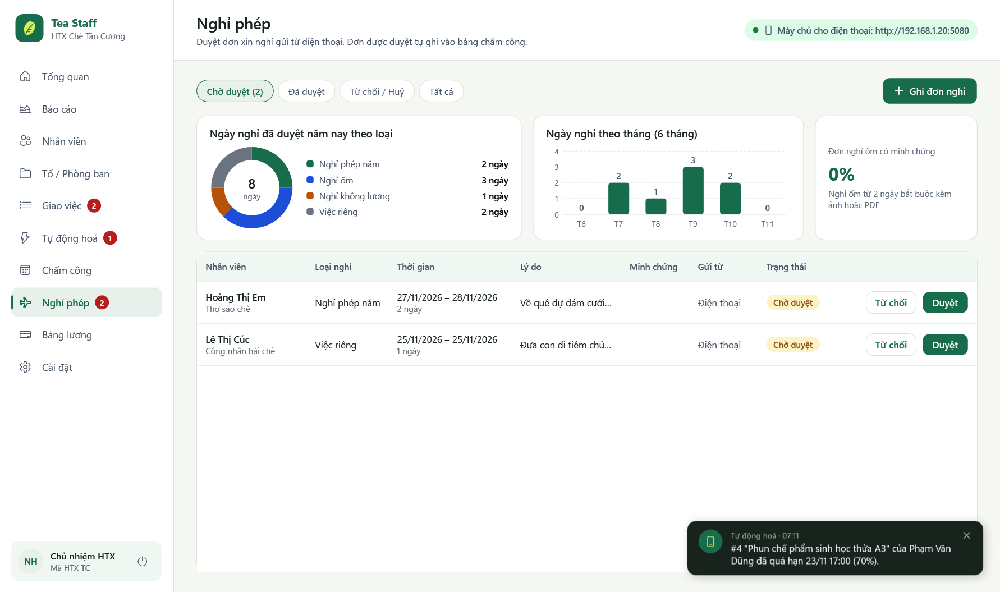
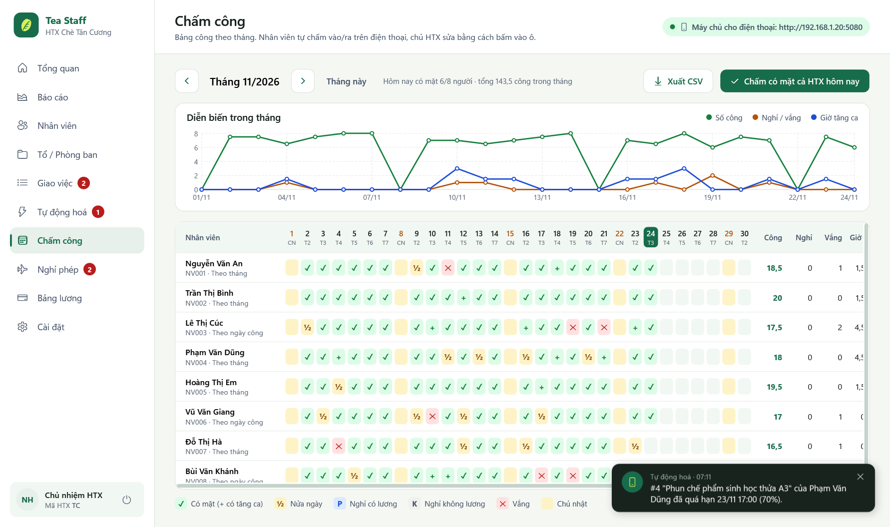
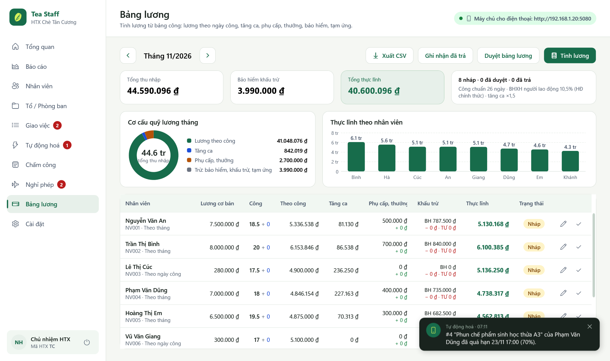
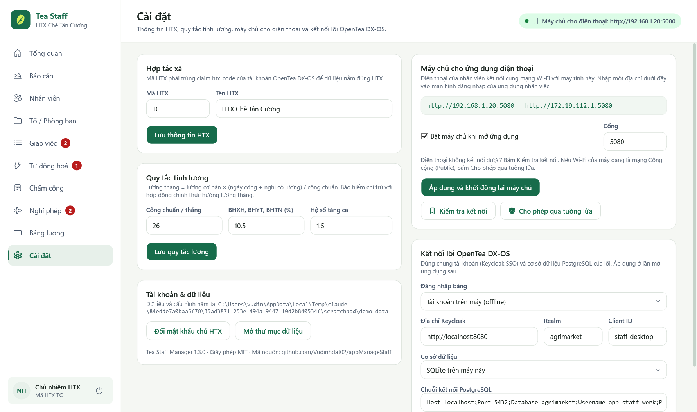
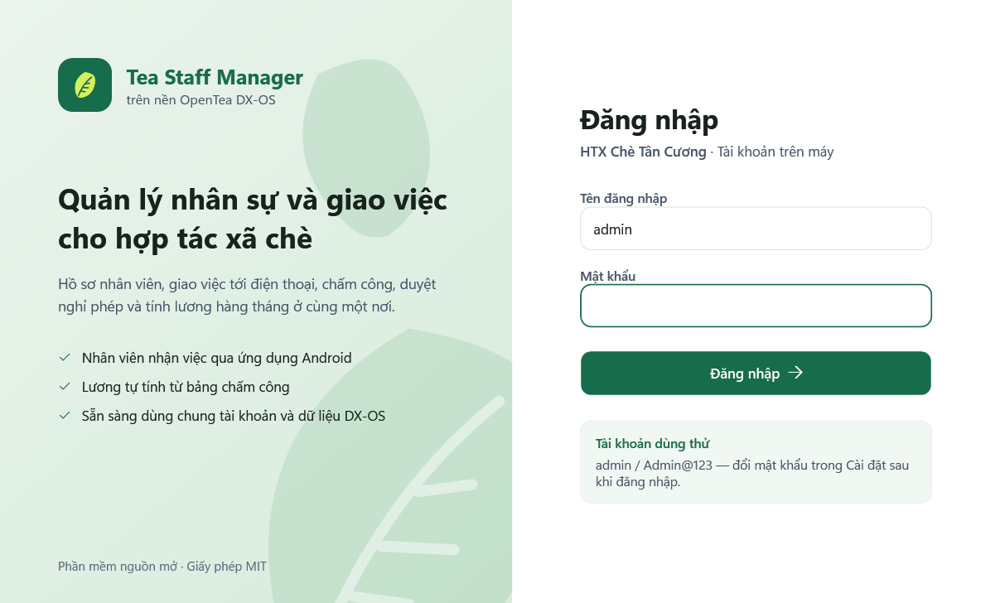

<div align="center">

# 🍃 Tea Staff Manager

**Staff, task and payroll management for tea cooperatives — a desktop app built on the [OpenTea DX-OS](https://github.com/maiychrus25/OpenTea-DX-OS) open core.**

[](./LICENSE)
[](https://dotnet.microsoft.com/)
[](#architecture)
[](https://github.com/Vudinhdat02/appManageStaff/releases)

[Features](#features) • [Download](#download) • [Build from source](#build-from-source) • [Architecture](#architecture) • [DX-OS integration](#integration-with-opentea-dx-os) • [Companion app](#companion-mobile-app)



</div>

---

Tea Staff Manager is the **owner side** of a two-app system for agricultural cooperatives (HTX). The cooperative owner hires staff, assigns field work, tracks attendance, approves leave and runs the monthly payroll on a Windows PC. Workers receive their tasks on Android with the companion app **[Tea Work](../staff-mobile)**.

Both apps follow the conventions of the OpenTea DX-OS core so they can later share its single sign-on account (Keycloak) and its PostgreSQL database instead of running standalone.

## Features

| Module | What it does |
| --- | --- |
| **Dashboard** | Active staff, open and overdue tasks, pending leave, payroll fund, today's attendance, progress per team, and charts of task status and the last 14 days (work days, completed tasks). |
| **Charts per module** | Employees: staff by team and contract type, base salary fund. Attendance: daily work days, absences and overtime in the month. Leave: approved days by type and per month, share of sick leave with evidence. Payroll: composition of gross pay and net pay per employee. |
| **Reports** | KPI tiles (overdue, not yet accepted, due in 3 days, pending leave, not checked in today, incomplete profiles) and charts drawn natively in WPF: task status bars, priority donut, daily task and attendance trends, six-month payroll fund and completed work per team, plus lists of what needs the owner. Period: 7, 30 or 90 days. |
| **Core sync** | Optional. Pulls the tasks a manager approved in OpenTea DX-OS (suggested by the AI assistant) every minute, creates them with a *Từ trợ lý AI* marker, and reports back the roster and today's attendance. See [docs/core-integration.md](docs/core-integration.md). |
| **Automation and AI suggestions** | An *Automation* page runs the cooperative's routine every minute: recurring work (picking rounds, machine checks, watering) becomes the day's tasks; rejected tasks and tasks of staff on approved leave get a replacement; forgotten check-outs are closed at 17:00; overdue work is flagged once; draft payslips are prepared on the first days of the month; one-day annual leave can be approved by rule. An explainable ranking scores who fits a task from the cooperative's own history (similar work done, on-time rate, overlapping work, team, place, past rejections, leave, today's attendance) and shows those facts. Following the DX-OS AI rule, changes of who does what are either rules the owner switched on or one-click suggestions. |
| **Field sensors** | Alerts from **[Tea IoT Station](https://github.com/maiychrus25/OpenTea-DX-OS/tree/main/apps/tea-iot)** (dry soil, frost, heat) arrive on `POST /api/iot/alerts` and become task suggestions with the sensor evidence and the best-placed worker. |
| **Live activity** | When staff accept, reject or finish a task, check in or send a leave request from the phone, the owner sees a toast, hears the system sound, the taskbar flashes and red counters appear on *Giao việc* and *Nghỉ phép*. |
| **Employees** | Full HR profile: personal data, team, position, contract type, monthly or daily wage, allowance, bank account, annual leave quota, status. Accent-insensitive search (`nguyen` finds `Nguyễn`), filters, CSV export, mobile account and password reset. |
| **Teams / departments** | Group staff into production teams (picking, processing, garden care, warehouse, office). |
| **Task assignment** | Kanban board (Mới giao, Đã nhận, Đang làm, Hoàn thành, Từ chối/Huỷ) or list view. Assign work with location, priority, start and due time; **Gợi ý** ranks who fits the task and why. Staff accept, reject (with a reason), report progress and complete from their phone; the list refreshes live. Duplicate, reassign, cancel, export. |
| **Attendance** | Monthly timesheet grid. Staff check in/out on the phone (half day and overtime are computed automatically); the owner edits any cell, marks the whole cooperative present in one click, and exports CSV. |
| **Leave** | Annual, sick, personal and unpaid leave with balance checking and **evidence** (photo or PDF, up to 5 MB; required for sick leave of 2 days or more). Files are recognised by content, stored under the data folder and opened from the review list. Approving a request writes the days into the timesheet. |
| **Payroll** | Generates payslips from the timesheet: prorated monthly salary or daily wage, overtime (×1.5 by default), allowance, bonus, compulsory insurance (10.5% for full-time contracts), other deductions and advances. Draft → Approved → Paid workflow; approved payslips appear on the worker's phone. CSV export for bank transfer. |
| **Settings** | Cooperative code and name, payroll rules, the built-in server for phones with a **connection self-test** and a one-click **firewall rule**, and the connection to the DX-OS core (Keycloak + PostgreSQL) with a **connection check**. |

<details>
<summary><b>More screenshots</b></summary>

| | |
| --- | --- |
|  |  |
|  |  |
|  |  |
|  |  |
|  | |

</details>

## Download

Grab the latest build from [**Releases**](https://github.com/Vudinhdat02/appManageStaff/releases):

- `TeaStaffManager-1.3.0-win-x64.exe` — self-contained, single file, no .NET installation needed (Windows 10/11 x64).

On first launch the app creates a demo cooperative (HTX code `TC`) with eight fictitious employees, a month of attendance, tasks and leave requests.

| Account | Password | Where |
| --- | --- | --- |
| `admin` | `Admin@123` | Owner login on the desktop app (change it in **Settings**) |
| `nv001` … `nv008` | `123456` | Staff login on the Tea Work Android app (or the staff member's OpenTea DX-OS account, see below) |

Data and configuration live in `%LOCALAPPDATA%\TeaStaff` (`teastaff.db`, `config.json`, `attachments\`); set the `TEASTAFF_DATA` environment variable to use another folder. Delete the folder to start over. Databases created by 1.0.0 are upgraded automatically.

### Connect the phones

1. Keep the PC and the phones on the same Wi-Fi network.
2. The address to type into the phone is shown at the top right of the window, e.g. `http://192.168.1.88:5080`.
3. If the phone cannot connect, open **Settings → Kiểm tra kết nối**. On a Wi-Fi marked *Public*, Windows blocks incoming connections: press **Cho phép qua tường lửa** (Windows asks for administrator approval). Also make sure the phone is on Wi-Fi, not mobile data, and that the router does not isolate clients.
4. A yellow banner on the phone means it is in offline demo mode; nothing is sent to the PC until you sign out and enter the server address.

## Build from source

Requirements: Windows 10/11, [.NET SDK 10](https://dotnet.microsoft.com/download). No other tools are needed; NuGet restores everything.

```bash
git clone https://github.com/Vudinhdat02/appManageStaff.git
cd appManageStaff
dotnet build AppManageStaff.sln
dotnet test AppManageStaff.sln
dotnet run --project src/TeaStaff.Desktop
```

Publish the single-file executable:

```bash
dotnet publish src/TeaStaff.Desktop -c Release -r win-x64 --self-contained -p:PublishSingleFile=true -p:IncludeNativeLibrariesForSelfExtract=true -o publish
```

### Command-line options

| Option | Purpose |
| --- | --- |
| `--serve` | Headless mode: only the staff API runs (for an always-on office PC). |
| `--screenshots <dir>` | Renders every screen to PNG with the demo data (used for this README and visual checks). |
| `--postgres-script <file>` | Writes the PostgreSQL DDL of the `app_staff_work` schema (see [`database/postgres/001_init.sql`](database/postgres/001_init.sql)). |

## Architecture

```
src/
  TeaStaff.Core            Domain entities, business rules, ports (no framework dependencies)
  TeaStaff.Infrastructure  EF Core adapters (SQLite / PostgreSQL), identity (local / Keycloak), staff REST API
  TeaStaff.Desktop         WPF views + view models (CommunityToolkit.Mvvm), theme, dialogs
tests/
  TeaStaff.Core.Tests      xUnit tests for payroll and the task state machine
```

- **MVVM** — every screen is a `PageViewModel`; forms are `EditorViewModel`s hosted in one generic dialog; views are resolved by `DataTemplate`, so code-behind holds no logic.
- **Ports and adapters** — the core depends only on repository and identity interfaces (`IEmployeeRepository`, `IIdentityProvider`, …). Swapping SQLite for the DX-OS PostgreSQL schema or the local login for Keycloak is a configuration change.
- **Multi-tenant by design** — every table carries `htx_code` and every query is filtered by the signed-in cooperative, the same rule the DX-OS core enforces for mini-apps.
- **Live sync** — changes coming from phones raise an `IDataChangeNotifier` event and the visible screen reloads itself.
- **Design** — colours, radii and typography follow the core's [`DESIGN.md`](https://github.com/maiychrus25/OpenTea-DX-OS/blob/main/DESIGN.md): tea green `#176c4b`, white cards on a soft green background, one amber accent.

More detail: [docs/architecture.md](docs/architecture.md) · staff API contract: [docs/mobile-api.md](docs/mobile-api.md).

## Integration with OpenTea DX-OS

| DX-OS concept | How this app follows it |
| --- | --- |
| Single account (Keycloak SSO, realm `agrimarket`) | `KeycloakIdentityProvider` signs the owner in with the shared account and reads `htx_code`, `name` and `realm_access.roles` (role `manager` required). Staff can sign in to Tea Work with their DX-OS account too: the staff API checks it against Keycloak and links it to the employee profile. |
| Shared PostgreSQL, one schema per app | Provider `Postgres` maps the same model onto schema `app_staff_work`; DDL in `database/postgres`. |
| `htx_code` on every table, tenant isolation | Enforced by EF Core global query filters. |
| Design tokens | Same palette and spacing as `DESIGN.md`. |
| AI invariant (facts, never decisions) | Rankings list their facts; anything that changes who does what is an owner-enabled rule or a suggestion awaiting one click. |
| Sensor data (MQTT, `telemetry`) | Field alerts from Tea IoT Station, which publishes to the core broker, turn into task suggestions. |

Step-by-step guide (Keycloak client, database role, switching the app over): [docs/core-integration.md](docs/core-integration.md).

## Companion mobile app

**[Tea Work](../staff-mobile)** (Kotlin, Jetpack Compose, MVVM) — staff receive tasks, report progress, check in/out, request leave and read their payslips.

## Documentation

- [CHANGELOG.md](CHANGELOG.md) — release history
- [DEPENDENCIES.md](DEPENDENCIES.md) — third-party libraries and licences
- [CONTRIBUTING.md](CONTRIBUTING.md) — how to report bugs and send changes
- [Issue tracker](https://github.com/Vudinhdat02/appManageStaff/issues)

## License

[MIT](LICENSE) © 2026 Vu Dinh Dat. Every source file carries an SPDX licence header.
