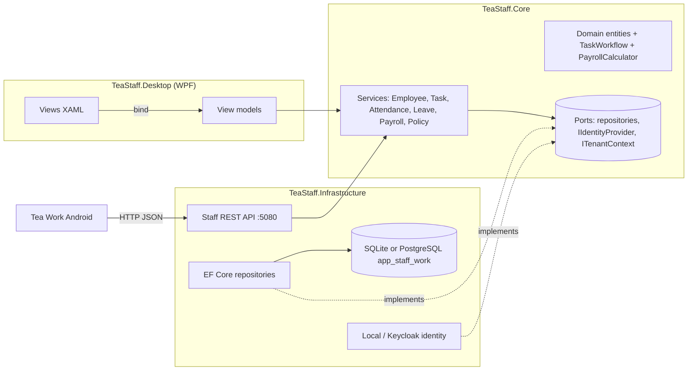

# Architecture

Tea Staff Manager is a .NET 10 solution with three production projects and one test project.

## Layers

| Project | Responsibility | Depends on |
| --- | --- | --- |
| `TeaStaff.Core` | Entities, enums, Vietnamese labels, business rules (`TaskWorkflow`, `PayrollCalculator`), application services, ports | nothing |
| `TeaStaff.Infrastructure` | `AppDbContext` (snake_case, tenant filters), repositories, `DatabaseInitializer` (schema + demo data), `Pbkdf2PasswordHasher`, `LocalIdentityProvider`, `KeycloakIdentityProvider`, `MobileApiServer` | Core, EF Core, ASP.NET Core |
| `TeaStaff.Desktop` | WPF shell, pages, editors, theme, dialog service, CSV export | Core, Infrastructure, CommunityToolkit.Mvvm |

## Key rules

- **Task state machine** (`TaskWorkflow`): `Assigned → Accepted | Rejected`, `Accepted → InProgress | Completed`, `InProgress → InProgress | Completed`. Rejecting needs a reason; completing sets progress to 100%. The owner can cancel any open task or reassign a rejected one.
- **Attendance**: check-out under 4 hours counts as a half day; time beyond 8 working hours plus a 1-hour break counts as overtime in half-hour steps.
- **Leave**: annual leave cannot exceed the remaining quota (approved and pending requests count); approval writes `PaidLeave`/`UnpaidLeave` days into the timesheet, skipping Sundays.
- **Payroll** (`PayrollCalculator`):
  - monthly: `earned = min(base, base / standardDays × (workDays + paidLeaveDays))`
  - daily: `earned = dailyRate × (workDays + paidLeaveDays)`
  - `overtime = dailyRate / 8 × hours × multiplier`
  - `insurance = base × rate` for full-time monthly contracts only
  - `net = max(0, earned + overtime + allowance + bonus − insurance − deduction − advance)`, rounded to whole dong.
  Regenerating a month refreshes draft payslips and keeps manual bonus/deduction/advance; approved or paid payslips are never changed.

## Threading and data access

Repositories open a short-lived `DbContext` per call through `IDbContextFactory`, so the UI thread and the Kestrel threads serving phones never share a context. Writes from the API raise `IDataChangeNotifier.Changed`; the shell reloads the visible page on the UI dispatcher.

## Security notes

- Passwords are stored as PBKDF2-SHA256 (100,000 iterations, random salt).
- Mobile sessions are random 256-bit bearer tokens kept in memory for 12 hours; restarting the desktop app signs phones out.
- The built-in API speaks plain HTTP for use on the cooperative's LAN. When deployed behind the DX-OS gateway, TLS and JWT validation are provided by APISIX and Keycloak.
