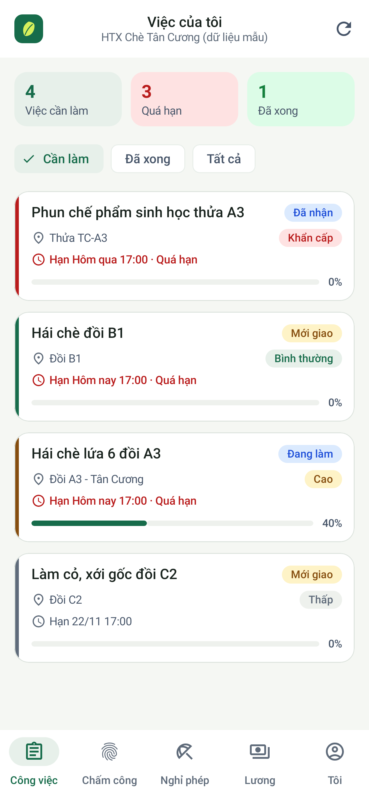
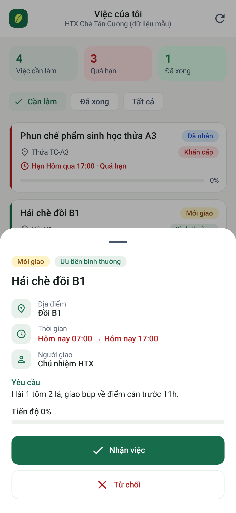
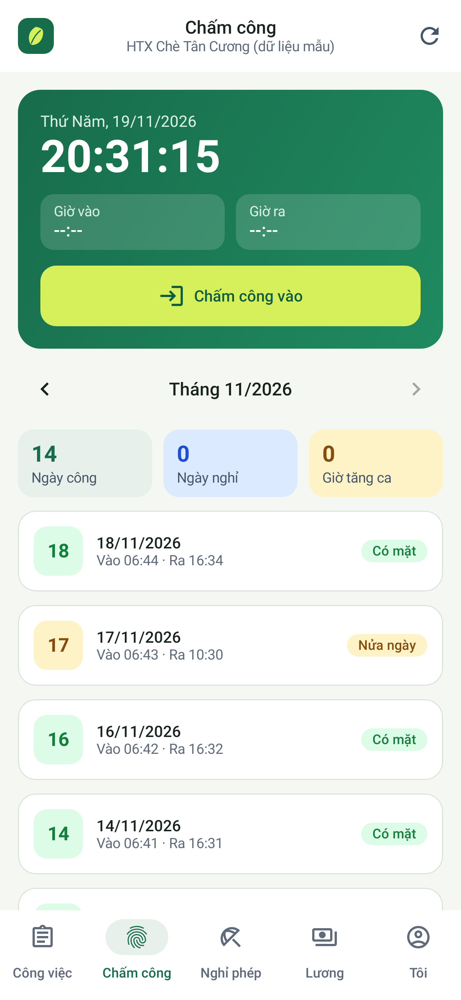
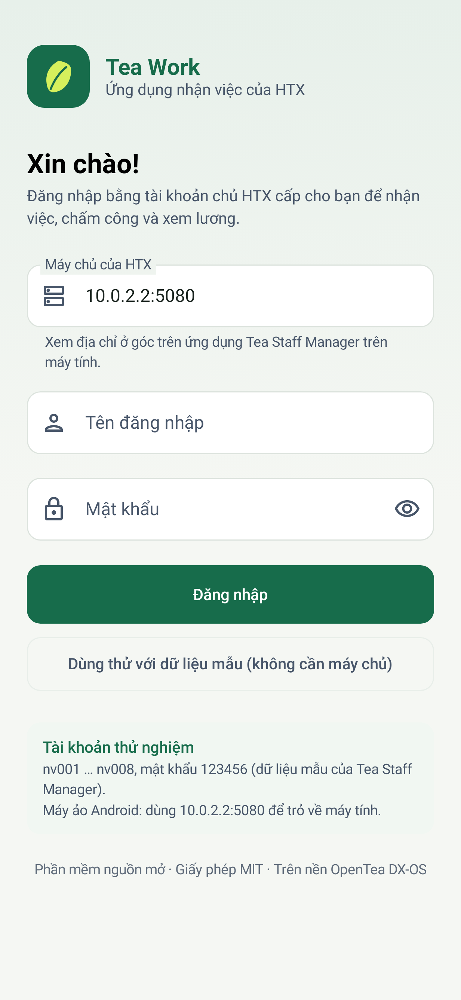
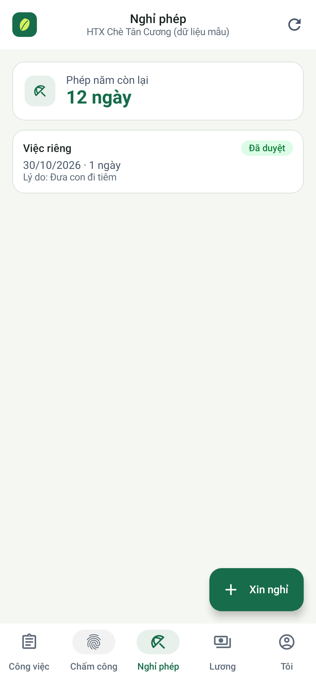
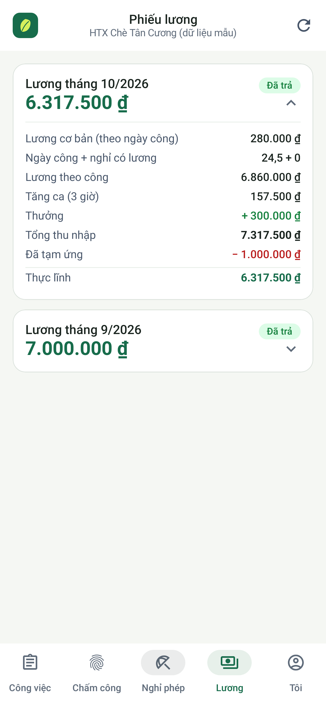
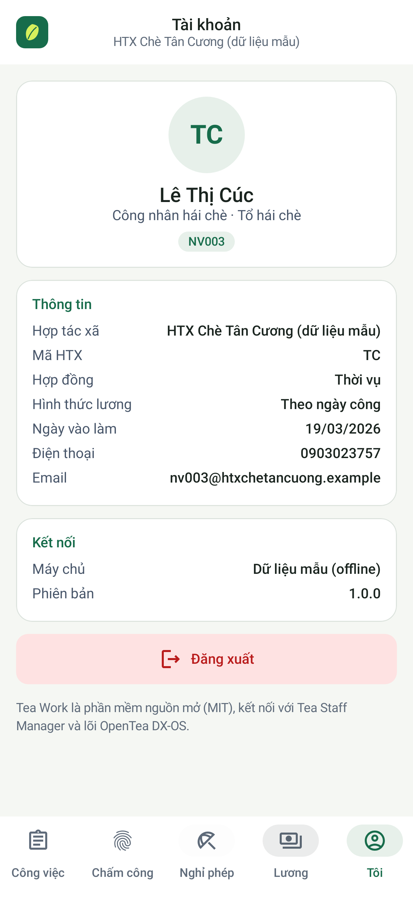

<div align="center">

# 🍃 Tea Work

**The staff app of a tea cooperative: receive tasks, report progress, check in, request leave and read payslips — built on the [OpenTea DX-OS](https://github.com/maiychrus25/OpenTea-DX-OS) open core.**

[](./LICENSE)
[](https://kotlinlang.org/)
[](#architecture)
[](#download)
[](https://github.com/Vudinhdat02/appReceiveWork/releases)





</div>

---

Tea Work is the **staff side** of a two-app system for agricultural cooperatives (HTX). The owner assigns work and runs payroll in the desktop app **[Tea Staff Manager](../staff-desktop)**; workers in the tea hills use this Android app.

## Features

- **Tasks** — see what was assigned, with location, priority, deadline and requirements; accept or reject (with a reason), start, report progress with a slider and a note, and mark it done. Overdue work is highlighted; pull to refresh.
- **Attendance** — live clock and one-tap check-in / check-out; monthly summary of work days, leave and overtime with a day-by-day history.
- **Leave** — remaining annual leave, request annual, sick, personal or unpaid leave with date pickers, follow the approval status and cancel pending requests.
- **Payslips** — approved and paid payslips with the full breakdown (earned salary, overtime, allowance, bonus, insurance, deductions, advances, net pay).
- **Profile** — personal and contract details, change password, sign out.
- **Offline demo** — "Dùng thử với dữ liệu mẫu" runs the whole app on sample data without a server.

<details>
<summary><b>More screenshots</b></summary>

   

</details>

## Download

Get `TeaWork-1.0.0.apk` from [**Releases**](https://github.com/Vudinhdat02/appReceiveWork/releases) and install it on Android 8.0 or newer (allow installing from this source when asked).

### Try it

| Mode | How |
| --- | --- |
| Without a server | Tap **Dùng thử với dữ liệu mẫu** on the login screen. |
| With the owner's PC | Start Tea Staff Manager, keep phone and PC on the same Wi-Fi, enter the address shown in the desktop app (e.g. `192.168.1.88:5080`) and sign in as `nv001` … `nv008`, password `123456`. |
| Android emulator | Use server `10.0.2.2:5080` to reach the PC running Tea Staff Manager. |

## Build from source

Requirements: JDK 17+ (the JBR bundled with Android Studio works), Android SDK with platform 37. Gradle and all libraries are downloaded by the wrapper.

```bash
git clone https://github.com/Vudinhdat02/appReceiveWork.git
cd appReceiveWork
./gradlew assembleRelease        # app/build/outputs/apk/release/app-release.apk
./gradlew testDebugUnitTest      # unit + UI walkthrough tests (Robolectric)
```

Create `local.properties` with `sdk.dir=<path to Android SDK>` if `ANDROID_HOME` is not set. The release build is minified with R8 and, for testing, signed with the debug key; use your own keystore for a store release.

### Tests

| Test | What it checks |
| --- | --- |
| `ScreenshotTest` | Drives the real `MainActivity` in demo mode through login, every tab and a task action, and saves the screenshots in `docs/screenshots`. |
| `RemoteApiContractTest` | End-to-end against a running Tea Staff Manager: login, task transitions, check-in, leave submit/cancel, payslips. Run with `./gradlew testDebugUnitTest -Pteawork.server=http://127.0.0.1:5080` (skipped otherwise). |

## Architecture

```
app/src/main/java/vn/opentea/staffwork/
  data/            Models (kotlinx.serialization), StaffRepository port,
                   RemoteStaffRepository (HTTP), DemoStaffRepository (offline), SessionStore
  ui/              ViewModels (StateFlow), theme, shared components
  ui/screens/      Login, Tasks (+ detail sheet), Attendance, Leaves, Payslips, Profile
  AppContainer.kt  Manual dependency container
  MainActivity.kt  Session switch, bottom navigation, snackbars
```

- **MVVM** — screens are stateless composables fed by `StateFlow` from one view model per feature; actions go back as callbacks.
- **Repository port** — every view model talks to `StaffRepository`. The HTTP adapter implements the [staff API contract](../staff-desktop/docs/mobile-api.md); pointing it at the DX-OS gateway later only changes the base URL and token.
- **Small footprint** — no networking or DI frameworks: `HttpURLConnection`, SharedPreferences and a tiny container keep the release APK under 2 MB.
- **Design** — palette and shapes from the core's `DESIGN.md`: tea green `#176c4b`, white cards on a soft leaf-green background, lime accent on the leaf logo. 44 dp+ touch targets for outdoor use.

## Integration with OpenTea DX-OS

The app shares the core's tenant model (each profile carries `htx_code`), its role vocabulary and its design tokens. Staff accounts can be linked to DX-OS Keycloak users (`core_user_id` on the owner side) so the same account works across the cooperative's apps; see [core-integration.md](../staff-desktop/docs/core-integration.md).

## Documentation

- [CHANGELOG.md](CHANGELOG.md) · [DEPENDENCIES.md](DEPENDENCIES.md) · [CONTRIBUTING.md](CONTRIBUTING.md)
- [Issue tracker](https://github.com/Vudinhdat02/appReceiveWork/issues)

## License

[MIT](LICENSE) © 2026 Vu Dinh Dat. Every source file carries an SPDX licence header.
