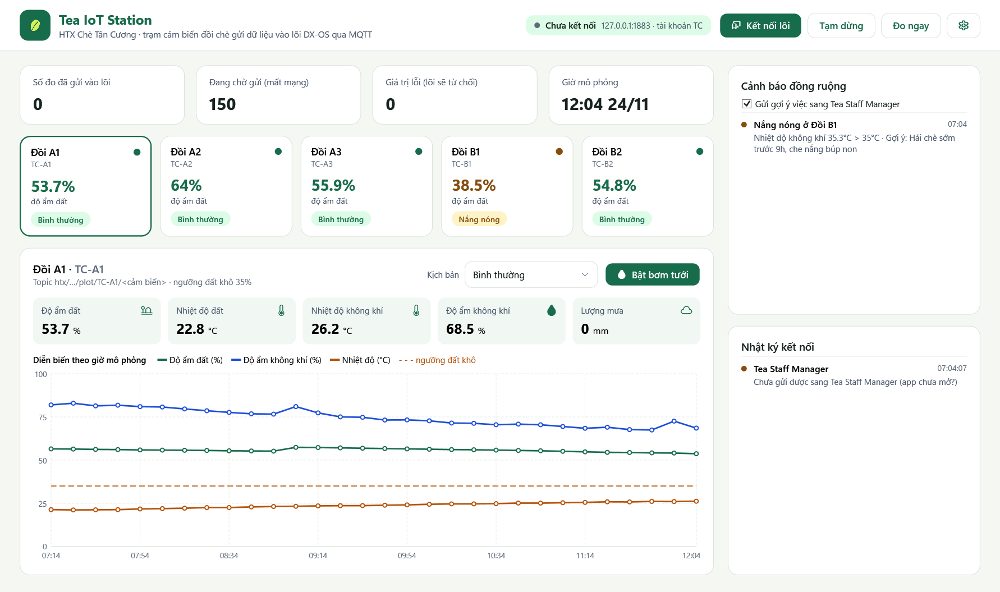

<div align="center">

# 🍃 Tea IoT Station

**A sensor station simulator for tea cooperatives that feeds the [OpenTea DX-OS](https://github.com/maiychrus25/OpenTea-DX-OS) core over MQTT.**



</div>

---

Tea IoT Station plays the role of the sensor gateways on a cooperative's tea hills. Every parcel (thửa) gets a station measuring soil moisture, soil temperature, air temperature, air humidity and rainfall. Readings go to the core broker with the exact contract the DX-OS ingest worker expects, so they land in `telemetry.sensor_readings`, appear in the daily view `telemetry.sensor_daily` and move to the Parquet cold store after 30 days. Field alerts (dry soil, frost, heat) become one-click task suggestions in **[Tea Staff Manager](../staff-desktop)**.

## Features

| | |
| --- | --- |
| **Physical model** | Daily temperature cycle, humidity that follows heat and rain, soil that dries with evapotranspiration and wets with rain or irrigation, soil temperature that lags the air. |
| **Scenarios per station** | Normal, heat and drought, heavy rain, frost, faulty sensor (sends values the core must reject, visible in `telemetry.ingest_rejects`). |
| **Core contract** | Topic `htx/<HTX>/plot/<parcel>/<sensor>`, body `{"ts": "<ISO 8601 with offset>", "value": <number>}`, QoS 1, device account = HTX code (the broker ACL only lets it write under its own HTX). |
| **Store and forward** | Readings taken while the broker is unreachable wait in an outbox (20,000 readings) and are sent in order on reconnect; the ingest worker accepts past timestamps. |
| **Alerts with evidence** | Dry soil below the parcel threshold, air above 35 °C, below 4 °C (frost) and heavy rain; each alert carries the measured value and the usual field work, and is not repeated within 30 minutes. |
| **Link to staff work** | Alerts are posted to Tea Staff Manager (`POST /api/iot/alerts`, `X-Device-Key`). The staff app ranks who should do the work and waits for the owner's click; it never assigns on its own. |
| **Same look as the other apps** | Palette, cards and charts of Tea Staff Manager and the core's `DESIGN.md`. |

## Run against a local DX-OS core

1. Start the core (`make platform-up`, then `make up-core` and `make up-sensors`).
2. Publish the broker on the loopback interface (development only):

   ```bash
   docker compose -f docker/docker-compose.yml -f apps/tea-iot/docker/mqtt-port.override.yml up -d mosquitto
   ```

3. Open **Tea IoT Station**, press ⚙ and enter the device password of your HTX from `DXOS_MQTT_DEVICES` in `docker/.env.local` (for example `TC:change_me_mqtt_tc` → account `TC`, password `change_me_mqtt_tc`). Parcel codes must exist in the core (`TC-A1` … `TC-B2` in the demo seed), otherwise the core stores the readings as `unknown_parcel` rejects.
4. Press **Kết nối lõi**. Check the data:

   ```sql
   SELECT parcel_code, sensor, count(*), round(avg(value)::numeric, 1)
   FROM telemetry.sensor_readings WHERE ts > now() - interval '10 minutes' GROUP BY 1, 2;
   ```

To turn alerts into task suggestions, keep Tea Staff Manager open on the same network; the address and the device key (`Iot.DeviceKey` in its `config.json`, default `tea-iot-demo`) are set in the station settings.

## Build from source

Requirements: Windows 10/11 and the [.NET SDK 10](https://dotnet.microsoft.com/download).

```bash
dotnet build apps/tea-iot/TeaIot.sln
dotnet test apps/tea-iot/TeaIot.sln
dotnet run --project apps/tea-iot/src/TeaIot.App
```

| Option | Purpose |
| --- | --- |
| `--connect` | Connect to the broker on start (unattended field PC). |
| `--smoke <file>` | Connect, send three rounds, write the counters to `<file>` and exit (code 1 on failure). |
| `--screenshot <file.png>` | Render the console once. |

Configuration lives in `%LOCALAPPDATA%\TeaIot\config.json`; set `TEAIOT_DATA` to use another folder.

## Architecture

```
src/
  TeaIot.Core   Sensor contract, station model, alert rules, outbox (no UI, no network)
  TeaIot.App    WPF + MVVM (CommunityToolkit.Mvvm), MQTTnet client, alert client for Tea Staff Manager
tests/
  TeaIot.Core.Tests   Contract, ranges, simulation, alerts and outbox
```

## License

[MIT](LICENSE) © 2026 Vu Dinh Dat. Third-party libraries: CommunityToolkit.Mvvm (MIT), MQTTnet (MIT).
