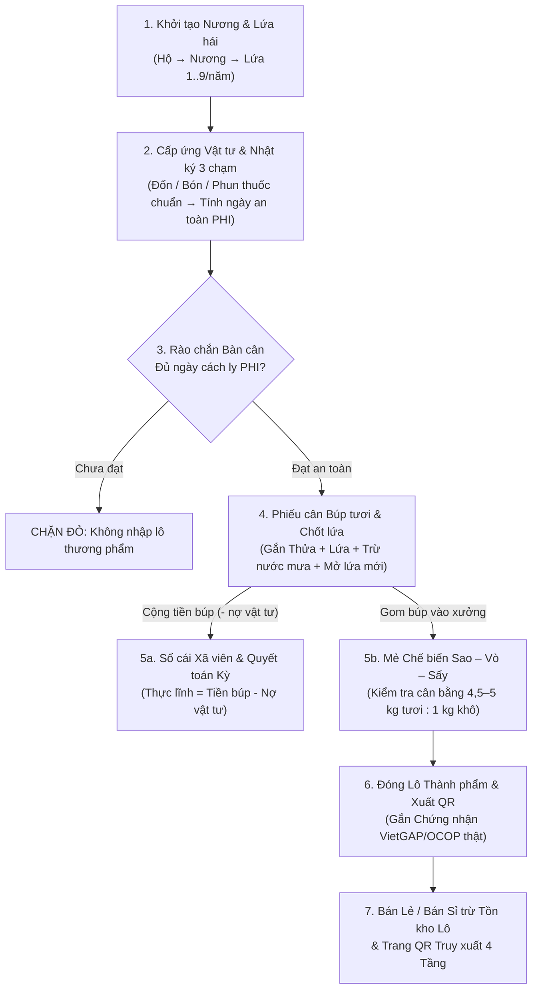

<!--
SPDX-License-Identifier: MIT
SPDX-FileCopyrightText: 2026 OpenTea Developers
-->
# BÀI TOÁN NGHIỆP VỤ (BUSINESS ANALYSIS DOCUMENT)

## DỰ ÁN: OPENTEA DX-OS — HỆ ĐIỀU HÀNH CHUYỂN ĐỔI SỐ CHO HỢP TÁC XÃ CHÈ VIỆT NAM

> **Trạng thái:** Đã chuẩn hóa theo định hướng chiến lược Ngành Chè & Kiến trúc DX-OS (`v1.17.0` → Lộ trình tái cấu trúc `2026-11-28`).
> **Cập nhật lần cuối:** 2026-11-28 (PO/BA & Kiến trúc Hệ thống).
> **Đối tượng mục tiêu:** Hợp tác xã (HTX) sản xuất – chế biến – kinh doanh chè Việt Nam (vận hành theo Luật HTX 2023) và Liên minh HTX / Doanh nghiệp đầu chuỗi vùng nguyên liệu chè.
> **Tài liệu liên quan:** [Lộ trình Sản phẩm Chiến lược](./product-roadmap.md) · [ADR 0005](./adr/0005-multi-tenant-tea-value-chain-dxos.md) · [Ngữ cảnh Dự án](./project-context.md)

---

### I. TỔNG QUAN DỰ ÁN & ĐẶC THÙ NGÀNH CHÈ

#### 1.1. Bối cảnh & Bản chất Nỗi đau của HTX Chè Việt Nam

Khác với cây ngắn ngày trồng một vụ gặt một lần, **cây chè là cây công nghiệp lâu năm (30–50 năm)** với chu kỳ sinh trưởng và sản xuất liên hoàn cực kỳ khắt khe:
- **Thu hái liên tục theo lứa (`Flushes`):** Từ tháng 3 đến tháng 11, một nương chè cho thu hoạch **7–9 lứa/năm** (mỗi lứa cách nhau 15–25 ngày), xen kẽ các đợt **đốn chè** (đốn phớt, đốn lửng, đốn đau), làm cỏ và bón thúc. Ngay sau khi hái búp lứa $N$, nông dân phải bón phân/phun phòng rầy xanh cho lứa $N+1$ trong khi búp tươi lứa $N$ vẫn đang được sao sấy và đóng gói trong xưởng.
- **Biên độ chế biến quyết định giá trị:** Búp tươi thu tại bàn cân phải qua **Làm héo → Diệt men (Sao ốp) → Vò → Sao khô / Lên hương → Sàng phân loại** với tỷ lệ hao hụt chuẩn khoảng **4,5 – 5,0 kg búp tươi = 1 kg chè khô**, phân tách thành nhiều phẩm cấp giá trị khác nhau (*Chè Đinh, Tôm Nõn, Móc Câu, Chè Bồm, Chè Cám*).
- **Tài chính xã viên gắn chặt với vật tư ứng trước:** Hộ xã viên thường ứng phân bón, thuốc BVTV từ HTX trong kỳ canh tác và được **cấn trừ công nợ** trực tiếp vào kỳ quyết toán tiền cân búp tươi.

Hiện tại, đa số HTX chè vận hành bằng sổ tay giấy, cân bàn ghi tay và file Excel rời rạc, dẫn tới **3 điểm nghẽn sống còn**: mất kiểm soát an toàn thuốc BVTV ở bàn cân, kiệt sức vì tính công nợ cuối kỳ, và không có hồ sơ truy xuất thật có cân bằng khối lượng để bán vào kênh siêu thị/OCOP giá cao.

#### 1.2. Mô hình Triển khai Thương mại & Phân tầng Sản phẩm

Theo [ADR 0005](./adr/0005-multi-tenant-tea-value-chain-dxos.md), OpenTea DX-OS được thiết kế trên **duy nhất 1 codebase Multi-Tenant (`htx_code`)** phục vụ 2 phân khúc thị trường:
1. **Cloud SaaS Đa HTX (`Multi-Tenant SaaS First` — ~90% thị phần mục tiêu):** Các HTX vừa và nhỏ (15–150 hộ, 0 nhân sự IT) đăng ký và vận hành ngay trên nền tảng đám mây chung với chi phí thấp, dùng sẵn kênh Zalo OA/ZNS nền tảng và Danh mục thuốc BVTV chuẩn.
2. **Cụm Độc lập Cấp Tỉnh / Doanh nghiệp Đầu chuỗi (`Sovereign-Cluster Ready` — ~10% hợp đồng B2G/B2B lớn):** Cài đặt trọn gói mã nguồn mở `DX-OS Open-Core` lên hạ tầng riêng của Sở NN&PTNT, Liên minh HTX Tỉnh hoặc Công ty Chè bao tiêu để quản trị vùng nguyên liệu nhiều HTX với chủ quyền dữ liệu 100%.

#### 1.3. 8 Pain Points Cốt lõi Cần Giải quyết

| # | Pain Point | Vai trò chính | Mô tả thực tế ngoài HTX Chè | Giá trị sản phẩm mang lại |
| - | --- | --- | --- | --- |
| 1 | **Mua nhầm búp còn dư lượng thuốc tại bàn cân** | Người cân / Cán bộ KT | Hộ vừa phun thuốc sâu hôm qua vẫn mang búp tới cân vì bàn cân không biết lịch sử nương chè đó → hỏng cả mẻ sao và mất uy tín VietGAP/OCOP. | Chốt chặn `Poka-yoke` đỏ ngay lúc cân nếu nương chưa qua ngày cách ly (PHI). |
| 2 | **Xung đột ngày cách ly giữa 2 lứa hái kế tiếp** | Cán bộ KT/CL | Hệ thống cũ không tách lứa, nên phun thuốc cho lứa $N+1$ làm khóa luôn lô chè của lứa $N$ vừa hái chưa kịp xuất QR. | Gắn chặt nhật ký, phiếu cân và lô vào từng `Lứa hái` (`ParcelCropCycle`). |
| 3 | **Thủ công rối rắm khi cấn trừ nợ vật tư vào tiền búp** | Kế toán / Giám đốc | Cân búp 1 sổ, phát phân bón 1 sổ, cuối tháng cộng trừ tay mất 2–3 ngày rất dễ sai sót và gây nghi ngờ với xã viên. | Sổ cái xã viên tự động: `Tiền búp − Nợ vật tư = Thực lĩnh` kèm phiếu gửi tận tay. |
| 4 | **Hố đen chế biến & thiếu cân bằng khối lượng trên tem QR** | Tổ xưởng / Cán bộ KT | Tem QR cũ nhảy thẳng từ nương chè ra gói trà, không biết mẻ sao nào, người sao là ai, và không chặn được việc "tạo lô 5.000 kg từ thửa 100 kg". | Phân hệ `Mẻ chế biến` nối từ phiếu cân búp ra chè khô theo phẩm cấp, cảnh báo lệch định mức ~4,5–5:1. |
| 5 | **Giám đốc "mù" số liệu hàng – tiền – giá thực địa mỗi sáng** | Giám đốc HTX | Dashboard cũ hiện chỉ số ngũ cốc/lúa mì FAO và biểu đồ mẫu, không thấy hôm nay cân mấy tạ búp, tồn kho chè khô, nợ xã viên hay công nợ thương lái. | 1 Bảng điều hành hợp nhất + công bố giá thu mua búp ngày trong 10 giây. |
| 6 | **Quá tải thao tác lẻ trên 100–300 thửa chè & tài liệu rời rạc** | Cán bộ KT/CL | Phải bấm duyệt từng dòng nhật ký, mở từng hộ để bắt đầu lứa mới, Chatbot không đọc được file PDF tiêu chuẩn VietGAP. | Duyệt hàng loạt 50 dòng, mở lứa hàng loạt, GPS walk-track ngoài đồi, RAG đọc PDF P.A.R.A. |
| 7 | **Xã viên 50+ tuổi ngại gõ form & mù thông tin tiền – giá** | Xã viên (Nông dân) | Giao diện cũ dùng chữ "Gieo sạ", giấu phiếu cân/công nợ vào menu phụ, bắt nhớ TOTP/email, dùng Telegram thay vì Zalo, thiếu TTS ở chỗ nhiều chữ. | 4 tab chữ to ưu tiên **Giá hôm nay – Sổ tiền – Nhật ký 3 chạm – Chụp bệnh & Nghe TTS**, tích hợp Zalo ZNS. |
| 8 | **AI bệnh lá thiếu đúng sâu bệnh hại chè Việt Nam** | Xã viên / Cán bộ KT | Mô hình hiện có chỉ học ảnh Kenya/Bangladesh, bỏ trống **Rầy xanh, Bọ cánh tơ, Nhện đỏ, Phồng lá chè** và không khóa ngày cách ly khi kê đơn. | AI đóng vai sàng lọc chuyển Cán bộ duyệt gắn Danh mục thuốc chuẩn, từng bước huấn luyện bằng ảnh thực địa VN. |

---

### II. MÔ HÌNH KIẾN TRÚC NGHIỆP VỤ DỰA TRÊN KHUNG HPDI & 3 TẦNG DX-OS (TS. TẠ TUẤN ANH)

OpenTea DX-OS tuân thủ khung lý thuyết **Hệ điều hành Doanh nghiệp Số (DX-OS Open-Core)** của TS. Tạ Tuấn Anh, kết hợp 4 không gian quản trị **HPDI (Human – Process – Data – Intelligence)** trên 3 tầng công nghệ mở:

#### 2.1. Không gian `[H]` — Human Space (Con người, Định danh & Tri thức P.A.R.A)
- **Định danh SSO đa vai trò:** Keycloak cấp phát định danh tập trung gắn `htx_code`. Mỗi người dùng đăng nhập bằng **Số điện thoại**, ánh xạ qua quan hệ thành viên **`htx_memberships (user_id, htx_code, roles[])`** và có **Role Switcher 1 chạm** (cho phép Giám đốc kiêm Cán bộ KT kiêm Chủ hộ trên 1 tài khoản duy nhất). Không ép nông dân phải có email hay Google Authenticator (TOTP).
- **Kho tri thức P.A.R.A chuẩn ngành Chè (trên SeaweedFS S3):**
  - `1-projects`: Lứa hái đang chạy, đợt tái đánh giá VietGAP/OCOP (`docs/templates/para-tea-cooperative/1-projects/`).
  - `2-areas`: Hồ sơ vùng trồng thường trực, quy trình sao sấy chuẩn của xưởng, sổ quyết toán kỳ (`2-areas/`).
  - `3-resources`: Danh mục thuốc BVTV được phép trên chè, sổ tay phòng trừ rầy xanh/bọ cánh tơ/phồng lá làm nguồn RAG (`3-resources/`).
  - `4-archives`: Hồ sơ lô QR, chứng nhận hết hạn và bảng kê đã khóa sổ lưu trữ bất biến (`4-archives/`).
- **Kênh tiếp cận phổ cập:** Web PWA (Next.js) cho quản trị & thực địa; lộ trình tích hợp **Zalo OA / ZNS** dùng chung cấp nền tảng cho xã viên (Telegram/Mattermost là kênh tùy chọn); Piper TTS tiếng Việt hỗ trợ người lớn tuổi nghe thay vì đọc.

#### 2.2. Không gian `[P]` — Process Space (Quy trình & 5 Rào chắn `Poka-yoke`)
Tự động hóa luồng việc qua n8n (kèm lối thoát Kestra theo ADR 0001) và đặt **5 rào chắn kỹ thuật `Poka-yoke` (chống sai lỗi ngay tại nguồn)**:
1. **Rào chắn Lứa hái (`cycle_id`):** Mọi nhật ký, phiếu cân và lô bắt buộc gắn với `ParcelCropCycle`. Thu hoạch xong tự chốt lứa cũ và mở lứa mới.
2. **Rào chắn Danh mục Thuốc BVTV:** Chọn thuốc từ danh mục chuẩn Bộ NN&PTNT (hoặc từ vật tư hộ vừa nhận) để tự tính `safe_harvest_date`, loại bỏ việc gõ chữ tự do dễ sai lệch.
3. **Rào chắn Bàn cân (PHI Gate):** Bàn cân kiểm tra `safe_harvest_date` của từng nương trước khi cho phép nhập phiếu cân thương phẩm.
4. **Rào chắn Cân bằng Khối lượng (Mass-Balance Gate):** Tổng hợp `Lô thành phẩm` phải bắt nguồn từ `Mẻ sao sấy` và `Phiếu cân búp tươi`; cảnh báo ngay nếu tỷ lệ tươi/khô lệch bất thường.
5. **Rào chắn Thẩm quyền Con người:** Mọi quyết định về **An toàn thực phẩm** (duyệt thu hoạch đạt cách ly) và **Tiền tệ** (chi trả xã viên, giá thu mua, khuyến mãi) luôn yêu cầu con người ký duyệt — tuyệt đối không để AI tự thực thi ngầm.

#### 2.3. Không gian `[D]` — Data Space (Single Source of Truth, Zero-Trust & Bản sao số IT/OT)
- **Một Nguồn Sự Thật duy nhất cho Chuỗi giá trị:** Dữ liệu chủ và giao dịch chuỗi giá trị (`Hộ – Nương – Lứa – Nhật ký – Phiếu cân – Mẻ sao – Lô – Sổ cái Công nợ`) nằm tập trung tại Core PostgreSQL. Các Mini-app Tầng 3 mở rộng đọc qua **Hasura GraphQL RLS** (cô lập chặt theo `htx_code`) và ghi qua **APISIX Core Action API**, không tạo ốc đảo dữ liệu riêng phá vỡ kiểm toán.
- **Zero-Trust & Kiểm toán Bất biến:** Mọi API đi qua cổng Apache APISIX; tệp tải lên qua SeaweedFS S3 được `dxos-scanner` + ClamAV quét kiểm dịch trong 5 giây; toàn bộ bảng nghiệp vụ lõi gắn trigger ghi chuỗi băm SHA-256 chỉ-thêm (`audit.events`).
- **Vòng đời Dữ liệu Nóng → Lạnh:** PostgreSQL giữ dữ liệu nóng 30–90 ngày; `dxos-lifecycle` chuyển dữ liệu cũ sang **Parquet (ZSTD)** trên `dxos-lake` kèm xác minh SHA-256 và truy vấn bằng DuckDB.
- **Hội tụ IT/OT → Bản sao số (`Digital Twin`):** Mở rộng từ trạm cảm biến đất/thời tiết ngoài đồi chè sang **cảm biến nhiệt độ/độ ẩm xưởng sao sấy & kho bảo quản chè khô**, gắn trực tiếp vào từng Mẻ chế biến và Lô thành phẩm.

#### 2.4. Không gian `[I]` — Intelligence Space (Agentic AI Minh bạch & Chủ quyền Số)
- **Kiến trúc 3 vùng tin cậy (`dxos-agent`):** AI chỉ đọc dữ liệu đã ẩn PII từ Hasura (`agent` role), tạo bằng chứng có băm SHA-256 (`evidence`), gửi đề xuất về Web để người có thẩm quyền duyệt (`audit.events`).
- **Đầu vào thực chất:** Tập trung vào bài toán thật của HTX chè — phát hiện bất thường chéo *(ứng thuốc nhưng không ghi phun; cân búp vượt định mức diện tích)*, dự báo sản lượng búp lứa tới, RAG đọc PDF P.A.R.A, CV phân loại sơ bộ sâu bệnh chè Việt Nam, và Piper TTS đọc to.
- **Chủ quyền Công nghệ:** Mặc định chạy LLM mã nguồn mở nội bộ (`Ollama`), cho phép bật tùy chọn provider ngoài theo từng HTX kèm lớp che dữ liệu PII và hạn mức ngân sách.

---

### III. CHÂN DUNG & NHIỆM VỤ THEO 6 VAI TRÒ (ACTORS)

*(Chi tiết ma trận màn hình và hạng mục gỡ bỏ từng vai trò xem tại [Lộ trình Sản phẩm Chiến lược](./product-roadmap.md) §6.)*

| Mã vai trò | Tên vai trò | Trạng thái | Nhiệm vụ chính (Jobs-to-be-Done) |
|---|---|---|---|
| `platform_admin` | **Quản trị Nền tảng** *(SaaS / Liên minh Tỉnh)* | Mục tiêu GĐ1 | Khởi tạo không gian `htx_code`, quản lý gói dịch vụ, cấu hình LLM/Zalo dùng chung, duy trì Danh mục giống & thuốc BVTV chuẩn Bộ NN&PTNT, xem thống kê vùng ẩn danh. |
| `manager` | **Giám đốc / Ban quản trị HTX** | Hiện có (tái cấu trúc GĐ0–GĐ3) | Công bố giá thu mua búp tươi hàng ngày trong 10 giây; theo dõi 1 Bảng điều hành hợp nhất (sản lượng cân, tồn kho chè khô, công nợ xã viên & thương lái, cảnh báo rủi ro); quản lý danh bạ đối tác B2B riêng của HTX. |
| `accountant` | **Kế toán / Thủ quỹ & Bàn cân** | Mục tiêu GĐ1 | Cân nhanh búp tươi tại điểm thu mua (kiểm soát đèn PHI, trừ % nước mưa); cấp ứng vật tư ghi nợ hộ; chốt kỳ thanh toán tự động cấn trừ công nợ; đối soát thu tiền đơn sỉ/lẻ. |
| `officer` | **Cán bộ KT/CL & Tổ trưởng Xưởng** | Hiện có (tái cấu trúc GĐ1–GĐ2) | Vẽ/cập nhật nương chè bằng GPS walk-track; duyệt nhật ký hàng loạt & ghi hộ nông dân lớn tuổi; quản lý lịch lứa hái, đốn chè & nghiệm thu đạt PHI; duyệt ca bệnh kê thuốc khóa PHI; lập Mẻ sao sấy & đóng Lô xuất tem QR. |
| `farmer` | **Xã viên (Nông hộ trồng chè)** | Hiện có (làm lại UX GĐ1) | Xem giá búp hôm nay của HTX, ngày được hái từng nương, phiếu cân & công nợ vật tư của mình; ghi nhật ký 3 chạm (chạy offline); chụp ảnh báo bệnh & nghe hướng dẫn bằng TTS; nhận thông báo qua Zalo/Web. |
| `public` | **Khách mua lẻ & Thương lái B2B** | Hiện có (hợp nhất GĐ2–GĐ3) | Quét **1 Trang Truy xuất QR duy nhất** (4 tầng: Đồi chè – An toàn PHI – Mẻ sao sấy – Chứng nhận VietGAP/OCOP thật); đặt mua sỉ/lẻ trừ tồn kho thật theo Lô. |

---

### IV. LUỒNG NGHIỆP VỤ KHÉP KÍN TỪ NƯƠNG CHÈ ĐẾN TIỀN VỀ TÚI XÃ VIÊN

---

### V. RÀNG BUỘC TRẠNG THÁI HIỆN TẠI (v1.17.0) VS. ĐÍCH LỘ TRÌNH

- **Những gì hệ thống đã có ở nền tảng `v1.17.0`:** Hạ tầng Tier 1 Headless DX-OS (`PostgreSQL + PostGIS + pgvector`, `Keycloak`, `APISIX`, `Hasura RLS`, `SeaweedFS`, `ClamAV`, `Mosquitto`, `DataOps Parquet/DuckDB`, `Ollama`, `Piper TTS`), Web Portal Hexagonal (`apps/web`), bộ khung Mini-app Tầng 3 (`AppKit`, `./dxos`), và kiến trúc lớp `dxos-agent` với sổ kiểm toán SHA-256.
- **Những gì cần điều chỉnh theo lộ trình [product-roadmap.md](./product-roadmap.md):** Thanh lọc dữ liệu giả/lệch miền lúa ở **GĐ0**, nối mạch `Nương → Lứa → Nhật ký/PHI → Cân búp → Cấn trừ công nợ` ở **GĐ1**, bổ sung `Mẻ sao sấy → Cân bằng khối lượng → Lô QR thật` ở **GĐ2**, hợp nhất `Bán hàng theo Lô & 1 Dashboard Giám đốc` ở **GĐ3**, và phủ sóng `Zalo OA/ZNS + CV sâu bệnh chè VN` ở **GĐ4**.
