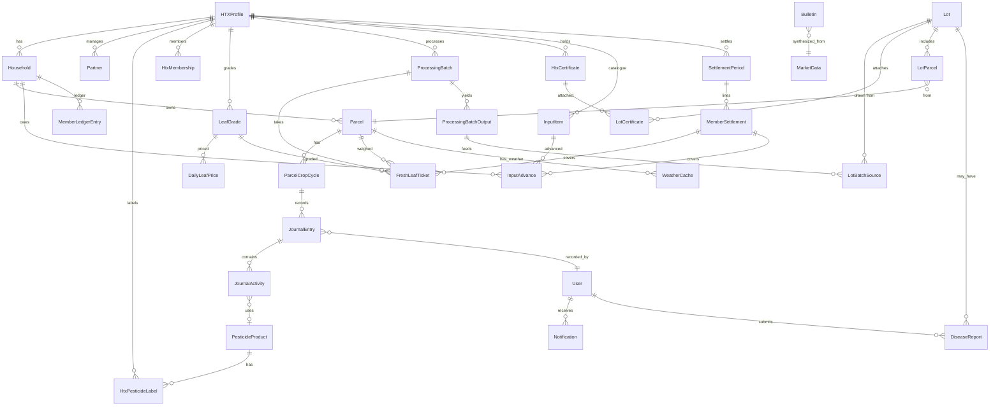

# Database Schema — OpenTea DX-OS

**ORM:** Prisma 5.x · **DB:** PostgreSQL 16 (PostGIS + pgvector) · **Schema file:** `apps/web/prisma/schema.prisma`

> [!IMPORTANT]
> **Nguồn sự thật thực thi:** `apps/web/prisma/schema.prisma` (schema `public`) và `platform/postgres/init/*.sql` (các schema `audit`, `telemetry`, `platform`), cộng với các schema `app_<id>` của Mini-app Tầng 3.
> Tài liệu này còn ghi nhận một số sai lệch lịch sử so với Prisma thực tế (ví dụ: người dùng quản lý qua Keycloak thay vì bảng `users`; `journal_entries` hiện chưa có `parcel_crop_cycle_id` và `partners.htx_profile_id` đã thêm ở GĐ0 (migration `20261128100000_partners_tenant`, DEV-007 đã sửa) — xem `DEV-010` trong [deviation-register.md](./deviation-register.md) và lộ trình hợp nhất trong [product-roadmap.md](./product-roadmap.md)).

> **Rule:** n8n is the ONLY writer to `market_data`, `weather_cache`, `bulletins`, `fx_rates` tables.
> All other core `public` tables are written by Next.js API routes via Prisma (and protected by `audit.events` hash-chain triggers).

---

## ERD Overview



---

## Tables

### `htx_profiles`
HTX (Hợp tác xã) master profile. Multi-tenant isolation key (`htx_code`, hỗ trợ nhiều HTX trên cùng một triển khai SaaS hoặc cụm Liên minh Tỉnh).

| Column | Type | Constraints | Description |
|--------|------|-------------|-------------|
| id | UUID | PK, default gen_random_uuid() | |
| htx_code | VARCHAR(20) | UNIQUE, NOT NULL | Mã HTX (dùng cho Lot code) |
| name | VARCHAR(200) | NOT NULL | Tên HTX |
| province | VARCHAR(100) | NOT NULL | Tỉnh/Thành phố |
| district | VARCHAR(100) | NOT NULL | Quận/Huyện |
| commune | VARCHAR(100) | NOT NULL | Xã/Phường |
| address_detail | TEXT | | Địa chỉ chi tiết |
| primary_crop | VARCHAR(100) | NOT NULL | Cây trồng chính |
| total_area_ha | DECIMAL(10,2) | | Tổng diện tích (ha) — auto-calc from parcels |
| member_count | INT | | Số thành viên — auto-calc from households |
| certification | VARCHAR(50) | | VietGAP / GlobalGAP / Organic |
| logo_minio_key | VARCHAR(500) | | MinIO object key cho logo |
| public_show_names | BOOLEAN | NOT NULL, DEFAULT false | Hiện tên người (hộ, người ghi nhật ký, thợ sao) trên trang QR công khai; ẩn lúc dựng trang khi `false` (`20261128160100_certificates_and_public_names`, GĐ2) |
| created_at | TIMESTAMPTZ | NOT NULL, DEFAULT now() | |
| updated_at | TIMESTAMPTZ | NOT NULL, DEFAULT now() | |

---

### `users`
Keycloak-linked user records. Synced on first login.

| Column | Type | Constraints | Description |
|--------|------|-------------|-------------|
| id | UUID | PK | Matches Keycloak subject ID |
| keycloak_id | VARCHAR(100) | UNIQUE, NOT NULL | Keycloak sub claim |
| email | VARCHAR(200) | UNIQUE, NOT NULL | |
| full_name | VARCHAR(200) | NOT NULL | |
| role | ENUM('manager','officer','farmer') | NOT NULL | Synced from Keycloak role |
| phone | VARCHAR(20) | | |
| household_id | UUID | FK → households, nullable | Nếu role = farmer |
| is_active | BOOLEAN | NOT NULL, DEFAULT true | |
| created_at | TIMESTAMPTZ | NOT NULL, DEFAULT now() | |
| updated_at | TIMESTAMPTZ | NOT NULL, DEFAULT now() | |

**Indexes:** `keycloak_id`, `email`, `role`

---

### `households`
Nông hộ thành viên HTX.

> ⚠️ **Schema Divergence (Story 7.0a):** `htx_profile_id` được thêm qua migration `20260814102205_add_htx_relations`. Field là `nullable` (`String?`) trong Prisma thực tế, không phải NOT NULL như spec gốc. Existing rows cần backfill (`scripts/backfill-htx-profile-id.sql`).

| Column | Type | Constraints | Description |
|--------|------|-------------|-------------|
| id | TEXT (cuid) | PK | |
| htx_profile_id | TEXT | FK → htx_profiles, **nullable** | Added by Story 7.0a migration |
| name | VARCHAR(200) | NOT NULL | Tên chủ hộ (`owner_name` trong spec gốc) |
| phone | VARCHAR(20) | UNIQUE, NOT NULL | Dùng làm household_code |
| address | TEXT | nullable | |
| keycloak_user_id | TEXT | nullable | Linked after farmer account created |
| bank_bin | TEXT | nullable, `CHECK` `^[0-9]{6}$` | BIN ngân hàng nhận tiền (`20261128150000_member_ledger`, GĐ1 S4) |
| bank_account | TEXT | nullable, `CHECK` `^[0-9]{6,19}$` | Số tài khoản; chỉ `manager` và `accountant` đọc đủ, không vào Hasura, Telegram hay agent |
| bank_account_name | TEXT | nullable | Tên chủ tài khoản, tối đa 60 ký tự (API) |
| created_at | TIMESTAMPTZ | NOT NULL, DEFAULT now() | |
| updated_at | TIMESTAMPTZ | NOT NULL, DEFAULT now() |

---

### `parcels`
Thửa đất (land parcel). Mỗi hộ có nhiều thửa.

| Column | Type | Constraints | Description |
|--------|------|-------------|-------------|
| id | UUID | PK | |
| household_id | UUID | FK → households, NOT NULL | |
| parcel_code | VARCHAR(50) | UNIQUE, NOT NULL | Mã thửa |
| name | VARCHAR(200) | | Tên thửa (tự đặt) |
| area_ha | DECIMAL(10,4) | NOT NULL | Diện tích (ha) — Turf.js calculated |
| geojson | JSONB | NOT NULL | GeoJSON polygon từ Leaflet.draw |
| centroid_lat | DECIMAL(10,7) | NOT NULL | Tâm thửa — cho Open-Meteo query |
| centroid_lng | DECIMAL(10,7) | NOT NULL | |
| status | ENUM('idle','growing','harvested','fallow') | NOT NULL, DEFAULT 'idle' | |
| current_crop | VARCHAR(100) | | Cây trồng đang canh tác |
| soil_type | VARCHAR(100) | | Loại đất |
| irrigation_type | VARCHAR(100) | | Tưới tiêu |
| created_at | TIMESTAMPTZ | NOT NULL, DEFAULT now() | |
| updated_at | TIMESTAMPTZ | NOT NULL, DEFAULT now() | |

**Indexes:** `household_id`, `status`, `(centroid_lat, centroid_lng)`

---

### `parcel_crop_cycles`
Vụ mùa của thửa đất. Mỗi thửa có thể nhiều vụ.

| Column | Type | Constraints | Description |
|--------|------|-------------|-------------|
| id | UUID | PK | |
| parcel_id | UUID | FK → parcels, NOT NULL | |
| season | VARCHAR(50) | NOT NULL | Vụ Đông Xuân / Hè Thu / Vụ Mùa |
| crop | VARCHAR(100) | NOT NULL | Cây trồng vụ này |
| planting_date | DATE | NOT NULL | |
| estimated_harvest_date | DATE | | |
| actual_harvest_date | DATE | | |
| estimated_yield_kg | DECIMAL(10,2) | | Sản lượng ước tính |
| actual_yield_kg | DECIMAL(10,2) | | Sản lượng thực tế |
| is_active | BOOLEAN | NOT NULL, DEFAULT true | |
| created_at | TIMESTAMPTZ | NOT NULL, DEFAULT now() | |

> **Thực tế trong Prisma (GĐ1 S1):** bảng dùng `season` (nullable, dạng `Lứa n/năm`), `sowed_at`, `harvested_at`, `estimated_harvest_date`, `created_at`; một dòng là một **lứa hái** của nương chè (hái 7 đến 9 lứa mỗi năm). `harvested_at` rỗng nghĩa là lứa đang mở. `journal_entries.cycle_id`, `lot_parcels.cycle_id` và `fresh_leaf_tickets.cycle_id` trỏ tới bảng này.

---

### `journal_entries`
Nhật ký canh tác. Officer ghi, Manager duyệt.

| Column | Type | Constraints | Description |
|--------|------|-------------|-------------|
| id | UUID | PK | |
| parcel_crop_cycle_id | UUID | FK → parcel_crop_cycles, NOT NULL | |
| recorded_by | UUID | FK → users, NOT NULL | Officer ID |
| approved_by | UUID | FK → users, nullable | Manager ID |
| entry_date | DATE | NOT NULL | Ngày ghi |
| growth_stage | VARCHAR(100) | | Giai đoạn sinh trưởng |
| observation | TEXT | | Quan sát chung |
| weather_condition | VARCHAR(100) | | Thời tiết ngày đó |
| temperature_c | DECIMAL(5,2) | | Auto từ Open-Meteo |
| rainfall_mm | DECIMAL(8,2) | | Auto từ Open-Meteo |
| status | ENUM('draft','pending_approval','approved','rejected') | NOT NULL, DEFAULT 'draft' | |
| approved_at | TIMESTAMPTZ | | |
| rejection_reason | TEXT | | |
| review_note | TEXT | nullable | Lý do cán bộ nhập khi từ chối hoặc yêu cầu sửa (`20261124120000_journal_review_note`) |
| reviewed_by_id | TEXT | nullable | Keycloak ID của người duyệt, từ chối hoặc yêu cầu sửa; ghi cùng lúc với cập nhật trạng thái có điều kiện `PENDING_APPROVAL` (`20261124140000_journal_reviewed_by`) |
| cycle_id | TEXT | nullable FK → parcel_crop_cycles (ON DELETE SET NULL) | Lứa hái của nhật ký (`20261128120100_flush_and_pesticides`). Rỗng với nhật ký `DRAFT` và nương chưa có lứa; được điền lúc gửi hoặc khi ngày ghi đổi |
| client_id | TEXT | nullable | UUID do máy khách sinh, chống trùng khi gửi lại từ hàng đợi offline |
| photo_minio_keys | TEXT[] | | Mảng MinIO keys |
| created_at | TIMESTAMPTZ | NOT NULL, DEFAULT now() | |
| updated_at | TIMESTAMPTZ | NOT NULL, DEFAULT now() | |

**Indexes:** `parcel_crop_cycle_id`, `status`, `entry_date`, `recorded_by`; thêm ở GĐ1: `cycle_id` và khoá duy nhất `(submitted_by_id, client_id)` (nhiều dòng có `client_id` rỗng vẫn hợp lệ). Trạng thái thực tế (cột `status` kiểu TEXT trong Prisma) gồm `DRAFT`, `PENDING_APPROVAL`, `APPROVED`, `REJECTED`, `REQUEST_CHANGES`.

---

### `journal_activities`
Chi tiết hoạt động trong một nhật ký (phun thuốc, bón phân...).

| Column | Type | Constraints | Description |
|--------|------|-------------|-------------|
| id | UUID | PK | |
| journal_entry_id | UUID | FK → journal_entries, NOT NULL | |
| activity_type | ENUM('pesticide','fertilizer','irrigation','harvesting','soil_prep','other') | NOT NULL | |
| product_name | VARCHAR(200) | | Tên thuốc / phân bón |
| dosage | VARCHAR(100) | | Liều lượng |
| area_applied_ha | DECIMAL(10,4) | | Diện tích áp dụng |
| withdrawal_days | INT | | Ngày cách ly (thuốc BVTV) |
| safe_harvest_date | DATE | | entry_date + withdrawal_days |
| notes | TEXT | | |
| pesticide_product_id | TEXT | nullable FK → pesticide_products (ON DELETE SET NULL) | Thuốc trong danh mục; rỗng là "Thuốc khác" (GĐ1 S1) |
| fresh_leaf_kg | DOUBLE PRECISION | nullable | Kg búp tươi thu hoạch, chỉ trên hoạt động `HARVEST` (`20261128120200_journal_fresh_leaf_kg`) |
| created_at | TIMESTAMPTZ | NOT NULL, DEFAULT now() | |

> **Thực tế trong Prisma:** kiểu hoạt động là enum `ActivityType` = `SOWING`, `FERTILIZING`, `SPRAYING`, `IRRIGATION`, `HARVEST`, `PRUNING`, `OTHER`. `PRUNING` (Đốn chè) thêm bằng migration riêng `20261128120000_activity_pruning`, vì giá trị enum mới không dùng được trong giao dịch đã thêm nó.

---

### `lots`
Lô hàng — đơn vị QR truy xuất nguồn gốc.

> ⚠️ **Schema Divergence (Story 7.0a):** Table được recreate qua migration `20260814102205_add_htx_relations` (DROP TABLE `Lot` + CREATE TABLE `lots`). Một số fields thực tế khác với spec gốc — xem cột "Thực tế" bên dưới.

| Column | Type | Constraints | Thực tế trong Prisma | Description |
|--------|------|-------------|---------------------|-------------|
| id | TEXT (cuid) | PK | `id String @id @default(cuid())` | |
| lot_code | VARCHAR(100) | UNIQUE, NOT NULL | ✅ | Format: HTX-CROP-YYYYMMDD-NNN |
| htx_profile_id | TEXT | **nullable** FK → htx_profiles | ✅ Added Story 7.0a | HTX scoping |
| commodity | VARCHAR(100) | NOT NULL | ✅ (`commodity`) | Loại nông sản |
| quality_grade | TEXT | nullable | ✅ (không có trong spec gốc) | "Grade 1" / "Grade 2" / "Ungraded" |
| harvest_date | DATE | NOT NULL | ✅ `DateTime` | |
| estimated_weight_kg | DECIMAL(10,2) | nullable | ✅ | |
| actual_weight_kg | DECIMAL(10,2) | nullable | ✅ | |
| packaging_type | VARCHAR(100) | nullable | ✅ | |
| destination | VARCHAR(200) | nullable | ✅ | Nơi giao hàng |
| buyer_name | VARCHAR(200) | nullable | ✅ | Tên người mua |
| status | ENUM | NOT NULL, DEFAULT 'DRAFT' | `LotStatus` enum: DRAFT/READY/QR_EXPORTED | |
| qr_image_url | TEXT | nullable | `qr_image_url` (không phải `qr_minio_key`) | MinIO URL |
| certificate_keys | TEXT[] | DEFAULT [] | ✅ | Khoá tệp chứng nhận (kho đối tượng) cho route tải công khai |
| dry_grade | ENUM `DryTeaGrade` | nullable | ✅ GĐ2 | Hạng chè khô của lô đóng từ mẻ; rỗng với lô tạo trước GĐ2 (`20261128160000_processing_batches`) |
| public_page_data | JSONB | nullable | ✅ | Snapshot for QR public page |
| created_by_id | TEXT | nullable | keycloak officer user ID | |
| created_at | TIMESTAMPTZ | NOT NULL, DEFAULT now() | ✅ | |
| updated_at | TIMESTAMPTZ | NOT NULL, DEFAULT now() | ✅ | |

**Indexes:** `lot_code` (unique), `status`, `htx_profile_id`

> **Note (cập nhật GĐ2):** `packaging_date`, `total_weight_kg` và `packaging_spec` có trong `schema.prisma` hiện tại; lô đóng từ mẻ ghi `packaging_date` (hôm nay) và `total_weight_kg` (tổng kg lấy). Quan hệ ngược: `batch_sources` (`lot_batch_sources`) và `certificates` (`lot_certificates`).

---

### `lot_parcels`
Junction: thửa nào thuộc lô nào (M-M).

| Column | Type | Constraints | Description |
|--------|------|-------------|-------------|
| lot_id | UUID | FK → lots, NOT NULL | |
| parcel_id | UUID | FK → parcels, NOT NULL | |
| cycle_id | TEXT | nullable FK → parcel_crop_cycles (ON DELETE SET NULL) | Lứa của dòng lô: lứa đóng gần nhất không sau ngày hái của lô, nếu không có thì lứa đang mở (`20261128120100_flush_and_pesticides` điền cho dòng cũ). Dòng cũ không có lứa vẫn rỗng |

**PK:** (lot_id, parcel_id)

---

### `partners`
Đối tác nông nghiệp (bản đồ đối tác).

| Column | Type | Constraints | Description |
|--------|------|-------------|-------------|
| id | UUID | PK | |
| htx_profile_id | TEXT | NULL, FK → htx_profiles (ON DELETE SET NULL), index | Tenant của đối tác. Mọi đọc và ghi lọc theo cột này, lấy từ phiên, không lấy từ body. Dòng rỗng coi như không tồn tại. Migration gán dòng cũ cho HTX `TC`, hoặc cho HTX duy nhất nếu chỉ có một; còn lại để rỗng. |
| name | VARCHAR(200) | NOT NULL | Tên đối tác |
| type | ENUM('buyer','supplier','service','bank','other') | NOT NULL | |
| address | TEXT | | |
| lat | DECIMAL(10,7) | | Geocoded bởi Nominatim |
| lng | DECIMAL(10,7) | | |
| phone | VARCHAR(20) | | |
| website | VARCHAR(500) | | |
| contact_person | VARCHAR(200) | | |
| is_verified | BOOLEAN | NOT NULL, DEFAULT false | Manager verified |
| created_at | TIMESTAMPTZ | NOT NULL, DEFAULT now() | |
| updated_at | TIMESTAMPTZ | NOT NULL, DEFAULT now() | |

**Indexes:** `type`, `(lat, lng)`, `htx_profile_id`

---

### `notifications`
Thông báo cá nhân (Web Bell).

| Column | Type | Constraints | Description |
|--------|------|-------------|-------------|
| id | UUID | PK | |
| recipient_id | UUID | FK → users, NOT NULL | |
| type | ENUM('market_alert','journal_approved','journal_rejected','lot_exported','system','disease_result') | NOT NULL | |
| title | VARCHAR(200) | NOT NULL | |
| body | TEXT | NOT NULL | |
| link | VARCHAR(500) | | Deep link URL |
| is_read | BOOLEAN | NOT NULL, DEFAULT false | |
| created_at | TIMESTAMPTZ | NOT NULL, DEFAULT now() | |
| read_at | TIMESTAMPTZ | | |

**Indexes:** `recipient_id`, `is_read`, `created_at DESC`

---

### `disease_reports`
Kết quả chẩn đoán bệnh cây (FastAPI model).

| Column | Type | Constraints | Description |
|--------|------|-------------|-------------|
| id | UUID | PK | |
| submitted_by | UUID | FK → users, NOT NULL | |
| parcel_id | UUID | FK → parcels, nullable | |
| lot_id | UUID | FK → lots, nullable | |
| image_minio_key | VARCHAR(500) | NOT NULL | |
| disease_name | VARCHAR(200) | | Tên bệnh (VI) |
| confidence_score | DECIMAL(5,4) | | 0.0000 – 1.0000 |
| raw_api_response | JSONB | | Full FastAPI response |
| created_at | TIMESTAMPTZ | NOT NULL, DEFAULT now() | |

---

### `market_data` *(written by n8n)*
Dữ liệu thị trường raw từ external APIs.

| Column | Type | Constraints | Description |
|--------|------|-------------|-------------|
| id | UUID | PK | |
| source | VARCHAR(50) | NOT NULL | (NASA, COMTRADE, USDA, WTO, FAOSTAT, worldbank, etc.) |
| commodity | VARCHAR(100) | NOT NULL | |
| metric | VARCHAR(100) | NOT NULL | (export_volume, price_fob, tariff_rate...) |
| value | DECIMAL(18,4) | NOT NULL | |
| unit | VARCHAR(50) | | |
| period | VARCHAR(20) | | YYYY-MM hoặc YYYY |
| country | VARCHAR(10) | | ISO country code |
| fetched_at | TIMESTAMPTZ | NOT NULL, DEFAULT now() | |

**Indexes:** `(source, commodity, metric, period)`

---

### `weather_cache` *(written by n8n)*
Cache thời tiết theo thửa (Open-Meteo 1h).

| Column | Type | Constraints | Description |
|--------|------|-------------|-------------|
| id | UUID | PK | |
| parcel_id | UUID | FK → parcels, NOT NULL | |
| temperature_c | DECIMAL(5,2) | | |
| humidity_pct | DECIMAL(5,2) | | |
| rainfall_mm | DECIMAL(8,2) | | |
| wind_speed_ms | DECIMAL(6,2) | | |
| weather_code | INT | | WMO weather code |
| uv_index | DECIMAL(4,1) | | |
| forecast_json | JSONB | | 7-day forecast |
| fetched_at | TIMESTAMPTZ | NOT NULL | |

**Upsert key:** `(parcel_id)` — một record per parcel, overwritten mỗi giờ

---

### `bulletins` *(written by n8n + Ollama)*
Bản tin thị trường được AI tổng hợp.

| Column | Type | Constraints | Description |
|--------|------|-------------|-------------|
| id | UUID | PK | |
| commodity | VARCHAR(100) | NOT NULL | |
| bulletin_vi | TEXT | NOT NULL | Bản tin tiếng Việt (Ollama output) |
| sources_json | JSONB | NOT NULL | Citations: [{source, url, date, value}] |
| audio_minio_key | VARCHAR(500) | | Piper TTS audio (nullable nếu chưa gen) |
| generated_at | TIMESTAMPTZ | NOT NULL | |
| model_used | VARCHAR(100) | NOT NULL | phi3 / mistral |
| is_latest | BOOLEAN | NOT NULL, DEFAULT true | Chỉ 1 record is_latest=true per commodity |
| status | TEXT | NOT NULL, DEFAULT 'published', CHECK `draft \| published \| rejected` | M4. Only `published` rows are read. Drafts are not stored (the text lives in the proposal), so `draft` and `rejected` are reserved |
| htx_code | TEXT | NULL | M4. The owning cooperative; NULL is a shared bulletin written by the n8n workflow |

Migration `20261125130000_bulletin_status_and_cooperative` adds `status` and `htx_code` (index `bulletins_htx_code_commodity_is_latest_idx`). The agent's `bulletin.publish` approval marks the cooperative's earlier latest rows of the commodity not latest and inserts a row with `htx_code` and `model_used = 'agent:bulletin'`. Readers (`/api/bulletin`, `/api/tts`, the manager and officer pages, Hasura `public_bulletins`) show the cooperative's own published row first, otherwise the latest shared one.

**Indexes:** `(commodity, is_latest)`, `generated_at DESC`

---

### `fx_rates` *(written by n8n)*
Tỷ giá USD/VND (Frankfurter API).

| Column | Type | Constraints | Description |
|--------|------|-------------|-------------|
| id | UUID | PK | |
| rates | JSONB | NOT NULL | Toàn bộ tỷ giá thế giới (VND, CNY, JPY...) |
| fetched_at | TIMESTAMPTZ | NOT NULL | |

---

### Chuỗi giá trị chè (GĐ1 S1 đến S3)

Các bảng dưới đây thêm bởi năm migration `apps/web/prisma/migrations/20261128120000_*`, `20261128120100_*`, `20261128120200_*`, `20261128130000_*` và `20261128140000_*`. Id là TEXT (cuid), thời gian là `TIMESTAMP(3)`.

**Trigger kiểm toán.** Cả sáu bảng mới có trigger `dxos_audit_row` (`AFTER INSERT OR UPDATE OR DELETE`, hàm `audit.capture_row()`): `platform/postgres/init/03-audit-triggers.sql` cài cho cơ sở dữ liệu mới, còn mỗi migration tạo trigger cho cơ sở dữ liệu đang chạy (bỏ qua khi chưa có schema `audit`). Cột bảng cũ thêm ở GĐ1 nằm trong bảng đã có trigger.

#### `pesticide_products`
Danh mục thuốc BVTV dùng chung mọi HTX (`20261128120100`). Ghi bởi migration (20 dòng khởi đầu) và `platform_admin` (`PUT /api/platform/pesticides/[id]`). Trigger kiểm toán: có.

| Column | Type | Constraints | Description |
|--------|------|-------------|-------------|
| id | TEXT | PK | |
| trade_name | TEXT | UNIQUE, NOT NULL | Tên thương mại |
| active_ingredient | TEXT | NOT NULL | Hoạt chất |
| group | ENUM `PesticideGroup` | NOT NULL | `BOTANICAL`, `MICROBIAL`, `BIOLOGICAL`, `CHEMICAL`, `ANTIBIOTIC` |
| targets | TEXT[] | NOT NULL | Đối tượng phòng trừ |
| default_phi_days | INT | NOT NULL | Mức sàn cách ly mặc định: 7 (thảo mộc, vi sinh, sinh học) hoặc 14 (hoá học, kháng sinh) |
| phi_needs_label_check | BOOLEAN | NOT NULL, DEFAULT true | Còn cần đối chiếu nhãn thực tế |
| source | TEXT | NOT NULL | Văn bản nguồn |
| active | BOOLEAN | NOT NULL, DEFAULT true | |
| created_at, updated_at | TIMESTAMP(3) | NOT NULL | |

#### `htx_pesticide_labels`
Số ngày cách ly theo nhãn thật mà một HTX đã đối chiếu; thay mức sàn mặc định cho HTX đó (`20261128120100`). Ghi bởi `officer`, `manager`. Trigger kiểm toán: có.

| Column | Type | Constraints | Description |
|--------|------|-------------|-------------|
| id | TEXT | PK | |
| htx_profile_id | TEXT | FK → htx_profiles (RESTRICT), NOT NULL | |
| pesticide_product_id | TEXT | FK → pesticide_products (RESTRICT), NOT NULL | |
| label_phi_days | INT | NOT NULL, `CHECK` 1..365 | |
| label_note | TEXT | | Số lô hoặc nội dung nhãn; API bắt buộc khi thấp hơn mức mặc định |
| verified_by_id | TEXT | NOT NULL | Keycloak sub của người đối chiếu |
| verified_at | TIMESTAMP(3) | NOT NULL, DEFAULT now() | |
| created_at, updated_at | TIMESTAMP(3) | NOT NULL | |

**Index:** khoá duy nhất `(htx_profile_id, pesticide_product_id)`.

#### `htx_memberships`
Các vai của một người trong một HTX (`20261128130000`). Keycloak là nguồn sự thật; `requireTenant()` đồng bộ dòng này từ token. Trigger kiểm toán: có.

| Column | Type | Constraints | Description |
|--------|------|-------------|-------------|
| id | TEXT | PK | |
| keycloak_user_id | TEXT | NOT NULL | |
| htx_profile_id | TEXT | FK → htx_profiles (RESTRICT), NOT NULL | |
| roles | TEXT[] | NOT NULL | Tập con của `farmer`, `officer`, `accountant`, `manager`; không có `platform_admin` |
| created_at, updated_at | TIMESTAMP(3) | NOT NULL | |

**Index:** khoá duy nhất `(keycloak_user_id, htx_profile_id)`; `htx_profile_id`.

#### `leaf_grades`
Phẩm cấp búp tươi của từng HTX (`20261128140000`). Ghi bởi `manager`. Trigger kiểm toán: có.

| Column | Type | Constraints | Description |
|--------|------|-------------|-------------|
| id | TEXT | PK | |
| htx_profile_id | TEXT | FK → htx_profiles (RESTRICT), NOT NULL | |
| name | TEXT | NOT NULL | |
| sort_order | INT | NOT NULL, DEFAULT 0 | |
| active | BOOLEAN | NOT NULL, DEFAULT true | Phẩm cấp ẩn không cân được |
| created_at, updated_at | TIMESTAMP(3) | NOT NULL | |

**Index:** khoá duy nhất `(htx_profile_id, name)`.

#### `daily_leaf_prices`
Một giá mỗi phẩm cấp mỗi ngày giờ Việt Nam (`20261128140000`). Ghi bởi `manager` (`PUT /api/leaf-prices/today`). Trigger kiểm toán: có.

| Column | Type | Constraints | Description |
|--------|------|-------------|-------------|
| id | TEXT | PK | |
| htx_profile_id | TEXT | FK → htx_profiles (RESTRICT), NOT NULL | |
| grade_id | TEXT | FK → leaf_grades (RESTRICT), NOT NULL | |
| price_date | DATE | NOT NULL | Ngày giờ Việt Nam |
| price_vnd_per_kg | INT | NOT NULL, `CHECK` 1..10000000 | |
| published_by_id | TEXT | NOT NULL | Keycloak sub |
| published_at | TIMESTAMP(3) | NOT NULL, DEFAULT now() | |
| updated_at | TIMESTAMP(3) | NOT NULL | |

**Index:** khoá duy nhất `(grade_id, price_date)`; `(htx_profile_id, price_date)`.

#### `fresh_leaf_tickets`
Phiếu cân búp tươi; ghi một lần, không sửa (sai thì huỷ và cân lại) (`20261128140000`). Ghi bởi `accountant`, `manager`. Trigger kiểm toán: có.

| Column | Type | Constraints | Description |
|--------|------|-------------|-------------|
| id | TEXT | PK | |
| htx_profile_id | TEXT | FK → htx_profiles (RESTRICT), NOT NULL | |
| ticket_no | TEXT | UNIQUE, NOT NULL | `{HTX_CODE}-PC-{YYYYMMDD}-{NNN}` |
| household_id | TEXT | FK → households (RESTRICT), NOT NULL | |
| parcel_id | TEXT | FK → parcels (RESTRICT), NOT NULL | |
| cycle_id | TEXT | nullable FK → parcel_crop_cycles (SET NULL) | Rỗng với nương chưa từng có lứa |
| grade_id | TEXT | FK → leaf_grades (RESTRICT), NOT NULL | |
| weighed_at | TIMESTAMP(3) | NOT NULL | Giờ máy chủ |
| gross_kg | DECIMAL(7,1) | NOT NULL, `CHECK` > 0 và <= 5000 | |
| deduction_pct | DECIMAL(4,1) | NOT NULL, `CHECK` 0..30 | |
| net_kg | DECIMAL(7,1) | NOT NULL | |
| price_vnd_per_kg | INT | NOT NULL, `CHECK` 1..10000000 | Giá chép lúc ghi |
| amount_vnd | BIGINT | NOT NULL | Thành tiền, đồng |
| status | ENUM `LeafTicketStatus` | NOT NULL, DEFAULT 'VALID' | `VALID`, `VOIDED` |
| void_reason, voided_by_id, voided_at | TEXT, TEXT, TIMESTAMP(3) | nullable | Điền khi huỷ |
| created_by_id | TEXT | NOT NULL | Keycloak sub người cân |
| client_id | TEXT | nullable | Chống trùng khi gửi lại |
| processing_batch_id | TEXT | nullable FK → processing_batches (RESTRICT), index | Mẻ sao chứa phiếu (một phiếu một mẻ); phiếu có giá trị này không huỷ được (`20261128160000_processing_batches`, GĐ2) |
| settlement_id | TEXT | nullable FK → member_settlements (RESTRICT) | Dòng quyết toán chứa phiếu; khoá ngoại thêm ở `20261128150000_member_ledger`. Phiếu có giá trị này không huỷ được |
| created_at | TIMESTAMP(3) | NOT NULL, DEFAULT now() | |

**Index:** khoá duy nhất `(created_by_id, client_id)`; `(htx_profile_id, weighed_at)`; `household_id`; `parcel_id`; `cycle_id`.

### Vật tư ứng, sổ cái và quyết toán (GĐ1 S4)

Thêm bởi migration `20261128150000_member_ledger`, cùng ba cột ngân hàng của `households` ở trên và khoá ngoại `fresh_leaf_tickets.settlement_id`. Enum mới: `InputKind` (`FERTILIZER`, `PESTICIDE`, `OTHER`), `SettlementStatus` (`DRAFT`, `CLOSED`), `LedgerEntryType` (`LEAF_CREDIT`, `INPUT_DEBIT`, `PAYOUT`, `ADJUSTMENT`), `PaymentMethod` (`TRANSFER`, `CASH`); `input_advances.status` dùng lại `LeafTicketStatus`. Số tiền là BIGINT đồng (trừ `unit_price_vnd` là INT).

**Trigger.** Cả năm bảng có trigger kiểm toán `dxos_audit_row` (`audit.capture_row()`), cài bởi `03-audit-triggers.sql` cho cơ sở dữ liệu mới và bởi migration cho cơ sở dữ liệu đang chạy (bỏ qua khi chưa có schema `audit`). Riêng `member_ledger_entries` còn có trigger **chỉ thêm**: `member_ledger_entries_append_only` (`BEFORE UPDATE OR DELETE`, theo dòng) và `member_ledger_entries_no_truncate` (`BEFORE TRUNCATE`) cùng gọi `public.member_ledger_entries_refuse_change()`, hàm này ném lỗi `restrict_violation`; sửa sai bằng dòng `ADJUSTMENT` mới.

#### `input_items`
Danh mục vật tư của HTX. Ghi bởi `manager`, `accountant`. Trigger kiểm toán: có.

| Column | Type | Constraints | Description |
|--------|------|-------------|-------------|
| id | TEXT | PK | |
| htx_profile_id | TEXT | FK → htx_profiles (RESTRICT), NOT NULL | |
| name | TEXT | NOT NULL | |
| unit | TEXT | NOT NULL | |
| unit_price_vnd | INT | NOT NULL, `CHECK` 0..100000000 | |
| kind | ENUM `InputKind` | NOT NULL | |
| pesticide_product_id | TEXT | nullable FK → pesticide_products (SET NULL) | Chỉ với loại `PESTICIDE` (API kiểm) |
| active | BOOLEAN | NOT NULL, DEFAULT true | |
| created_at, updated_at | TIMESTAMP(3) | NOT NULL | |

**Index:** khoá duy nhất `(htx_profile_id, name)`.

#### `input_advances`
Phiếu ứng vật tư; ghi một lần, sai thì huỷ và ghi lại. Ghi bởi `accountant`, `manager`. Trigger kiểm toán: có.

| Column | Type | Constraints | Description |
|--------|------|-------------|-------------|
| id | TEXT | PK | |
| htx_profile_id | TEXT | FK → htx_profiles (RESTRICT), NOT NULL | |
| advance_no | TEXT | UNIQUE, NOT NULL | `{HTX_CODE}-VT-{YYYYMMDD}-{NNN}` |
| household_id | TEXT | FK → households (RESTRICT), NOT NULL | |
| item_id | TEXT | FK → input_items (RESTRICT), NOT NULL | |
| quantity | DECIMAL(9,2) | NOT NULL, `CHECK` > 0 | |
| unit_price_vnd | INT | NOT NULL, `CHECK` >= 0 | Chép từ vật tư lúc ghi |
| amount_vnd | BIGINT | NOT NULL, `CHECK` >= 0 | Số lượng × đơn giá, làm tròn đồng, nửa làm tròn lên |
| advanced_on | DATE | NOT NULL | Ngày giờ Việt Nam |
| status | ENUM `LeafTicketStatus` | NOT NULL, DEFAULT 'VALID' | `VALID`, `VOIDED` |
| void_reason, voided_by_id, voided_at | TEXT, TEXT, TIMESTAMP(3) | nullable | Điền khi huỷ |
| settlement_id | TEXT | nullable FK → member_settlements (RESTRICT) | Có giá trị thì không huỷ được |
| client_id | TEXT | nullable | Chống trùng khi gửi lại |
| created_by_id | TEXT | NOT NULL | Keycloak sub |
| created_at | TIMESTAMP(3) | NOT NULL, DEFAULT now() | |

**Index:** khoá duy nhất `(created_by_id, client_id)`; `(htx_profile_id, advanced_on)`; `household_id`.

#### `settlement_periods`
Kỳ quyết toán của HTX. Ghi bởi `accountant`, `manager` (tạo) và `manager` (chốt). Trigger kiểm toán: có.

| Column | Type | Constraints | Description |
|--------|------|-------------|-------------|
| id | TEXT | PK | |
| htx_profile_id | TEXT | FK → htx_profiles (RESTRICT), NOT NULL | |
| code | TEXT | UNIQUE, NOT NULL | `{HTX_CODE}-QT-{YYYYMMDD}` theo `date_to` |
| date_from, date_to | DATE | NOT NULL, `CHECK` `date_from <= date_to` | |
| status | ENUM `SettlementStatus` | NOT NULL, DEFAULT 'DRAFT' | |
| created_by_id | TEXT | NOT NULL | Keycloak sub |
| created_by_name | TEXT | nullable | Tên hiển thị lúc tạo |
| created_at | TIMESTAMP(3) | NOT NULL, DEFAULT now() | |
| closed_by_id, closed_by_name, closed_at | TEXT, TEXT, TIMESTAMP(3) | nullable | Người và giờ chốt |

**Index:** khoá duy nhất `code`; `(htx_profile_id, date_from)`. Tính liền nhau của các kỳ và một kỳ `DRAFT` mỗi HTX do ứng dụng giữ dưới khoá tư vấn, không có ràng buộc cơ sở dữ liệu.

#### `member_settlements`
Một dòng cho mỗi hộ trong mỗi kỳ đã chốt. Ghi lúc chốt (`manager`); `paid_*` ghi lúc chi trả. Trigger kiểm toán: có.

| Column | Type | Constraints | Description |
|--------|------|-------------|-------------|
| id | TEXT | PK | |
| period_id | TEXT | FK → settlement_periods (RESTRICT), NOT NULL | |
| household_id | TEXT | FK → households (RESTRICT), NOT NULL | |
| leaf_net_kg | DECIMAL(10,1) | NOT NULL | Tổng kg tịnh |
| leaf_amount_vnd | BIGINT | NOT NULL | `L`, tiền búp |
| advances_vnd | BIGINT | NOT NULL | `A`, tiền vật tư |
| debt_in_vnd | BIGINT | NOT NULL, `CHECK` >= 0 | Nợ mang vào, chỉ để hiện |
| payable_vnd | BIGINT | NOT NULL, `CHECK` >= 0 | `max(0, L − A + outstanding)` |
| debt_out_vnd | BIGINT | NOT NULL, `CHECK` >= 0 | `max(0, −(L − A + outstanding))` |
| paid_at, paid_by_id | TIMESTAMP(3), TEXT | nullable | Điền khi ghi trả (một lần) |
| payment_method | ENUM `PaymentMethod` | nullable | |
| payment_ref | TEXT | nullable | |

**Index:** khoá duy nhất `(period_id, household_id)`; `household_id`.

#### `member_ledger_entries`
Sổ cái xã viên, **chỉ thêm** (xem trigger ở trên). Dương là HTX nợ hộ, âm là hộ nợ HTX. Ghi lúc chốt kỳ (`LEAF_CREDIT`, `INPUT_DEBIT`), chi trả (`PAYOUT`) và điều chỉnh (`ADJUSTMENT`). Trigger kiểm toán: có.

| Column | Type | Constraints | Description |
|--------|------|-------------|-------------|
| id | TEXT | PK | |
| htx_profile_id | TEXT | FK → htx_profiles (RESTRICT), NOT NULL | |
| household_id | TEXT | FK → households (RESTRICT), NOT NULL | |
| entry_type | ENUM `LedgerEntryType` | NOT NULL | |
| amount_vnd | BIGINT | NOT NULL | Có dấu |
| ticket_id, advance_id | TEXT | nullable | Cột có sẵn, mã hiện chưa điền |
| settlement_id | TEXT | nullable FK → member_settlements (RESTRICT) | Dòng quyết toán của bút toán; rỗng với `ADJUSTMENT` |
| note | TEXT | nullable | Mã tham chiếu chi trả hoặc lý do điều chỉnh |
| created_by_id | TEXT | NOT NULL | Keycloak sub |
| created_at | TIMESTAMP(3) | NOT NULL, DEFAULT now() | |

**Index:** `(household_id, created_at)`.

### Mẻ sao sấy, lô từ mẻ và chứng nhận (GĐ2)

Thêm bởi hai migration `20261128160000_processing_batches` và `20261128160100_certificates_and_public_names`, cùng các cột `fresh_leaf_tickets.processing_batch_id`, `lots.dry_grade` và `htx_profiles.public_show_names` đã ghi ở các bảng trên. Enum mới: `ProcessingBatchStatus` (`OPEN`, `FINISHED`, `CANCELLED`), `DryTeaGrade` (`DINH`, `TOM_NON`, `MOC_CAU`, `BOM`, `CAM`), `CertificateKind` (`VIETGAP`, `OCOP`, `ORGANIC`, `OTHER`). Id là TEXT (cuid), thời gian `TIMESTAMP(3)`.

**Trigger kiểm toán.** Cả năm bảng mới có trigger `dxos_audit_row` (`audit.capture_row()`), cài bởi `03-audit-triggers.sql` cho cơ sở dữ liệu mới và bởi migration cho cơ sở dữ liệu đang chạy (bỏ qua khi chưa có schema `audit`). Các giao dịch mẻ, chứng nhận và đóng lô đặt `dxos.actor`. `lot_certificates` có `id` riêng (cùng khoá duy nhất `(lot_id, certificate_id)`) để dòng kiểm toán có khoá hàng, vì `audit.capture_row()` lấy khoá hàng từ cột `id`.

#### `processing_batches`
Mẻ sao sấy. Ghi bởi `officer`, `manager`. Trigger kiểm toán: có.

| Column | Type | Constraints | Description |
|--------|------|-------------|-------------|
| id | TEXT | PK | |
| htx_profile_id | TEXT | FK → htx_profiles (RESTRICT), NOT NULL | |
| batch_code | TEXT | UNIQUE, NOT NULL | `{HTX_CODE}-MS-{YYYYMMDD}-{NN}` |
| processed_on | DATE | NOT NULL | Ngày chế biến (giờ Việt Nam) |
| status | ENUM `ProcessingBatchStatus` | NOT NULL, DEFAULT 'OPEN' | |
| master_name, shift, notes | TEXT | nullable | Thợ sao, ca, ghi chú |
| fresh_kg, dry_kg | DECIMAL(10,1) | nullable, `CHECK` >= 0 | Chốt lúc hoàn thành |
| recovery_ratio | DECIMAL(5,2) | nullable, `CHECK` > 0 | `fresh_kg / dry_kg`, làm tròn 2 chữ số |
| out_of_band | BOOLEAN | NOT NULL, DEFAULT false | Ngoài khoảng 4,50 đến 5,00 |
| deviation_note | TEXT | nullable | Giải trình khi lệch (API bắt buộc từ 10 ký tự) |
| created_by_id | TEXT | NOT NULL | Keycloak sub |
| created_at | TIMESTAMP(3) | NOT NULL, DEFAULT now() | |
| finished_by_id, finished_at | TEXT, TIMESTAMP(3) | nullable | |
| cancelled_by_id, cancelled_at, cancel_reason | TEXT, TIMESTAMP(3), TEXT | nullable | |

**Index:** khoá duy nhất `batch_code`; `(htx_profile_id, processed_on)`; `fresh_leaf_tickets(processing_batch_id)`.

#### `processing_batch_outputs`
Sản lượng chè khô theo hạng của một mẻ. Trigger kiểm toán: có.

| Column | Type | Constraints | Description |
|--------|------|-------------|-------------|
| id | TEXT | PK | |
| batch_id | TEXT | FK → processing_batches (RESTRICT), NOT NULL | |
| grade | ENUM `DryTeaGrade` | NOT NULL | |
| kg | DECIMAL(9,1) | NOT NULL, `CHECK` > 0 và <= 100000 | |

**Index:** khoá duy nhất `(batch_id, grade)`.

#### `lot_batch_sources`
Phần kg của một lô lấy từ một dòng sản lượng. Tồn của dòng = `kg` − tổng `lot_batch_sources.kg`. Ghi lúc đóng lô. Trigger kiểm toán: có.

| Column | Type | Constraints | Description |
|--------|------|-------------|-------------|
| id | TEXT | PK | |
| lot_id | TEXT | FK → lots (RESTRICT), NOT NULL | |
| output_id | TEXT | FK → processing_batch_outputs (RESTRICT), NOT NULL | |
| kg | DECIMAL(9,1) | NOT NULL, `CHECK` > 0 | |

**Index:** khoá duy nhất `(lot_id, output_id)`; `output_id`.

#### `htx_certificates`
Chứng nhận của HTX kèm tệp. Không xoá; thu hồi bằng `revoked_at`. Ghi bởi `officer`, `manager` (thu hồi: `manager`). Trigger kiểm toán: có.

| Column | Type | Constraints | Description |
|--------|------|-------------|-------------|
| id | TEXT | PK | |
| htx_profile_id | TEXT | FK → htx_profiles (RESTRICT), NOT NULL | |
| kind | ENUM `CertificateKind` | NOT NULL | |
| number | TEXT | NOT NULL | `CHECK` tối đa 60 ký tự |
| issuer | TEXT | NOT NULL | `CHECK` tối đa 120 ký tự |
| issued_on, expires_on | DATE | NOT NULL, `CHECK` `expires_on >= issued_on` | |
| scope_note | TEXT | nullable | `CHECK` tối đa 200 ký tự |
| file_key | TEXT | NOT NULL | `para/<htx_code>/Certificates/<uuid>-<tên>` |
| file_name, file_mime | TEXT | NOT NULL | Tên đã làm sạch; `application/pdf`, `image/jpeg` hoặc `image/png` |
| file_size | INT | NOT NULL, `CHECK` > 0 và <= 10485760 | Byte |
| created_by_id | TEXT | NOT NULL | Keycloak sub |
| created_at | TIMESTAMP(3) | NOT NULL, DEFAULT now() | |
| revoked_at, revoked_by_id, revoke_reason | TIMESTAMP(3), TEXT, TEXT | nullable | Điền khi thu hồi |

**Index:** `(htx_profile_id, expires_on)`. Trạng thái `VALID`, `EXPIRED`, `REVOKED` tính lúc đọc, không có cột.

#### `lot_certificates`
Chứng nhận gắn vào lô lúc xuất QR. Trigger kiểm toán: có.

| Column | Type | Constraints | Description |
|--------|------|-------------|-------------|
| id | TEXT | PK | Khoá riêng, để dòng kiểm toán có khoá hàng |
| lot_id | TEXT | FK → lots (RESTRICT), NOT NULL | |
| certificate_id | TEXT | FK → htx_certificates (RESTRICT), NOT NULL | |

**Index:** khoá duy nhất `(lot_id, certificate_id)`.

### Agentic Layer (`platform` schema — `platform/postgres/init/08-agent.sql`, M1a)
Tất cả ba bảng đều gắn trigger `dxos_audit_row` ghi vào `audit.events`.

- **`platform.agent_runs`**: lịch sử các lượt chạy agent (`id`, `htx_code`, `agent`, `trigger` ∈ `schedule|event|manual`, `started_at`, `finished_at`, `status` ∈ `running|ok|failed|skipped`, `provider`, `model`, `tokens_in`, `tokens_out`, `cost_estimate`, `error`, `prompt_version`, `input_hash`).
- **`platform.agent_proposals`**: hàng đợi đề xuất hành động và vết kiểm duyệt (`id`, `htx_code`, `run_id`, `agent`, `kind`, `payload` JSONB, `reason_vi`, `evidence` JSONB, `confidence`, `risk` ∈ `low|medium|high`, `status` ∈ `proposed|approved|executed|failed|rejected|expired|stale|sent_to_staff_app`, `origin` ∈ `agent|user`, `requested_by`, `dedupe_key`, `subject_ids` text[] NOT NULL DEFAULT `'{}'`, `created_at`, `expires_at`, `decided_by`, `decided_by_name`, `decided_at`, `decision_channel` ∈ `web|telegram`, `decision_note`, `edited_payload` JSONB, `executed_at`, `result` JSONB, `external_ref` text NULL: mã việc của app nhân sự). `dedupe_key` được máy tạo từ `kind` và danh sách đối tượng (`subject_ids`), không lấy khóa do agent gửi. Partial unique index `agent_proposals_one_open` trên `(htx_code, kind, dedupe_key)` khi `status IN ('proposed', 'approved')`. GIN index `agent_proposals_subject_ids` trên `subject_ids`: đề xuất `journal.*` mới bị từ chối khi một đề xuất mở cùng HTX đã chứa đối tượng đó (kiểm dưới khóa `pg_advisory_xact_lock` theo HTX). Migration Prisma `20261124130000_agent_proposal_subjects` thêm cột có điều kiện, vì bảng này nằm ngoài schema Prisma; cùng thay đổi nằm trong `platform/postgres/init/08-agent.sql` (idempotent).
- **`platform.agent_settings`**: cấu hình agent theo từng HTX (`id` UUID UNIQUE, `htx_code`, `agent`, `enabled`, `schedule`, `provider`, `model`, `thresholds` JSONB, `monthly_budget`; PK `(htx_code, agent)`). M3: `model` là tên model tuỳ chọn (cột thêm trong `08-agent.sql` và bằng migration Prisma `20261125120000_agent_external_providers`, có điều kiện vì bảng nằm ngoài Prisma). Tab Cài đặt trên web chỉ đổi `provider`, `model`, `schedule` và ngân sách; `enabled` chỉ đổi bằng `./dxos agent enable|disable`. Hàng `agent = 'cooperative'` giữ ngân sách tháng của HTX trong `monthly_budget`; với `digest`, `schedule` là giờ gửi báo cáo `HH:MM`.


### Chiến dịch hôm nay (`platform` schema — `platform/postgres/init/08-agent.sql`, M7)

Migration Prisma `20261126180000_daily_campaigns` tạo cùng ba bảng khi schema `platform` đã có (có điều kiện, như các bảng M3 đến M5).

- **`platform.campaigns`**: một chiến dịch cho mỗi HTX và ngày Việt Nam (`UNIQUE (htx_code, day)`). `status` ∈ `draft|approved|partial|done|dropped`; `goals` JSONB (`[{goal_key, label_vi, unit_vi, target}]`), `summary_vi`, `run_id`, `decided_by`, `decided_by_name`, `decided_at`, `telegram_sent`, `created_at`. Có trigger `dxos_audit_row`.
- **`platform.campaign_items`**: các việc của chiến dịch, `(campaign_id, proposal_id)` là khóa chính, `position` 1..15 duy nhất trong chiến dịch, `goal_key`, `target`. Có trigger `dxos_audit_row`. Bảng có thêm cột `id uuid UNIQUE` để trigger kiểm toán (đọc `NEW.id`) hoạt động như các bảng khác; đây là khác biệt so với hợp đồng C1 ghi trong kế hoạch M7.
- **`platform.campaign_outcomes`**: kết quả 18:00 theo mục tiêu, khóa chính `(campaign_id, goal_key)`, `target`, `actual`, `measured_at`. Cũng có cột `id uuid UNIQUE` và trigger `dxos_audit_row` vì cùng lý do.

### Cải tiến hằng tuần (`platform` schema — `platform/postgres/init/08-agent.sql`, M8)

Migration Prisma `20261127090000_weekly_improvements` tạo bảng khi schema `platform` đã có (có điều kiện, như các migration M7).

- **`platform.improvements`**: cải tiến A10 đề xuất, một dòng cho mỗi HTX, tuần (thứ Hai) và `metric_key` (`UNIQUE (htx_code, week, metric_key)`). `kind` ∈ `setting|process|template`; `title_vi` tối đa 120 ký tự, `rationale_vi` tối đa 600; `baseline` số; `evidence` JSONB do agent gửi; `proposal_id` là đề xuất đã tạo (`UNIQUE`, khóa ngoại tới `agent_proposals`). `status` ∈ `proposed|adopted|declined|measured`, `decided_by`, `adopted_at`. `effect` JSONB chứa `after_2w` và `after_4w`, mỗi mục gồm `value`, `verdict` (`helped|no_effect|drop`) và `at`. `template` JSONB chỉ cho kind `template`: `{weekday, goal_key, title_vi}`. Có trigger `dxos_audit_row`.
- Ghi kiểm toán dùng tác nhân `agent:improvement` khi A10 tạo hoặc gắn đề xuất, và `user:<id>` khi quyết định.

### Giao việc cho nhân sự (`platform` schema — `platform/postgres/init/08-agent.sql`, M10)

Migration Prisma `20261127170000_staff_sync` thêm cột `agent_proposals.external_ref`, đổi ràng buộc `agent_proposals_status_check` để có `sent_to_staff_app` (chỉ `staff.task.create` dùng), và tạo hai bảng khi schema `platform` đã có (có điều kiện, như các migration M7). Cả hai bảng có trigger `dxos_audit_row`.

- **`platform.staff_roster`**: nhân sự do app nhân sự báo, `UNIQUE (htx_code, staff_ref)`; `staff_ref` là mã nhân viên trong app, `name`, `department`, `active`, `updated_at`. Mỗi lần đẩy danh sách, dòng không có mặt chuyển `active = false` (không xóa). Không lưu số điện thoại hay lương.
- **`platform.staff_attendance`**: số người có mặt theo ngày, `UNIQUE (htx_code, day)`, `present` ≥ 0, `reported_at`. Quy tắc người của A9 chỉ đọc hàng của hôm nay.
- Ghi kiểm toán dùng tác nhân `system:staff` cho đẩy danh sách, báo có mặt và xác nhận việc; sự kiện `agent.proposal.sent_to_staff_app` khi duyệt, `agent.proposal.executed` khi app nhân sự xác nhận.

### Kế hoạch mùa vụ (`platform` schema — `platform/postgres/init/08-agent.sql`, M11)

Migration Prisma `20261127150000_strategy_plans` tạo bảng khi schema `platform` đã có (có điều kiện, như các migration M7 và M8).

- **`platform.strategy_plans`**: kế hoạch quý do A11 soạn. `season` dạng `YYYY-Qn`; `goals` JSONB (`[{key, label_vi, unit_vi, baseline, target, direction}]`), `priorities` và `initiatives` JSONB (mỗi loại tối đa 5), `warnings` JSONB (mặc định `[]`). `status` ∈ `draft|adopted|superseded`; `proposal_id` UNIQUE, khóa ngoại tới `agent_proposals` với `ON DELETE SET NULL`; `adopted_by`, `adopted_at`, `run_id`, `created_at`; `UNIQUE (htx_code, season, created_at)`.
- Chỉ mục duy nhất từng phần `strategy_plans_one_draft` trên `(htx_code, season) WHERE status = 'draft'`: mỗi HTX và quý chỉ có một bản nháp. Áp dụng một bản nháp chuyển bản đã áp dụng trước của quý đó sang `superseded`.
- Có trigger `dxos_audit_row`. Ghi kiểm toán dùng tác nhân `agent:strategy` khi A11 tạo hoặc gắn đề xuất, `user:<id>` khi áp dụng, kèm sự kiện `strategy.adopted`.

### Tự vận hành (`platform` schema — `platform/postgres/init/08-agent.sql`, M12)

Migration Prisma `20261127120000_autopilot` tạo bảng và thêm cột khi schema `platform` đã có (có điều kiện, như các migration M7 và M8). Trong init, ràng buộc `agent_proposals_decision_channel_check` được tạo lại để nhận giá trị `autopilot`.

- **`platform.autopilot`**: một dòng cho mỗi HTX (`htx_code` UNIQUE). `enabled`, `enabled_by` (id trưởng HTX đã bật), `enabled_by_name`, `enabled_at`, `unlocked_kinds` text[] (các loại `unlockable` được mở lúc bật), `daily_cap` 1..50 (mặc định 50), `stopped_at`, `stopped_by`, `stop_reason` ∈ `manual|enabler_lost|inactive|brake_failures|brake_cap|brake_blocks|brake_volume`, `last_manager_activity_at`, `updated_at`. Có trigger `dxos_audit_row`. Bật lại dùng lại dòng cũ (xóa các cột dừng).
- **`platform.agent_proposals`** có thêm: `shadow_auto` boolean (đề xuất có chạy tự động không nếu mọi loại `unlockable` đều được mở; ghi lúc tạo ở cả hai chế độ), `run_at` (giờ tick được phép chạy; chỉ đặt khi chế độ bật), `run_claimed_at` (tick đã nhận; câu lệnh nhận là `UPDATE … WHERE run_at <= now() AND run_claimed_at IS NULL … FOR UPDATE SKIP LOCKED … RETURNING`, nên hai tick không bao giờ nhận cùng một dòng), `blocked_by`, `blocked_at` (nút Chặn). Chỉ mục từng phần `agent_proposals_due (run_at) WHERE run_at IS NOT NULL AND run_claimed_at IS NULL AND status = 'proposed'`.
- `decision_channel` nhận thêm `autopilot`. Dừng chế độ xóa `run_at` và `run_claimed_at` của mọi đề xuất còn `proposed`.
- Sự kiện kiểm toán: `autopilot.enabled` (kèm ảnh chụp màn hình bật), `autopilot.stopped` (`reason`, `returned`), `autopilot.blocked`. Quyết định tự chạy ghi tác nhân `autopilot:<agent>` và `enabled_by` trong chi tiết của `agent.proposal.approved`, `executed`, `failed`, `stale`.

### Xưởng mini-app (`platform` schema — `platform/postgres/init/08-agent.sql`, M13)

- `app_build_requests`: yêu cầu của trưởng HTX (`request_text` 5 đến 500, `questions` tối đa 5, `answer_text`, `path` `store|book|build`, `app_id`, `spec`, `status` `new|asking|routed|spec_proposed|spec_approved|building|passed|failed|installed|cancelled`, `error_vi`, `announced_at`). Chỉ mục duy nhất từng phần: một dòng mỗi `htx_code` ở `new`, `asking`, `spec_proposed`, `spec_approved`, `building`. Có trigger kiểm toán.
- `app_builds`: mỗi lần xây (`request_id` ON DELETE CASCADE, `app_id`, `version`, `provider`, `rounds` 0 đến 3, `status` `running|passed|failed`, `gates` `[{name, ok, detail_vi}]`, `git_tag`); duy nhất `(app_id, version)`. Có trigger kiểm toán.
- `app_build_files`: sáu tệp theo `(build_id, name)`: bốn ảnh PNG, `review.md`, `spec.md`.
- `app_catalog.owner_htx` (06-app-store.sql) và `app_catalog.build_id` (tham chiếu `app_builds`): app do AI xây thuộc đúng một HTX. `telegram_conversations.kind` thêm `app_answer`; `telegram_outbox.photos jsonb`.
- Di chuyển `20261127190000_app_builder` (có `IF` bảo vệ như M7 và M12).

### Telegram base (`platform` schema — `platform/postgres/init/09-telegram.sql`, M2)
Chỉ `telegram_links` và `system_alerts` gắn trigger `dxos_audit_row` (ai liên kết tài khoản nào, cảnh báo hệ thống). Các bảng còn lại là dữ liệu vận hành (mã liên kết, hàng đợi gửi, hội thoại, mã cập nhật, nhịp tim mỗi phút, dấu báo cáo): ghi audit sẽ làm chuỗi băm phình ra mà không thêm thông tin.

- **`platform.telegram_links`**: liên kết Telegram. `kind` ∈ `user|group`; với `user` có `user_id` (Keycloak sub), `user_name`, `role` (lúc liên kết, chỉ dùng để chọn người nhận), `telegram_user_id`; `htx_code`, `chat_id`, `linked_at`, `unlinked_at`. Tối đa một liên kết hoạt động cho mỗi tài khoản Telegram, mỗi người dùng, và mỗi HTX có một nhóm.
- **`platform.telegram_link_codes`**: mã liên kết, chỉ lưu `code_hash` (SHA-256), dùng một lần, hết hạn sau 10 phút.
- **`platform.telegram_outbox`**: hàng đợi tin nhắn cho relay. `op` ∈ `send|edit`, `purpose` ∈ `proposal|result|report|health|reply`, `status` ∈ `pending|leased|sent|failed`, kèm `attempts`, `next_attempt_at`, `lease_until`, `telegram_message_id`, `last_error`. Cột `health_key` (bổ sung ngoài thiết kế ban đầu) giữ khóa để mỗi tình trạng chỉ báo tối đa một lần sau 6 giờ.
- **`platform.telegram_conversations`**: mỗi người dùng Telegram một hội thoại đang mở. `kind` ∈ `reject_reason|flow`. `reject_reason` (M2) có `proposal_id`; `flow` (M5) có `proposal_id` rỗng và các cột `flow` (tên hành động hoặc `ask`), `step` (chỉ số bước; `-1` là thẻ đầu, `-2` là thẻ thứ hai), `state` JSONB, `token` (mã của nút đang hiệu lực), `card_message_id`, `expires_at`. Ràng buộc `(kind = 'reject_reason') = (proposal_id IS NOT NULL)`. Hội thoại hết hạn: luồng sau 30 phút không có bước mới, thẻ sau 10 phút, thẻ thứ hai sau 10 phút kể từ khi bấm Tiếp tục.
- **`platform.telegram_updates_seen`**: `update_id` đã xử lý, để bỏ qua cập nhật lặp lại. Cột `telegram_user_id` (M5, chỉ mục `(telegram_user_id, seen_at)`) đếm giới hạn 60 tin mỗi giờ.
- **`platform.assistant_requests`** (M5): câu chat mà router không xử lý, chờ agent A7. `status` ∈ `pending|claimed|done|failed|expired`, `role`, `chat_id`, `run_id`, `created_at`, `claimed_at`, `finished_at`. `text` tối đa 1000 ký tự và được xoá khi yêu cầu xong, hết hạn hoặc thất bại; dòng còn lại chỉ để đếm. Chỉ mục `(htx_code, status, created_at)`.
- **`platform.agent_runs.trigger`** (M5): thêm giá trị `message` cho lượt A7 chạy theo câu chat; ràng buộc `agent_runs_trigger_check` được tạo lại trong `08-agent.sql` và trong migration `20261126120000_telegram_assistant`.
- **`platform.service_heartbeats`**: nhịp kiểm tra theo dịch vụ. Khóa `service` là `telegram` hoặc `agent:<HTX>`. Cột `details` JSONB (M3) giữ `{ "providers": [...] }` cho agent: danh sách provider có khoá trong container. Cột được thêm trong `09-telegram.sql` và trong cùng migration `20261125120000_agent_external_providers`.
- **`platform.system_alerts`**: cảnh báo hệ thống. `source` ∈ `n8n|agent|web`; `htx_code` và `notified_at` có thể rỗng; `id` và `created_at` có mặc định. n8n ghi vào bảng này khi workflow lỗi.
- **`platform.agent_reports`**: báo cáo đã ghi nhận, khóa `(htx_code, kind, period_start)`, bảo đảm mỗi kỳ chỉ gửi một lần.

---

## Indexing Strategy

```sql
-- Critical query patterns and their indexes

-- 1. Journal entries by parcel, pending approval (most common officer query)
CREATE INDEX idx_journal_parcel_status ON journal_entries(parcel_crop_cycle_id, status);

-- 2. Notifications for user, unread first (polling/SSE)
CREATE INDEX idx_notif_recipient_read ON notifications(recipient_id, is_read, created_at DESC);

-- 3. Market data latest per source+commodity (bulletin generation)
CREATE INDEX idx_market_source_commodity ON market_data(source, commodity, metric, period DESC);

-- 4. Lot lookup by code (QR public page — must be fast)
CREATE UNIQUE INDEX idx_lot_code ON lots(lot_code);

-- 5. Weather by parcel (real-time dashboard)
CREATE INDEX idx_weather_parcel ON weather_cache(parcel_id, fetched_at DESC);

-- 6. Latest bulletin per commodity
CREATE INDEX idx_bulletin_latest ON bulletins(commodity, is_latest, generated_at DESC);
```

---

## Prisma Schema Location

```
apps/web/prisma/schema.prisma    ← Single source of truth
apps/web/prisma/migrations/      ← Auto-generated by prisma migrate
```

**Migration commands:**
```bash
# Dev: generate + apply
npx prisma migrate dev --name "init"

# Production: apply only
npx prisma migrate deploy

# Reset dev DB
npx prisma migrate reset
```
