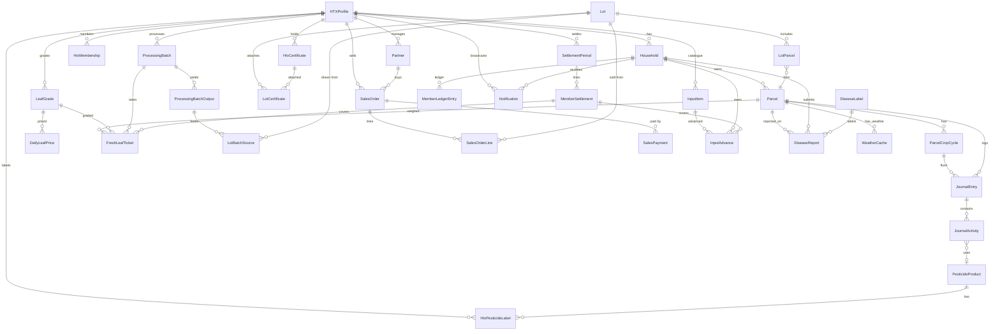

# Database Schema — OpenTea DX-OS

**ORM:** Prisma 5.x · **DB:** PostgreSQL 16 (PostGIS + pgvector) · **Schema file:** `apps/web/prisma/schema.prisma`

> [!IMPORTANT]
> **Nguồn sự thật thực thi:** `apps/web/prisma/schema.prisma` (schema `public`) và `platform/postgres/init/*.sql` (các schema `audit`, `telemetry`, `platform`), cộng với các schema `app_<id>` của Mini-app Tầng 3.
> Từ v1.24.0 các bảng `public` dưới đây khớp từng cột với `schema.prisma` (tên bảng theo `@@map`, tên cột theo tên trường, kiểu theo Postgres mà Prisma sinh); `python3 scripts/check-schema-doc.py` kiểm tên bảng và cột trong CI. **Người dùng nằm ở Keycloak, không có bảng `users`**: các cột `*_by_id`, `recipient_id`, `user_id`, `keycloak_user_id` giữ Keycloak ID dạng chuỗi và không có khoá ngoại. Các sai lệch còn lại so với thiết kế gốc xem `DEV-010` trong [deviation-register.md](./deviation-register.md) và lộ trình hợp nhất trong [product-roadmap.md](./product-roadmap.md).

> **Rule:** n8n is the ONLY writer to `market_data`, `weather_cache`, `bulletins`, `fx_rates` tables.
> All other core `public` tables are written by Next.js API routes via Prisma (and protected by `audit.events` hash-chain triggers).

---

## ERD Overview



---

## Tables

### `htx_profiles`
HTX (Hợp tác xã) master profile. Khoá cô lập đa tenant (`htx_code`, hỗ trợ nhiều HTX trên cùng một triển khai SaaS hoặc cụm Liên minh Tỉnh).

| Column | Type | Constraints | Description |
|--------|------|-------------|-------------|
| id | TEXT | PK |  |
| name | TEXT | NOT NULL |  |
| address | TEXT | NOT NULL |  |
| contact_phone | TEXT | nullable |  |
| contact_email | TEXT | nullable |  |
| crop_types | TEXT[] | NOT NULL | Ví dụ `["Chè Trung du", "Chè Kim Tuyên"]` |
| season_label | TEXT | nullable | Ví dụ `Lứa 1/2026` |
| htx_code | TEXT | NOT NULL, UNIQUE | Mã HTX, dùng cho mã lô và URL công khai (ví dụ `TC`) |
| total_area_ha | DOUBLE PRECISION | NOT NULL, DEFAULT 0 | Tổng diện tích (ha) |
| created_at | TIMESTAMP(3) | NOT NULL, DEFAULT now() |  |
| updated_at | TIMESTAMP(3) | NOT NULL |  |
| public_show_names | BOOLEAN | NOT NULL, DEFAULT false | Hiện tên người (hộ, người ghi nhật ký, thợ sao) trên trang QR công khai; ẩn lúc dựng trang khi `false` (`20261128160100_certificates_and_public_names`, GĐ2) |
| disease_training_consent | BOOLEAN | NOT NULL, DEFAULT false | Cho phép dùng ảnh ca bệnh đã xác nhận để huấn luyện mô hình chè; mặc định tắt, chỉ trưởng HTX (`manager`) bật (`20261128180100_disease_training_consent`, GĐ4-B). Bảng có trigger kiểm toán nên mỗi lần bật/tắt để lại sự kiện kèm người làm |
| disease_training_consent_at | TIMESTAMP(3) | nullable | Lần đổi gần nhất của công tắc trên |
| disease_training_consent_by | TEXT | nullable | Mã người dùng đổi công tắc gần nhất |

---

### `households`
Nông hộ thành viên HTX.

| Column | Type | Constraints | Description |
|--------|------|-------------|-------------|
| id | TEXT | PK |  |
| name | TEXT | NOT NULL | Tên chủ hộ |
| phone | TEXT | NOT NULL, UNIQUE | Dùng làm mã hộ |
| address | TEXT | nullable |  |
| keycloak_user_id | TEXT | nullable | Gắn sau khi tạo tài khoản nông dân |
| bank_bin | TEXT | nullable | BIN ngân hàng nhận tiền; `CHECK` `^[0-9]{6}$` (`20261128150000_member_ledger`, GĐ1 S4) |
| bank_account | TEXT | nullable | Số tài khoản; `CHECK` `^[0-9]{6,19}$`; chỉ `manager` và `accountant` đọc đủ, không vào Hasura, Telegram hay agent |
| bank_account_name | TEXT | nullable | Tên chủ tài khoản, tối đa 60 ký tự (API) |
| created_at | TIMESTAMP(3) | NOT NULL, DEFAULT now() |  |
| updated_at | TIMESTAMP(3) | NOT NULL |  |
| htx_profile_id | TEXT | nullable, FK → htx_profiles (SET NULL) | Nullable: thêm bởi `20260814102205_add_htx_relations`, dòng cũ cần backfill (`scripts/backfill-htx-profile-id.sql`) |

**Index:** `htx_profile_id`

---

### `parcels`
Thửa đất (nương chè). Mỗi hộ có nhiều thửa.

| Column | Type | Constraints | Description |
|--------|------|-------------|-------------|
| id | TEXT | PK |  |
| parcel_code | TEXT | NOT NULL, UNIQUE | Mã thửa, tự sinh, ví dụ `P-TC-001` |
| household_id | TEXT | NOT NULL, FK → households (RESTRICT) |  |
| crop_type | TEXT | NOT NULL |  |
| area_ha | DOUBLE PRECISION | NOT NULL |  |
| centroid_lat | DOUBLE PRECISION | nullable |  |
| centroid_lng | DOUBLE PRECISION | nullable |  |
| polygon_geojson | JSONB | nullable | GeoJSON Polygon feature |
| status | ENUM `ParcelStatus` | NOT NULL, DEFAULT 'DRAFT' | `SOWING` / `TENDING` / `HARVEST_APPROVED` / `HARVESTED` / `DRAFT` |
| estimated_yield_per_ha | DOUBLE PRECISION | nullable | Sản lượng ước tính mỗi ha |
| harvest_approved_by | TEXT | nullable | Keycloak ID của cán bộ duyệt thu hoạch |
| harvest_approved_at | TIMESTAMP(3) | nullable |  |
| created_at | TIMESTAMP(3) | NOT NULL, DEFAULT now() |  |
| updated_at | TIMESTAMP(3) | NOT NULL |  |

---

### `parcel_crop_cycles`
Một dòng là một **lứa hái** của nương chè (hái 7 đến 9 lứa mỗi năm). `journal_entries.cycle_id`, `lot_parcels.cycle_id` và `fresh_leaf_tickets.cycle_id` trỏ tới bảng này.

| Column | Type | Constraints | Description |
|--------|------|-------------|-------------|
| id | TEXT | PK |  |
| parcel_id | TEXT | NOT NULL, FK → parcels (RESTRICT) |  |
| season | TEXT | nullable | Dạng `Lứa n/năm` |
| sowed_at | TIMESTAMP(3) | nullable |  |
| harvested_at | TIMESTAMP(3) | nullable | Rỗng nghĩa là lứa đang mở |
| estimated_harvest_date | TIMESTAMP(3) | nullable |  |
| created_at | TIMESTAMP(3) | NOT NULL, DEFAULT now() |  |

---

### `journal_entries`
Nhật ký canh tác: mỗi dòng một hoạt động của một thửa. Nông dân hoặc cán bộ ghi, cán bộ duyệt.

| Column | Type | Constraints | Description |
|--------|------|-------------|-------------|
| id | TEXT | PK |  |
| parcel_id | TEXT | NOT NULL, FK → parcels (RESTRICT) |  |
| entry_date | TIMESTAMP(3) | NOT NULL |  |
| activity_type | ENUM `ActivityType` | NOT NULL | `SOWING` / `FERTILIZING` / `SPRAYING` / `IRRIGATION` / `HARVEST` / `PRUNING` / `OTHER` |
| performed_by | TEXT | NOT NULL | Tên người thực hiện (chuỗi) |
| submitted_by_id | TEXT | nullable | Keycloak ID người gửi |
| submitted_role | ENUM `UserRole` | NOT NULL | Vai lúc gửi |
| status | TEXT | NOT NULL, DEFAULT 'PENDING_APPROVAL' | TEXT, không phải enum: `DRAFT`, `PENDING_APPROVAL`, `APPROVED`, `REJECTED`, `REQUEST_CHANGES` |
| approved_by_id | TEXT | nullable | Keycloak ID của cán bộ duyệt |
| approved_at | TIMESTAMP(3) | nullable |  |
| review_note | TEXT | nullable | Lý do cán bộ nhập khi từ chối hoặc yêu cầu sửa (`20261124120000_journal_review_note`) |
| reviewed_by_id | TEXT | nullable | Keycloak ID của người duyệt, từ chối hoặc yêu cầu sửa; ghi cùng lúc với cập nhật trạng thái có điều kiện `PENDING_APPROVAL` (`20261124140000_journal_reviewed_by`) |
| notes | TEXT | nullable |  |
| cycle_id | TEXT | nullable, FK → parcel_crop_cycles (SET NULL) | Lứa hái của nhật ký (`20261128120100_flush_and_pesticides`). Rỗng với nhật ký `DRAFT` và nương chưa có lứa; được điền lúc gửi hoặc khi ngày ghi đổi |
| client_id | TEXT | nullable | UUID do máy khách sinh, chống trùng khi gửi lại từ hàng đợi offline |
| weather_condition | TEXT | nullable | Thời tiết ngày đó, tự gắn |
| weather_temperature | DOUBLE PRECISION | nullable | Nhiệt độ, tự gắn |
| weather_precipitation | DOUBLE PRECISION | nullable | Lượng mưa, tự gắn |
| weather_humidity | DOUBLE PRECISION | nullable | Độ ẩm, tự gắn |
| photo_url | TEXT | nullable |  |
| photo_minio_key | TEXT | nullable |  |
| created_at | TIMESTAMP(3) | NOT NULL, DEFAULT now() |  |
| updated_at | TIMESTAMP(3) | NOT NULL |  |

**Khoá duy nhất:** `(submitted_by_id, client_id)`. **Index:** `cycle_id`

---

### `journal_activities`
Chi tiết của một nhật ký (phun thuốc, bón phân, hái...). Kiểu hoạt động nằm ở `journal_entries.activity_type`, enum `ActivityType` = `SOWING`, `FERTILIZING`, `SPRAYING`, `IRRIGATION`, `HARVEST`, `PRUNING`, `OTHER`; `PRUNING` (Đốn chè) thêm bằng migration riêng `20261128120000_activity_pruning` vì giá trị enum mới không dùng được trong giao dịch đã thêm nó.

| Column | Type | Constraints | Description |
|--------|------|-------------|-------------|
| id | TEXT | PK |  |
| journal_entry_id | TEXT | NOT NULL, FK → journal_entries (CASCADE) |  |
| activity_detail | TEXT | NOT NULL | Mô tả hoạt động |
| product_name | TEXT | nullable | Tên thuốc hoặc phân bón (phun, bón) |
| dosage | TEXT | nullable |  |
| withdrawal_days | INT | nullable | Ngày cách ly (phun thuốc) |
| safe_harvest_date | TIMESTAMP(3) | nullable | `entry_date` + `withdrawal_days` |
| fresh_leaf_kg | DOUBLE PRECISION | nullable | Kg búp tươi thu hoạch, chỉ trên hoạt động `HARVEST` (`20261128120200_journal_fresh_leaf_kg`) |
| pesticide_product_id | TEXT | nullable, FK → pesticide_products (SET NULL) | Thuốc trong danh mục; rỗng là "Thuốc khác" (GĐ1 S1) |
| created_at | TIMESTAMP(3) | NOT NULL, DEFAULT now() |  |

---

### `lots`
Lô hàng, đơn vị QR truy xuất nguồn gốc. Quan hệ ngược: `lot_parcels`, `lot_batch_sources`, `lot_certificates`, `sales_order_lines`.

| Column | Type | Constraints | Description |
|--------|------|-------------|-------------|
| id | TEXT | PK |  |
| lot_code | TEXT | NOT NULL, UNIQUE | Ví dụ `TC-CHE-20261110-001` |
| commodity | TEXT | NOT NULL |  |
| quality_grade | TEXT | nullable | `Grade 1` / `Grade 2` / `Ungraded` |
| harvest_date | TIMESTAMP(3) | NOT NULL |  |
| estimated_weight_kg | DOUBLE PRECISION | nullable |  |
| actual_weight_kg | DOUBLE PRECISION | nullable |  |
| packaging_type | TEXT | nullable |  |
| destination | TEXT | nullable | Nơi giao hàng |
| buyer_name | TEXT | nullable | Tên người mua |
| packaging_date | TIMESTAMP(3) | nullable | Lô đóng từ mẻ ghi ngày hôm nay (GĐ2) |
| total_weight_kg | DOUBLE PRECISION | nullable | Tổng kg lấy từ các mẻ (GĐ2) |
| packaging_spec | TEXT | nullable |  |
| status | ENUM `LotStatus` | NOT NULL, DEFAULT 'DRAFT' | `DRAFT` / `READY` / `QR_EXPORTED` |
| qr_image_url | TEXT | nullable | URL ảnh QR trong kho đối tượng |
| certificate_keys | TEXT[] | NOT NULL, DEFAULT '{}' | Khoá tệp chứng nhận (kho đối tượng) cho route tải công khai |
| public_page_data | JSONB | nullable | Ảnh chụp dữ liệu cho trang QR công khai |
| dry_grade | ENUM `DryTeaGrade` | nullable | Hạng chè khô của lô đóng từ mẻ; rỗng với lô tạo trước GĐ2 (`20261128160000_processing_batches`) |
| created_by_id | TEXT | nullable | Keycloak ID của cán bộ tạo lô |
| created_at | TIMESTAMP(3) | NOT NULL, DEFAULT now() |  |
| updated_at | TIMESTAMP(3) | NOT NULL |  |
| htx_profile_id | TEXT | nullable, FK → htx_profiles (SET NULL) |  |

**Index:** `(htx_profile_id, status)`

---

### `lot_parcels`
Bảng nối: thửa nào thuộc lô nào (M-M).

| Column | Type | Constraints | Description |
|--------|------|-------------|-------------|
| id | TEXT | PK |  |
| lot_id | TEXT | NOT NULL, FK → lots (RESTRICT) |  |
| parcel_id | TEXT | NOT NULL, FK → parcels (RESTRICT) |  |
| cycle_id | TEXT | nullable, FK → parcel_crop_cycles (SET NULL) | Lứa của dòng lô: lứa đóng gần nhất không sau ngày hái của lô, nếu không có thì lứa đang mở (`20261128120100_flush_and_pesticides` điền cho dòng cũ). Dòng cũ không có lứa vẫn rỗng |

**Khoá duy nhất:** `(lot_id, parcel_id)`

---

### `partners`
Đối tác nông nghiệp (bản đồ đối tác).

| Column | Type | Constraints | Description |
|--------|------|-------------|-------------|
| id | TEXT | PK |  |
| name | TEXT | NOT NULL |  |
| partner_type | ENUM `PartnerType` | NOT NULL | `BUYER` / `MIDDLEMAN` / `WAREHOUSE` |
| contact_phone | TEXT | nullable |  |
| primary_commodities | TEXT[] | NOT NULL | Nông sản chính |
| lat | DOUBLE PRECISION | NOT NULL | Vĩ độ |
| lng | DOUBLE PRECISION | NOT NULL | Kinh độ |
| address | TEXT | nullable |  |
| htx_profile_id | TEXT | nullable, FK → htx_profiles (SET NULL) | Tenant của đối tác. Mọi đọc và ghi lọc theo cột này, lấy từ phiên, không lấy từ body. Dòng rỗng coi như không tồn tại. Migration `20261128100000_partners_tenant` gán dòng cũ cho HTX `TC`, hoặc cho HTX duy nhất nếu chỉ có một; còn lại để rỗng |
| created_at | TIMESTAMP(3) | NOT NULL, DEFAULT now() |  |
| updated_at | TIMESTAMP(3) | NOT NULL |  |

**Index:** `htx_profile_id`

---

### `notifications`
Thông báo (chuông web, phát chung, đẩy Mattermost). Người dùng nằm ở Keycloak nên `recipient_id` là Keycloak ID, không có khoá ngoại.

| Column | Type | Constraints | Description |
|--------|------|-------------|-------------|
| id | TEXT | PK |  |
| type | ENUM `NotificationType` | NOT NULL | `ANNOUNCEMENT` / `HARVEST_APPROVED` / `DISEASE_REPORT` / `JOURNAL_SUBMITTED` / `JOURNAL_APPROVED` / `MARKET_ALERT` / `SYSTEM` / `BROADCAST` |
| title | TEXT | NOT NULL |  |
| body | TEXT | NOT NULL |  |
| recipient_id | TEXT | nullable | Keycloak ID người nhận; rỗng là thông báo chung |
| household_id | TEXT | nullable, FK → households (SET NULL) |  |
| htx_profile_id | TEXT | nullable, FK → htx_profiles (SET NULL) | HTX sở hữu thông báo chung (`recipient_id` rỗng), `20261109130000_notifications_htx` |
| sender_id | TEXT | nullable | Keycloak ID người gửi |
| is_read | BOOLEAN | NOT NULL, DEFAULT false |  |
| pushed_to_mattermost | BOOLEAN | NOT NULL, DEFAULT false | Đã đẩy sang Mattermost chưa (Story 5.7); n8n quét các dòng chưa đẩy |
| deep_link_url | TEXT | nullable | Liên kết sâu |
| tts_text | TEXT | nullable | Văn bản đọc sẵn (tóm tắt) |
| created_at | TIMESTAMP(3) | NOT NULL, DEFAULT now() |  |

**Index:** `(recipient_id, is_read)`; `htx_profile_id`; `created_at`; `(pushed_to_mattermost, type)`

---

### `disease_reports`
Báo cáo sâu bệnh của nông dân kèm ảnh, kết quả AI và xác nhận của cán bộ.

| Column | Type | Constraints | Description |
|--------|------|-------------|-------------|
| id | TEXT | PK |  |
| parcel_id | TEXT | NOT NULL, FK → parcels (RESTRICT) |  |
| household_id | TEXT | NOT NULL, FK → households (RESTRICT) |  |
| detected_by_id | TEXT | NOT NULL | Keycloak ID nông dân |
| detection_date | TIMESTAMP(3) | NOT NULL |  |
| photo_url | TEXT | NOT NULL | Đường dẫn ảnh trong kho đối tượng |
| photo_minio_key | TEXT | NOT NULL | Khoá đối tượng, dùng để tạo URL mới |
| gps_lat | DOUBLE PRECISION | nullable |  |
| gps_lng | DOUBLE PRECISION | nullable |  |
| ai_disease_name | TEXT | NOT NULL | Tên bệnh mô hình dự đoán |
| ai_confidence | DOUBLE PRECISION | NOT NULL | Độ tin cậy 0 đến 1 |
| confirmed_diagnosis | TEXT | nullable | Chẩn đoán cán bộ tự gõ; vẫn giữ sau khi có nhãn |
| confirmed_by_id | TEXT | nullable | Keycloak ID cán bộ xác nhận |
| confirmed_at | TIMESTAMP(3) | nullable |  |
| treatment_notes | TEXT | nullable | Ghi chú nội bộ của cán bộ, không hiện cho nông dân |
| treatment_recommendation | TEXT | nullable | Lời khuyên điều trị hiện cho nông dân |
| confirmed_label_code | TEXT | nullable, FK → disease_labels (SET NULL) | Nhãn cán bộ chọn khi duyệt (`20261128180000_disease_labels`, GĐ4-B); bắt buộc ở tầng ứng dụng khi `status = CONFIRMED`. Báo cáo cũ được gán nhãn khi `confirmed_diagnosis` khớp đúng `disease_labels.name_vi`, không khớp thì để trống |
| model_version | TEXT | nullable | Phiên bản mô hình AI đã dự đoán (ví dụ `tea-2026.11.0`); rỗng với mô hình chung hoặc báo cáo cũ |
| status | ENUM `DiseaseReportStatus` | NOT NULL, DEFAULT 'PENDING' | `PENDING` / `CONFIRMED` / `REJECTED` |
| created_at | TIMESTAMP(3) | NOT NULL, DEFAULT now() |  |
| updated_at | TIMESTAMP(3) | NOT NULL |  |

**Index:** `confirmed_label_code`

---

### `disease_labels`
Danh mục nhãn duy nhất cho sâu bệnh chè (`20261128180000_disease_labels`, GĐ4-B). Cán bộ chọn nhãn từ đây khi duyệt; mô hình chè huấn luyện theo các mã này. Ghi bởi migration; có trigger kiểm toán `dxos_audit_row` (cũng nằm trong `03-audit-triggers.sql`).

| Column | Type | Constraints | Description |
|--------|------|-------------|-------------|
| code | TEXT | PK | Mã lớp, tiếng Anh, ví dụ `green_leafhopper` |
| name_vi | TEXT | NOT NULL | Tên tiếng Việt hiển thị |
| scientific_name | TEXT | nullable | Tên khoa học (chỉ ghi khi chắc chắn) |
| group | ENUM `DiseaseLabelGroup` | NOT NULL | Sâu, bệnh, khoẻ, khác: `PEST` / `DISEASE` / `HEALTHY` / `OTHER` |
| is_target | BOOLEAN | NOT NULL, DEFAULT false | Một trong năm mục tiêu của GĐ4-B |
| sort_order | INT | NOT NULL | Thứ tự trong danh sách (mục tiêu trước) |

**Dữ liệu gieo (14 dòng):** năm mục tiêu `green_leafhopper` Rầy xanh, `tea_thrips` Bọ cánh tơ, `red_spider_mite` Nhện đỏ, `blister_blight` Phồng lá chè, `helopeltis` Bọ xít muỗi; sáu lớp còn lại của mô hình hiện có (`algal_leaf_spot`, `birds_eye_spot`, `brown_blight`, `gray_blight`, `red_leaf_spot`, `white_spot`, tên theo `ai-models/tea_class_names_vi.json`); và `healthy` (Lá khoẻ), `not_tea_leaf` (Không phải lá chè), `other` (Khác).

---

### `market_data`
Dữ liệu thị trường thô từ API ngoài. *(chỉ n8n ghi)*

| Column | Type | Constraints | Description |
|--------|------|-------------|-------------|
| id | UUID | PK, DEFAULT gen_random_uuid() |  |
| source | TEXT | NOT NULL | `USDA`, `WTO`, `FAOSTAT`, `NASA`... |
| commodity | TEXT | NOT NULL |  |
| metric | TEXT | NOT NULL | `export_price`, `import_tariff`, `production_volume`... |
| value | DOUBLE PRECISION | NOT NULL |  |
| unit | TEXT | NOT NULL |  |
| period | TEXT | NOT NULL | `2026-07`, `2026` hoặc `2026-W30` |
| fetched_at | TIMESTAMP(3) | NOT NULL, DEFAULT now() |  |

**Khoá duy nhất:** `(source, commodity, metric, period)`. **Index:** `(commodity, fetched_at)`

---

### `weather_cache`
Cache thời tiết theo thửa (Open-Meteo, mỗi giờ). *(chỉ n8n ghi)*

| Column | Type | Constraints | Description |
|--------|------|-------------|-------------|
| id | UUID | PK, DEFAULT gen_random_uuid() |  |
| parcel_id | TEXT | NOT NULL, FK → parcels (RESTRICT) |  |
| recorded_at | TIMESTAMP(3) | NOT NULL | Giờ đã làm tròn xuống |
| condition | TEXT | NOT NULL |  |
| temperature_c | DOUBLE PRECISION | NOT NULL |  |
| precipitation_mm | DOUBLE PRECISION | NOT NULL |  |
| humidity_pct | DOUBLE PRECISION | NOT NULL |  |
| source | TEXT | NOT NULL, DEFAULT 'open-meteo' | Nguồn dữ liệu |
| forecast_json | JSONB | nullable | Dự báo |

**Khoá duy nhất:** `(parcel_id, recorded_at)`

---

### `bulletins`
Bản tin thị trường do AI tổng hợp. *(n8n + Ollama ghi; agent đăng bản của HTX)* Agent `bulletin.publish` đánh dấu các dòng mới nhất cũ của HTX là không mới nhất rồi thêm một dòng có `htx_code`. Nơi đọc (`/api/bulletin`, `/api/tts`, trang manager và officer, Hasura `public_bulletins`) hiện dòng đã đăng của HTX trước, rồi mới đến dòng chung mới nhất.

| Column | Type | Constraints | Description |
|--------|------|-------------|-------------|
| id | UUID | PK, DEFAULT gen_random_uuid() |  |
| commodity | TEXT | NOT NULL |  |
| bulletin_vi | TEXT | NOT NULL | Bản tin tiếng Việt (Ollama) |
| sources_json | JSONB | NOT NULL | Trích dẫn `[{source, metric, value, date}]` |
| model_used | TEXT | NOT NULL | Mô hình tạo bản tin; `agent:bulletin` với bản do agent đăng |
| is_latest | BOOLEAN | NOT NULL, DEFAULT false | Chỉ một dòng `true` cho mỗi nông sản (và mỗi HTX) |
| status | TEXT | NOT NULL, DEFAULT 'published' | `CHECK` `draft | published | rejected` (`20261125130000_bulletin_status_and_cooperative`). Chỉ đọc dòng `published`; bản nháp không lưu (văn bản nằm trong đề xuất) nên `draft` và `rejected` để dành |
| htx_code | TEXT | nullable | HTX sở hữu; rỗng là bản tin chung do workflow n8n ghi |
| created_at | TIMESTAMP(3) | NOT NULL, DEFAULT now() |  |

**Index:** `(commodity, is_latest)`; `(htx_code, commodity, is_latest)`

---

### `fx_rates`
Tỷ giá USD/VND (Frankfurter API). *(chỉ n8n ghi)*

| Column | Type | Constraints | Description |
|--------|------|-------------|-------------|
| id | UUID | PK, DEFAULT gen_random_uuid() |  |
| rates | JSONB | NOT NULL | Toàn bộ tỷ giá (VND, CNY, JPY...) |
| fetched_at | TIMESTAMPTZ | NOT NULL, DEFAULT now()) @db.Timestamptz(6 |  |

---

### `chat_history`
Lịch sử chat của trợ lý (thị trường hoặc kỹ thuật). Người dùng nằm ở Keycloak nên `user_id` là Keycloak ID, không có khoá ngoại.

| Column | Type | Constraints | Description |
|--------|------|-------------|-------------|
| id | TEXT | PK |  |
| session_id | TEXT | NOT NULL | Mã phiên chat |
| user_id | TEXT | NOT NULL | Keycloak ID người chat |
| role | ENUM `ChatRole` | NOT NULL | `USER` / `ASSISTANT` |
| content | TEXT | NOT NULL |  |
| sources_json | JSONB | nullable | Trích dẫn `[{source, date, url}]` |
| chat_type | TEXT | NOT NULL | `market` hoặc `technical` |
| created_at | TIMESTAMP(3) | NOT NULL, DEFAULT now() |  |

**Index:** `(session_id, created_at)`; `(user_id, created_at)`

---

### Chuỗi giá trị chè (GĐ1 S1 đến S3)

Các bảng dưới đây thêm bởi năm migration `apps/web/prisma/migrations/20261128120000_*`, `20261128120100_*`, `20261128120200_*`, `20261128130000_*` và `20261128140000_*`. Id là TEXT (cuid), thời gian là `TIMESTAMP(3)`.

**Trigger kiểm toán.** Cả sáu bảng mới có trigger `dxos_audit_row` (`AFTER INSERT OR UPDATE OR DELETE`, hàm `audit.capture_row()`): `platform/postgres/init/03-audit-triggers.sql` cài cho cơ sở dữ liệu mới, còn mỗi migration tạo trigger cho cơ sở dữ liệu đang chạy (bỏ qua khi chưa có schema `audit`). Cột bảng cũ thêm ở GĐ1 nằm trong bảng đã có trigger.

#### `pesticide_products`
Danh mục thuốc BVTV dùng chung mọi HTX (`20261128120100`). Ghi bởi migration (20 dòng khởi đầu) và `platform_admin` (`PUT /api/platform/pesticides/[id]`). Trigger kiểm toán: có.

| Column | Type | Constraints | Description |
|--------|------|-------------|-------------|
| id | TEXT | PK | |
| trade_name | TEXT | UNIQUE, NOT NULL | Tên thương mại |
| active_ingredient | TEXT | NOT NULL | Hoạt chất |
| group | ENUM `PesticideGroup` | NOT NULL | `BOTANICAL`, `MICROBIAL`, `BIOLOGICAL`, `CHEMICAL`, `ANTIBIOTIC` |
| targets | TEXT[] | NOT NULL | Đối tượng phòng trừ |
| default_phi_days | INT | NOT NULL | Mức sàn cách ly mặc định: 7 (thảo mộc, vi sinh, sinh học) hoặc 14 (hoá học, kháng sinh) |
| phi_needs_label_check | BOOLEAN | NOT NULL, DEFAULT true | Còn cần đối chiếu nhãn thực tế |
| source | TEXT | NOT NULL | Văn bản nguồn |
| active | BOOLEAN | NOT NULL, DEFAULT true | |
| created_at, updated_at | TIMESTAMP(3) | NOT NULL | |

#### `htx_pesticide_labels`
Số ngày cách ly theo nhãn thật mà một HTX đã đối chiếu; thay mức sàn mặc định cho HTX đó (`20261128120100`). Ghi bởi `officer`, `manager`. Trigger kiểm toán: có.

| Column | Type | Constraints | Description |
|--------|------|-------------|-------------|
| id | TEXT | PK | |
| htx_profile_id | TEXT | FK → htx_profiles (RESTRICT), NOT NULL | |
| pesticide_product_id | TEXT | FK → pesticide_products (RESTRICT), NOT NULL | |
| label_phi_days | INT | NOT NULL, `CHECK` 1..365 | |
| label_note | TEXT | nullable | Số lô hoặc nội dung nhãn; API bắt buộc khi thấp hơn mức mặc định |
| verified_by_id | TEXT | NOT NULL | Keycloak sub của người đối chiếu |
| verified_at | TIMESTAMP(3) | NOT NULL, DEFAULT now() | |
| created_at, updated_at | TIMESTAMP(3) | NOT NULL | |

**Index:** khoá duy nhất `(htx_profile_id, pesticide_product_id)`.

#### `htx_memberships`
Các vai của một người trong một HTX (`20261128130000`). Keycloak là nguồn sự thật; `requireTenant()` đồng bộ dòng này từ token. Trigger kiểm toán: có.

| Column | Type | Constraints | Description |
|--------|------|-------------|-------------|
| id | TEXT | PK | |
| keycloak_user_id | TEXT | NOT NULL | |
| htx_profile_id | TEXT | FK → htx_profiles (RESTRICT), NOT NULL | |
| roles | TEXT[] | NOT NULL | Tập con của `farmer`, `officer`, `accountant`, `manager`; không có `platform_admin` |
| created_at, updated_at | TIMESTAMP(3) | NOT NULL | |

**Index:** khoá duy nhất `(keycloak_user_id, htx_profile_id)`; `htx_profile_id`.

#### `leaf_grades`
Phẩm cấp búp tươi của từng HTX (`20261128140000`). Ghi bởi `manager`. Trigger kiểm toán: có.

| Column | Type | Constraints | Description |
|--------|------|-------------|-------------|
| id | TEXT | PK | |
| htx_profile_id | TEXT | FK → htx_profiles (RESTRICT), NOT NULL | |
| name | TEXT | NOT NULL | |
| sort_order | INT | NOT NULL, DEFAULT 0 | |
| active | BOOLEAN | NOT NULL, DEFAULT true | Phẩm cấp ẩn không cân được |
| created_at, updated_at | TIMESTAMP(3) | NOT NULL | |

**Index:** khoá duy nhất `(htx_profile_id, name)`.

#### `daily_leaf_prices`
Một giá mỗi phẩm cấp mỗi ngày giờ Việt Nam (`20261128140000`). Ghi bởi `manager` (`PUT /api/leaf-prices/today`). Trigger kiểm toán: có.

| Column | Type | Constraints | Description |
|--------|------|-------------|-------------|
| id | TEXT | PK | |
| htx_profile_id | TEXT | FK → htx_profiles (RESTRICT), NOT NULL | |
| grade_id | TEXT | FK → leaf_grades (RESTRICT), NOT NULL | |
| price_date | DATE | NOT NULL | Ngày giờ Việt Nam |
| price_vnd_per_kg | INT | NOT NULL, `CHECK` 1..10000000 | |
| published_by_id | TEXT | NOT NULL | Keycloak sub |
| published_at | TIMESTAMP(3) | NOT NULL, DEFAULT now() | |
| updated_at | TIMESTAMP(3) | NOT NULL | |

**Index:** khoá duy nhất `(grade_id, price_date)`; `(htx_profile_id, price_date)`.

#### `fresh_leaf_tickets`
Phiếu cân búp tươi; ghi một lần, không sửa (sai thì huỷ và cân lại) (`20261128140000`). Ghi bởi `accountant`, `manager`. Trigger kiểm toán: có.

| Column | Type | Constraints | Description |
|--------|------|-------------|-------------|
| id | TEXT | PK | |
| htx_profile_id | TEXT | FK → htx_profiles (RESTRICT), NOT NULL | |
| ticket_no | TEXT | UNIQUE, NOT NULL | `{HTX_CODE}-PC-{YYYYMMDD}-{NNN}` |
| household_id | TEXT | FK → households (RESTRICT), NOT NULL | |
| parcel_id | TEXT | FK → parcels (RESTRICT), NOT NULL | |
| cycle_id | TEXT | nullable FK → parcel_crop_cycles (SET NULL) | Rỗng với nương chưa từng có lứa |
| grade_id | TEXT | FK → leaf_grades (RESTRICT), NOT NULL | |
| weighed_at | TIMESTAMP(3) | NOT NULL | Giờ máy chủ |
| gross_kg | DECIMAL(7,1) | NOT NULL, `CHECK` > 0 và <= 5000 | |
| deduction_pct | DECIMAL(4,1) | NOT NULL, `CHECK` 0..30 | |
| net_kg | DECIMAL(7,1) | NOT NULL | |
| price_vnd_per_kg | INT | NOT NULL, `CHECK` 1..10000000 | Giá chép lúc ghi |
| amount_vnd | BIGINT | NOT NULL | Thành tiền, đồng |
| status | ENUM `LeafTicketStatus` | NOT NULL, DEFAULT 'VALID' | `VALID`, `VOIDED` |
| void_reason, voided_by_id, voided_at | TEXT, TEXT, TIMESTAMP(3) | nullable | Điền khi huỷ |
| created_by_id | TEXT | NOT NULL | Keycloak sub người cân |
| client_id | TEXT | nullable | Chống trùng khi gửi lại |
| processing_batch_id | TEXT | nullable FK → processing_batches (RESTRICT), index | Mẻ sao chứa phiếu (một phiếu một mẻ); phiếu có giá trị này không huỷ được (`20261128160000_processing_batches`, GĐ2) |
| settlement_id | TEXT | nullable FK → member_settlements (RESTRICT) | Dòng quyết toán chứa phiếu; khoá ngoại thêm ở `20261128150000_member_ledger`. Phiếu có giá trị này không huỷ được |
| created_at | TIMESTAMP(3) | NOT NULL, DEFAULT now() | |

**Index:** khoá duy nhất `(created_by_id, client_id)`; `(htx_profile_id, weighed_at)`; `household_id`; `parcel_id`; `cycle_id`.

### Vật tư ứng, sổ cái và quyết toán (GĐ1 S4)

Thêm bởi migration `20261128150000_member_ledger`, cùng ba cột ngân hàng của `households` ở trên và khoá ngoại `fresh_leaf_tickets.settlement_id`. Enum mới: `InputKind` (`FERTILIZER`, `PESTICIDE`, `OTHER`), `SettlementStatus` (`DRAFT`, `CLOSED`), `LedgerEntryType` (`LEAF_CREDIT`, `INPUT_DEBIT`, `PAYOUT`, `ADJUSTMENT`), `PaymentMethod` (`TRANSFER`, `CASH`); `input_advances.status` dùng lại `LeafTicketStatus`. Số tiền là BIGINT đồng (trừ `unit_price_vnd` là INT).

**Trigger.** Cả năm bảng có trigger kiểm toán `dxos_audit_row` (`audit.capture_row()`), cài bởi `03-audit-triggers.sql` cho cơ sở dữ liệu mới và bởi migration cho cơ sở dữ liệu đang chạy (bỏ qua khi chưa có schema `audit`). Riêng `member_ledger_entries` còn có trigger **chỉ thêm**: `member_ledger_entries_append_only` (`BEFORE UPDATE OR DELETE`, theo dòng) và `member_ledger_entries_no_truncate` (`BEFORE TRUNCATE`) cùng gọi `public.member_ledger_entries_refuse_change()`, hàm này ném lỗi `restrict_violation`; sửa sai bằng dòng `ADJUSTMENT` mới.

#### `input_items`
Danh mục vật tư của HTX. Ghi bởi `manager`, `accountant`. Trigger kiểm toán: có.

| Column | Type | Constraints | Description |
|--------|------|-------------|-------------|
| id | TEXT | PK | |
| htx_profile_id | TEXT | FK → htx_profiles (RESTRICT), NOT NULL | |
| name | TEXT | NOT NULL | |
| unit | TEXT | NOT NULL | |
| unit_price_vnd | INT | NOT NULL, `CHECK` 0..100000000 | |
| kind | ENUM `InputKind` | NOT NULL | |
| pesticide_product_id | TEXT | nullable FK → pesticide_products (SET NULL) | Chỉ với loại `PESTICIDE` (API kiểm) |
| active | BOOLEAN | NOT NULL, DEFAULT true | |
| created_at, updated_at | TIMESTAMP(3) | NOT NULL | |

**Index:** khoá duy nhất `(htx_profile_id, name)`.

#### `input_advances`
Phiếu ứng vật tư; ghi một lần, sai thì huỷ và ghi lại. Ghi bởi `accountant`, `manager`. Trigger kiểm toán: có.

| Column | Type | Constraints | Description |
|--------|------|-------------|-------------|
| id | TEXT | PK | |
| htx_profile_id | TEXT | FK → htx_profiles (RESTRICT), NOT NULL | |
| advance_no | TEXT | UNIQUE, NOT NULL | `{HTX_CODE}-VT-{YYYYMMDD}-{NNN}` |
| household_id | TEXT | FK → households (RESTRICT), NOT NULL | |
| item_id | TEXT | FK → input_items (RESTRICT), NOT NULL | |
| quantity | DECIMAL(9,2) | NOT NULL, `CHECK` > 0 | |
| unit_price_vnd | INT | NOT NULL, `CHECK` >= 0 | Chép từ vật tư lúc ghi |
| amount_vnd | BIGINT | NOT NULL, `CHECK` >= 0 | Số lượng × đơn giá, làm tròn đồng, nửa làm tròn lên |
| advanced_on | DATE | NOT NULL | Ngày giờ Việt Nam |
| status | ENUM `LeafTicketStatus` | NOT NULL, DEFAULT 'VALID' | `VALID`, `VOIDED` |
| void_reason, voided_by_id, voided_at | TEXT, TEXT, TIMESTAMP(3) | nullable | Điền khi huỷ |
| settlement_id | TEXT | nullable FK → member_settlements (RESTRICT) | Có giá trị thì không huỷ được |
| client_id | TEXT | nullable | Chống trùng khi gửi lại |
| created_by_id | TEXT | NOT NULL | Keycloak sub |
| created_at | TIMESTAMP(3) | NOT NULL, DEFAULT now() | |

**Index:** khoá duy nhất `(created_by_id, client_id)`; `(htx_profile_id, advanced_on)`; `household_id`.

#### `settlement_periods`
Kỳ quyết toán của HTX. Ghi bởi `accountant`, `manager` (tạo) và `manager` (chốt). Trigger kiểm toán: có.

| Column | Type | Constraints | Description |
|--------|------|-------------|-------------|
| id | TEXT | PK | |
| htx_profile_id | TEXT | FK → htx_profiles (RESTRICT), NOT NULL | |
| code | TEXT | UNIQUE, NOT NULL | `{HTX_CODE}-QT-{YYYYMMDD}` theo `date_to` |
| date_from, date_to | DATE | NOT NULL, `CHECK` `date_from <= date_to` | |
| status | ENUM `SettlementStatus` | NOT NULL, DEFAULT 'DRAFT' | |
| created_by_id | TEXT | NOT NULL | Keycloak sub |
| created_by_name | TEXT | nullable | Tên hiển thị lúc tạo |
| created_at | TIMESTAMP(3) | NOT NULL, DEFAULT now() | |
| closed_by_id, closed_by_name, closed_at | TEXT, TEXT, TIMESTAMP(3) | nullable | Người và giờ chốt |

**Index:** khoá duy nhất `code`; `(htx_profile_id, date_from)`. Tính liền nhau của các kỳ và một kỳ `DRAFT` mỗi HTX do ứng dụng giữ dưới khoá tư vấn, không có ràng buộc cơ sở dữ liệu.

#### `member_settlements`
Một dòng cho mỗi hộ trong mỗi kỳ đã chốt. Ghi lúc chốt (`manager`); `paid_*` ghi lúc chi trả. Trigger kiểm toán: có.

| Column | Type | Constraints | Description |
|--------|------|-------------|-------------|
| id | TEXT | PK | |
| period_id | TEXT | FK → settlement_periods (RESTRICT), NOT NULL | |
| household_id | TEXT | FK → households (RESTRICT), NOT NULL | |
| leaf_net_kg | DECIMAL(10,1) | NOT NULL | Tổng kg tịnh |
| leaf_amount_vnd | BIGINT | NOT NULL | `L`, tiền búp |
| advances_vnd | BIGINT | NOT NULL | `A`, tiền vật tư |
| debt_in_vnd | BIGINT | NOT NULL, `CHECK` >= 0 | Nợ mang vào, chỉ để hiện |
| payable_vnd | BIGINT | NOT NULL, `CHECK` >= 0 | `max(0, L − A + outstanding)` |
| debt_out_vnd | BIGINT | NOT NULL, `CHECK` >= 0 | `max(0, −(L − A + outstanding))` |
| paid_at, paid_by_id | TIMESTAMP(3), TEXT | nullable | Điền khi ghi trả (một lần) |
| payment_method | ENUM `PaymentMethod` | nullable | |
| payment_ref | TEXT | nullable | |

**Index:** khoá duy nhất `(period_id, household_id)`; `household_id`.

#### `member_ledger_entries`
Sổ cái xã viên, **chỉ thêm** (xem trigger ở trên). Dương là HTX nợ hộ, âm là hộ nợ HTX. Ghi lúc chốt kỳ (`LEAF_CREDIT`, `INPUT_DEBIT`), chi trả (`PAYOUT`) và điều chỉnh (`ADJUSTMENT`). Trigger kiểm toán: có.

| Column | Type | Constraints | Description |
|--------|------|-------------|-------------|
| id | TEXT | PK | |
| htx_profile_id | TEXT | FK → htx_profiles (RESTRICT), NOT NULL | |
| household_id | TEXT | FK → households (RESTRICT), NOT NULL | |
| entry_type | ENUM `LedgerEntryType` | NOT NULL | |
| amount_vnd | BIGINT | NOT NULL | Có dấu |
| ticket_id, advance_id | TEXT | nullable | Cột có sẵn, mã hiện chưa điền |
| settlement_id | TEXT | nullable FK → member_settlements (RESTRICT) | Dòng quyết toán của bút toán; rỗng với `ADJUSTMENT` |
| note | TEXT | nullable | Mã tham chiếu chi trả hoặc lý do điều chỉnh |
| created_by_id | TEXT | NOT NULL | Keycloak sub |
| created_at | TIMESTAMP(3) | NOT NULL, DEFAULT now() | |

**Index:** `(household_id, created_at)`.

### Mẻ sao sấy, lô từ mẻ và chứng nhận (GĐ2)

Thêm bởi hai migration `20261128160000_processing_batches` và `20261128160100_certificates_and_public_names`, cùng các cột `fresh_leaf_tickets.processing_batch_id`, `lots.dry_grade` và `htx_profiles.public_show_names` đã ghi ở các bảng trên. Enum mới: `ProcessingBatchStatus` (`OPEN`, `FINISHED`, `CANCELLED`), `DryTeaGrade` (`DINH`, `TOM_NON`, `MOC_CAU`, `BOM`, `CAM`), `CertificateKind` (`VIETGAP`, `OCOP`, `ORGANIC`, `OTHER`). Id là TEXT (cuid), thời gian `TIMESTAMP(3)`.

**Trigger kiểm toán.** Cả năm bảng mới có trigger `dxos_audit_row` (`audit.capture_row()`), cài bởi `03-audit-triggers.sql` cho cơ sở dữ liệu mới và bởi migration cho cơ sở dữ liệu đang chạy (bỏ qua khi chưa có schema `audit`). Các giao dịch mẻ, chứng nhận và đóng lô đặt `dxos.actor`. `lot_certificates` có `id` riêng (cùng khoá duy nhất `(lot_id, certificate_id)`) để dòng kiểm toán có khoá hàng, vì `audit.capture_row()` lấy khoá hàng từ cột `id`.

#### `processing_batches`
Mẻ sao sấy. Ghi bởi `officer`, `manager`. Trigger kiểm toán: có.

| Column | Type | Constraints | Description |
|--------|------|-------------|-------------|
| id | TEXT | PK | |
| htx_profile_id | TEXT | FK → htx_profiles (RESTRICT), NOT NULL | |
| batch_code | TEXT | UNIQUE, NOT NULL | `{HTX_CODE}-MS-{YYYYMMDD}-{NN}` |
| processed_on | DATE | NOT NULL | Ngày chế biến (giờ Việt Nam) |
| status | ENUM `ProcessingBatchStatus` | NOT NULL, DEFAULT 'OPEN' | |
| master_name, shift, notes | TEXT | nullable | Thợ sao, ca, ghi chú |
| fresh_kg, dry_kg | DECIMAL(10,1) | nullable, `CHECK` >= 0 | Chốt lúc hoàn thành |
| recovery_ratio | DECIMAL(5,2) | nullable, `CHECK` > 0 | `fresh_kg / dry_kg`, làm tròn 2 chữ số |
| out_of_band | BOOLEAN | NOT NULL, DEFAULT false | Ngoài khoảng 4,50 đến 5,00 |
| deviation_note | TEXT | nullable | Giải trình khi lệch (API bắt buộc từ 10 ký tự) |
| created_by_id | TEXT | NOT NULL | Keycloak sub |
| created_at | TIMESTAMP(3) | NOT NULL, DEFAULT now() | |
| finished_by_id, finished_at | TEXT, TIMESTAMP(3) | nullable | |
| cancelled_by_id, cancelled_at, cancel_reason | TEXT, TIMESTAMP(3), TEXT | nullable | |

**Index:** khoá duy nhất `batch_code`; `(htx_profile_id, processed_on)`; `fresh_leaf_tickets(processing_batch_id)`.

#### `processing_batch_outputs`
Sản lượng chè khô theo hạng của một mẻ. Trigger kiểm toán: có.

| Column | Type | Constraints | Description |
|--------|------|-------------|-------------|
| id | TEXT | PK | |
| batch_id | TEXT | FK → processing_batches (RESTRICT), NOT NULL | |
| grade | ENUM `DryTeaGrade` | NOT NULL | |
| kg | DECIMAL(9,1) | NOT NULL, `CHECK` > 0 và <= 100000 | |

**Index:** khoá duy nhất `(batch_id, grade)`.

#### `lot_batch_sources`
Phần kg của một lô lấy từ một dòng sản lượng. Tồn của dòng = `kg` − tổng `lot_batch_sources.kg`. Ghi lúc đóng lô. Trigger kiểm toán: có.

| Column | Type | Constraints | Description |
|--------|------|-------------|-------------|
| id | TEXT | PK | |
| lot_id | TEXT | FK → lots (RESTRICT), NOT NULL | |
| output_id | TEXT | FK → processing_batch_outputs (RESTRICT), NOT NULL | |
| kg | DECIMAL(9,1) | NOT NULL, `CHECK` > 0 | |

**Index:** khoá duy nhất `(lot_id, output_id)`; `output_id`.

#### `htx_certificates`
Chứng nhận của HTX kèm tệp. Không xoá; thu hồi bằng `revoked_at`. Ghi bởi `officer`, `manager` (thu hồi: `manager`). Trigger kiểm toán: có.

| Column | Type | Constraints | Description |
|--------|------|-------------|-------------|
| id | TEXT | PK | |
| htx_profile_id | TEXT | FK → htx_profiles (RESTRICT), NOT NULL | |
| kind | ENUM `CertificateKind` | NOT NULL | |
| number | TEXT | NOT NULL | `CHECK` tối đa 60 ký tự |
| issuer | TEXT | NOT NULL | `CHECK` tối đa 120 ký tự |
| issued_on, expires_on | DATE | NOT NULL, `CHECK` `expires_on >= issued_on` | |
| scope_note | TEXT | nullable | `CHECK` tối đa 200 ký tự |
| file_key | TEXT | NOT NULL | `para/<htx_code>/Certificates/<uuid>-<tên>` |
| file_name, file_mime | TEXT | NOT NULL | Tên đã làm sạch; `application/pdf`, `image/jpeg` hoặc `image/png` |
| file_size | INT | NOT NULL, `CHECK` > 0 và <= 10485760 | Byte |
| created_by_id | TEXT | NOT NULL | Keycloak sub |
| created_at | TIMESTAMP(3) | NOT NULL, DEFAULT now() | |
| revoked_at, revoked_by_id, revoke_reason | TIMESTAMP(3), TEXT, TEXT | nullable | Điền khi thu hồi |

**Index:** `(htx_profile_id, expires_on)`. Trạng thái `VALID`, `EXPIRED`, `REVOKED` tính lúc đọc, không có cột.

#### `lot_certificates`
Chứng nhận gắn vào lô lúc xuất QR. Trigger kiểm toán: có.

| Column | Type | Constraints | Description |
|--------|------|-------------|-------------|
| id | TEXT | PK | Khoá riêng, để dòng kiểm toán có khoá hàng |
| lot_id | TEXT | FK → lots (RESTRICT), NOT NULL | |
| certificate_id | TEXT | FK → htx_certificates (RESTRICT), NOT NULL | |

**Index:** khoá duy nhất `(lot_id, certificate_id)`.

### Bán hàng gắn lô (GĐ3 S8)

Thêm bởi migration `20261128170000_sales`. Enum mới: `SalesKind` (`WHOLESALE`, `RETAIL`), `SalesSource` (`CORE`, `TEA_SHOP`), `SalesStatus` (`CONFIRMED`, `CANCELLED`); `sales_payments.method` dùng lại `PaymentMethod` (`TRANSFER`, `CASH`). Tiền là BIGINT đồng (trừ `price_vnd_per_kg` là INT), khối lượng là INT gam.

**Trigger.** Cả ba bảng có trigger kiểm toán `dxos_audit_row` (`audit.capture_row()`), cài bởi `03-audit-triggers.sql` cho cơ sở dữ liệu mới và bởi migration cho cơ sở dữ liệu đang chạy (bỏ qua khi chưa có schema `audit`); các giao dịch bán hàng đặt `dxos.actor`. `sales_payments` còn có trigger **chỉ thêm**: `sales_payments_append_only` (`BEFORE UPDATE OR DELETE`, theo dòng) và `sales_payments_no_truncate` (`BEFORE TRUNCATE`) cùng gọi `public.sales_payments_refuse_change()`, hàm này ném lỗi `restrict_violation`. Khoản thu sai không sửa được; đơn đã có khoản thu không huỷ được (do ứng dụng giữ).

#### `sales_orders`
Đơn bán sỉ (lõi) và đơn lẻ (mini-app). Ghi bởi `manager`, `accountant` (huỷ: `manager`) và, qua Core Action API, bởi token của `manager`. Trigger kiểm toán: có.

| Column | Type | Constraints | Description |
|--------|------|-------------|-------------|
| id | TEXT | PK | |
| htx_profile_id | TEXT | FK → htx_profiles (RESTRICT), NOT NULL | |
| order_no | TEXT | UNIQUE, NOT NULL | `{HTX_CODE}-DH-{YYYYMMDD}-{NNN}` theo ngày đặt |
| kind | ENUM `SalesKind` | NOT NULL | |
| source | ENUM `SalesSource` | NOT NULL, DEFAULT 'CORE' | Đơn lẻ của tea-shop là `TEA_SHOP` |
| external_ref | TEXT | nullable | Mã đơn của mini-app; duy nhất cùng `(htx_profile_id, source)` |
| partner_id | TEXT | nullable FK → partners (SET NULL) | Bắt buộc với `WHOLESALE` |
| customer_name | TEXT | nullable | Tên khách lẻ |
| ordered_on | DATE | NOT NULL | Ngày giờ Việt Nam |
| due_on | DATE | nullable | Hạn thanh toán, chỉ đơn sỉ |
| status | ENUM `SalesStatus` | NOT NULL, DEFAULT 'CONFIRMED' | |
| total_vnd | BIGINT | NOT NULL, `CHECK` >= 0 | Tổng các dòng |
| note | TEXT | nullable | |
| created_by_id | TEXT | NOT NULL | Keycloak sub |
| created_at | TIMESTAMP(3) | NOT NULL, DEFAULT now() | |
| cancelled_by_id, cancelled_at, cancel_reason | TEXT, TIMESTAMP(3), TEXT | nullable | Điền khi huỷ |

**CHECK:** `sales_orders_due_check` (`due_on` rỗng hoặc không trước `ordered_on`); `sales_orders_kind_check` (`WHOLESALE` thì có `partner_id`; `RETAIL` thì `due_on` rỗng). **Index:** khoá duy nhất `order_no`; khoá duy nhất `(htx_profile_id, source, external_ref)` (nhiều dòng `external_ref` rỗng vẫn hợp lệ); `(htx_profile_id, ordered_on)`; `(htx_profile_id, kind, status, due_on)`; `partner_id`.

#### `sales_order_lines`
Một dòng bán một lô. Trigger kiểm toán: có.

| Column | Type | Constraints | Description |
|--------|------|-------------|-------------|
| id | TEXT | PK | |
| order_id | TEXT | FK → sales_orders (RESTRICT), NOT NULL | |
| lot_id | TEXT | FK → lots (RESTRICT), NOT NULL | |
| net_g | INT | NOT NULL, `CHECK` > 0 | Khối lượng tịnh bán, gam |
| pack_count, pack_net_g | INT | nullable | Dòng lẻ: số gói và gam mỗi gói |
| price_vnd_per_kg | INT | nullable | Chỉ dòng sỉ |
| amount_vnd | BIGINT | NOT NULL, `CHECK` >= 0 | Dòng sỉ: giá × gam / 1000, làm tròn đồng, nửa lên |

**CHECK:** `sales_order_lines_packs_check` (`pack_count` và `pack_net_g` cùng rỗng, hoặc cùng lớn hơn 0 và `net_g = pack_count × pack_net_g`). **Index:** `order_id`; `lot_id`. Tồn của lô = sức chứa − tổng `net_g` của các dòng thuộc đơn `CONFIRMED` (mục 3.28 của [rules-and-limits.md](./rules-and-limits.md)).

#### `sales_payments`
Khoản thu của đơn; **chỉ thêm** (xem trigger ở trên). Ghi bởi `manager`, `accountant`. Trigger kiểm toán: có.

| Column | Type | Constraints | Description |
|--------|------|-------------|-------------|
| id | TEXT | PK | |
| order_id | TEXT | FK → sales_orders (RESTRICT), NOT NULL | |
| amount_vnd | BIGINT | NOT NULL, `CHECK` > 0 | Tổng các khoản không vượt `total_vnd` (do ứng dụng giữ dưới khoá dòng đơn) |
| paid_on | DATE | NOT NULL | |
| method | ENUM `PaymentMethod` | NOT NULL | |
| ref | TEXT | nullable | |
| created_by_id | TEXT | NOT NULL | Keycloak sub |
| created_at | TIMESTAMP(3) | NOT NULL, DEFAULT now() | |

**Index:** `order_id`.

### Agentic Layer (`platform` schema — `platform/postgres/init/08-agent.sql`, M1a)
Tất cả ba bảng đều gắn trigger `dxos_audit_row` ghi vào `audit.events`.

- **`platform.agent_runs`**: lịch sử các lượt chạy agent (`id`, `htx_code`, `agent`, `trigger` ∈ `schedule|event|manual`, `started_at`, `finished_at`, `status` ∈ `running|ok|failed|skipped`, `provider`, `model`, `tokens_in`, `tokens_out`, `cost_estimate`, `error`, `prompt_version`, `input_hash`).
- **`platform.agent_proposals`**: hàng đợi đề xuất hành động và vết kiểm duyệt (`id`, `htx_code`, `run_id`, `agent`, `kind`, `payload` JSONB, `reason_vi`, `evidence` JSONB, `confidence`, `risk` ∈ `low|medium|high`, `status` ∈ `proposed|approved|executed|failed|rejected|expired|stale|sent_to_staff_app`, `origin` ∈ `agent|user`, `requested_by`, `dedupe_key`, `subject_ids` text[] NOT NULL DEFAULT `'{}'`, `created_at`, `expires_at`, `decided_by`, `decided_by_name`, `decided_at`, `decision_channel` ∈ `web|telegram`, `decision_note`, `edited_payload` JSONB, `executed_at`, `result` JSONB, `external_ref` text NULL: mã việc của app nhân sự). `dedupe_key` được máy tạo từ `kind` và danh sách đối tượng (`subject_ids`), không lấy khóa do agent gửi. Partial unique index `agent_proposals_one_open` trên `(htx_code, kind, dedupe_key)` khi `status IN ('proposed', 'approved')`. GIN index `agent_proposals_subject_ids` trên `subject_ids`: đề xuất `journal.*` mới bị từ chối khi một đề xuất mở cùng HTX đã chứa đối tượng đó (kiểm dưới khóa `pg_advisory_xact_lock` theo HTX). Migration Prisma `20261124130000_agent_proposal_subjects` thêm cột có điều kiện, vì bảng này nằm ngoài schema Prisma; cùng thay đổi nằm trong `platform/postgres/init/08-agent.sql` (idempotent).
- **`platform.agent_settings`**: cấu hình agent theo từng HTX (`id` UUID UNIQUE, `htx_code`, `agent`, `enabled`, `schedule`, `provider`, `model`, `thresholds` JSONB, `monthly_budget`; PK `(htx_code, agent)`). M3: `model` là tên model tuỳ chọn (cột thêm trong `08-agent.sql` và bằng migration Prisma `20261125120000_agent_external_providers`, có điều kiện vì bảng nằm ngoài Prisma). Tab Cài đặt trên web chỉ đổi `provider`, `model`, `schedule` và ngân sách; `enabled` chỉ đổi bằng `./dxos agent enable|disable`. Hàng `agent = 'cooperative'` giữ ngân sách tháng của HTX trong `monthly_budget`; với `digest`, `schedule` là giờ gửi báo cáo `HH:MM`.


### Chiến dịch hôm nay (`platform` schema — `platform/postgres/init/08-agent.sql`, M7)

Migration Prisma `20261126180000_daily_campaigns` tạo cùng ba bảng khi schema `platform` đã có (có điều kiện, như các bảng M3 đến M5).

- **`platform.campaigns`**: một chiến dịch cho mỗi HTX và ngày Việt Nam (`UNIQUE (htx_code, day)`). `status` ∈ `draft|approved|partial|done|dropped`; `goals` JSONB (`[{goal_key, label_vi, unit_vi, target}]`), `summary_vi`, `run_id`, `decided_by`, `decided_by_name`, `decided_at`, `telegram_sent`, `created_at`. Có trigger `dxos_audit_row`.
- **`platform.campaign_items`**: các việc của chiến dịch, `(campaign_id, proposal_id)` là khóa chính, `position` 1..15 duy nhất trong chiến dịch, `goal_key`, `target`. Có trigger `dxos_audit_row`. Bảng có thêm cột `id uuid UNIQUE` để trigger kiểm toán (đọc `NEW.id`) hoạt động như các bảng khác; đây là khác biệt so với hợp đồng C1 ghi trong kế hoạch M7.
- **`platform.campaign_outcomes`**: kết quả 18:00 theo mục tiêu, khóa chính `(campaign_id, goal_key)`, `target`, `actual`, `measured_at`. Cũng có cột `id uuid UNIQUE` và trigger `dxos_audit_row` vì cùng lý do.

### Cải tiến hằng tuần (`platform` schema — `platform/postgres/init/08-agent.sql`, M8)

Migration Prisma `20261127090000_weekly_improvements` tạo bảng khi schema `platform` đã có (có điều kiện, như các migration M7).

- **`platform.improvements`**: cải tiến A10 đề xuất, một dòng cho mỗi HTX, tuần (thứ Hai) và `metric_key` (`UNIQUE (htx_code, week, metric_key)`). `kind` ∈ `setting|process|template`; `title_vi` tối đa 120 ký tự, `rationale_vi` tối đa 600; `baseline` số; `evidence` JSONB do agent gửi; `proposal_id` là đề xuất đã tạo (`UNIQUE`, khóa ngoại tới `agent_proposals`). `status` ∈ `proposed|adopted|declined|measured`, `decided_by`, `adopted_at`. `effect` JSONB chứa `after_2w` và `after_4w`, mỗi mục gồm `value`, `verdict` (`helped|no_effect|drop`) và `at`. `template` JSONB chỉ cho kind `template`: `{weekday, goal_key, title_vi}`. Có trigger `dxos_audit_row`.
- Ghi kiểm toán dùng tác nhân `agent:improvement` khi A10 tạo hoặc gắn đề xuất, và `user:<id>` khi quyết định.

### Giao việc cho nhân sự (`platform` schema — `platform/postgres/init/08-agent.sql`, M10)

Migration Prisma `20261127170000_staff_sync` thêm cột `agent_proposals.external_ref`, đổi ràng buộc `agent_proposals_status_check` để có `sent_to_staff_app` (chỉ `staff.task.create` dùng), và tạo hai bảng khi schema `platform` đã có (có điều kiện, như các migration M7). Cả hai bảng có trigger `dxos_audit_row`.

- **`platform.staff_roster`**: nhân sự do app nhân sự báo, `UNIQUE (htx_code, staff_ref)`; `staff_ref` là mã nhân viên trong app, `name`, `department`, `active`, `updated_at`. Mỗi lần đẩy danh sách, dòng không có mặt chuyển `active = false` (không xóa). Không lưu số điện thoại hay lương.
- **`platform.staff_attendance`**: số người có mặt theo ngày, `UNIQUE (htx_code, day)`, `present` ≥ 0, `reported_at`. Quy tắc người của A9 chỉ đọc hàng của hôm nay.
- Ghi kiểm toán dùng tác nhân `system:staff` cho đẩy danh sách, báo có mặt và xác nhận việc; sự kiện `agent.proposal.sent_to_staff_app` khi duyệt, `agent.proposal.executed` khi app nhân sự xác nhận.

### Kế hoạch mùa vụ (`platform` schema — `platform/postgres/init/08-agent.sql`, M11)

Migration Prisma `20261127150000_strategy_plans` tạo bảng khi schema `platform` đã có (có điều kiện, như các migration M7 và M8).

- **`platform.strategy_plans`**: kế hoạch quý do A11 soạn. `season` dạng `YYYY-Qn`; `goals` JSONB (`[{key, label_vi, unit_vi, baseline, target, direction}]`), `priorities` và `initiatives` JSONB (mỗi loại tối đa 5), `warnings` JSONB (mặc định `[]`). `status` ∈ `draft|adopted|superseded`; `proposal_id` UNIQUE, khóa ngoại tới `agent_proposals` với `ON DELETE SET NULL`; `adopted_by`, `adopted_at`, `run_id`, `created_at`; `UNIQUE (htx_code, season, created_at)`.
- Chỉ mục duy nhất từng phần `strategy_plans_one_draft` trên `(htx_code, season) WHERE status = 'draft'`: mỗi HTX và quý chỉ có một bản nháp. Áp dụng một bản nháp chuyển bản đã áp dụng trước của quý đó sang `superseded`.
- Có trigger `dxos_audit_row`. Ghi kiểm toán dùng tác nhân `agent:strategy` khi A11 tạo hoặc gắn đề xuất, `user:<id>` khi áp dụng, kèm sự kiện `strategy.adopted`.

### Tự vận hành (`platform` schema — `platform/postgres/init/08-agent.sql`, M12)

Migration Prisma `20261127120000_autopilot` tạo bảng và thêm cột khi schema `platform` đã có (có điều kiện, như các migration M7 và M8). Trong init, ràng buộc `agent_proposals_decision_channel_check` được tạo lại để nhận giá trị `autopilot`.

- **`platform.autopilot`**: một dòng cho mỗi HTX (`htx_code` UNIQUE). `enabled`, `enabled_by` (id trưởng HTX đã bật), `enabled_by_name`, `enabled_at`, `unlocked_kinds` text[] (các loại `unlockable` được mở lúc bật), `daily_cap` 1..50 (mặc định 50), `stopped_at`, `stopped_by`, `stop_reason` ∈ `manual|enabler_lost|inactive|brake_failures|brake_cap|brake_blocks|brake_volume`, `last_manager_activity_at`, `updated_at`. Có trigger `dxos_audit_row`. Bật lại dùng lại dòng cũ (xóa các cột dừng).
- **`platform.agent_proposals`** có thêm: `shadow_auto` boolean (đề xuất có chạy tự động không nếu mọi loại `unlockable` đều được mở; ghi lúc tạo ở cả hai chế độ), `run_at` (giờ tick được phép chạy; chỉ đặt khi chế độ bật), `run_claimed_at` (tick đã nhận; câu lệnh nhận là `UPDATE … WHERE run_at <= now() AND run_claimed_at IS NULL … FOR UPDATE SKIP LOCKED … RETURNING`, nên hai tick không bao giờ nhận cùng một dòng), `blocked_by`, `blocked_at` (nút Chặn). Chỉ mục từng phần `agent_proposals_due (run_at) WHERE run_at IS NOT NULL AND run_claimed_at IS NULL AND status = 'proposed'`.
- `decision_channel` nhận thêm `autopilot`. Dừng chế độ xóa `run_at` và `run_claimed_at` của mọi đề xuất còn `proposed`.
- Sự kiện kiểm toán: `autopilot.enabled` (kèm ảnh chụp màn hình bật), `autopilot.stopped` (`reason`, `returned`), `autopilot.blocked`. Quyết định tự chạy ghi tác nhân `autopilot:<agent>` và `enabled_by` trong chi tiết của `agent.proposal.approved`, `executed`, `failed`, `stale`.

### Xưởng mini-app (`platform` schema — `platform/postgres/init/08-agent.sql`, M13)

- `app_build_requests`: yêu cầu của trưởng HTX (`request_text` 5 đến 500, `questions` tối đa 5, `answer_text`, `path` `store|book|build`, `app_id`, `spec`, `status` `new|asking|routed|spec_proposed|spec_approved|building|passed|failed|installed|cancelled`, `error_vi`, `announced_at`). Chỉ mục duy nhất từng phần: một dòng mỗi `htx_code` ở `new`, `asking`, `spec_proposed`, `spec_approved`, `building`. Có trigger kiểm toán.
- `app_builds`: mỗi lần xây (`request_id` ON DELETE CASCADE, `app_id`, `version`, `provider`, `rounds` 0 đến 3, `status` `running|passed|failed`, `gates` `[{name, ok, detail_vi}]`, `git_tag`); duy nhất `(app_id, version)`. Có trigger kiểm toán.
- `app_build_files`: sáu tệp theo `(build_id, name)`: bốn ảnh PNG, `review.md`, `spec.md`.
- `app_catalog.owner_htx` (06-app-store.sql) và `app_catalog.build_id` (tham chiếu `app_builds`): app do AI xây thuộc đúng một HTX. `telegram_conversations.kind` thêm `app_answer`; `telegram_outbox.photos jsonb`.
- Di chuyển `20261127190000_app_builder` (có `IF` bảo vệ như M7 và M12).

### Telegram base (`platform` schema — `platform/postgres/init/09-telegram.sql`, M2)
Chỉ `telegram_links` và `system_alerts` gắn trigger `dxos_audit_row` (ai liên kết tài khoản nào, cảnh báo hệ thống). Các bảng còn lại là dữ liệu vận hành (mã liên kết, hàng đợi gửi, hội thoại, mã cập nhật, nhịp tim mỗi phút, dấu báo cáo): ghi audit sẽ làm chuỗi băm phình ra mà không thêm thông tin.

- **`platform.telegram_links`**: liên kết Telegram. `kind` ∈ `user|group`; với `user` có `user_id` (Keycloak sub), `user_name`, `role` (lúc liên kết, chỉ dùng để chọn người nhận), `telegram_user_id`; `htx_code`, `chat_id`, `linked_at`, `unlinked_at`. Tối đa một liên kết hoạt động cho mỗi tài khoản Telegram, mỗi người dùng, và mỗi HTX có một nhóm.
- **`platform.telegram_link_codes`**: mã liên kết, chỉ lưu `code_hash` (SHA-256), dùng một lần, hết hạn sau 10 phút.
- **`platform.telegram_outbox`**: hàng đợi tin nhắn cho relay. `op` ∈ `send|edit`, `purpose` ∈ `proposal|result|report|health|reply`, `status` ∈ `pending|leased|sent|failed`, kèm `attempts`, `next_attempt_at`, `lease_until`, `telegram_message_id`, `last_error`. Cột `health_key` (bổ sung ngoài thiết kế ban đầu) giữ khóa để mỗi tình trạng chỉ báo tối đa một lần sau 6 giờ.
- **`platform.telegram_conversations`**: mỗi người dùng Telegram một hội thoại đang mở. `kind` ∈ `reject_reason|flow`. `reject_reason` (M2) có `proposal_id`; `flow` (M5) có `proposal_id` rỗng và các cột `flow` (tên hành động hoặc `ask`), `step` (chỉ số bước; `-1` là thẻ đầu, `-2` là thẻ thứ hai), `state` JSONB, `token` (mã của nút đang hiệu lực), `card_message_id`, `expires_at`. Ràng buộc `(kind = 'reject_reason') = (proposal_id IS NOT NULL)`. Hội thoại hết hạn: luồng sau 30 phút không có bước mới, thẻ sau 10 phút, thẻ thứ hai sau 10 phút kể từ khi bấm Tiếp tục.
- **`platform.telegram_updates_seen`**: `update_id` đã xử lý, để bỏ qua cập nhật lặp lại. Cột `telegram_user_id` (M5, chỉ mục `(telegram_user_id, seen_at)`) đếm giới hạn 60 tin mỗi giờ.
- **`platform.assistant_requests`** (M5): câu chat mà router không xử lý, chờ agent A7. `status` ∈ `pending|claimed|done|failed|expired`, `role`, `chat_id`, `run_id`, `created_at`, `claimed_at`, `finished_at`. `text` tối đa 1000 ký tự và được xoá khi yêu cầu xong, hết hạn hoặc thất bại; dòng còn lại chỉ để đếm. Chỉ mục `(htx_code, status, created_at)`.
- **`platform.agent_runs.trigger`** (M5): thêm giá trị `message` cho lượt A7 chạy theo câu chat; ràng buộc `agent_runs_trigger_check` được tạo lại trong `08-agent.sql` và trong migration `20261126120000_telegram_assistant`.
- **`platform.service_heartbeats`**: nhịp kiểm tra theo dịch vụ. Khóa `service` là `telegram` hoặc `agent:<HTX>`. Cột `details` JSONB (M3) giữ `{ "providers": [...] }` cho agent: danh sách provider có khoá trong container. Cột được thêm trong `09-telegram.sql` và trong cùng migration `20261125120000_agent_external_providers`.
- **`platform.system_alerts`**: cảnh báo hệ thống. `source` ∈ `n8n|agent|web`; `htx_code` và `notified_at` có thể rỗng; `id` và `created_at` có mặc định. n8n ghi vào bảng này khi workflow lỗi.
- **`platform.agent_reports`**: báo cáo đã ghi nhận, khóa `(htx_code, kind, period_start)`, bảo đảm mỗi kỳ chỉ gửi một lần.

### Zalo OA/ZNS (`platform` schema — `platform/postgres/init/10-zalo.sql`, GĐ4-C)
Kênh tin nhắn Zalo cấp nền tảng: web giữ mọi logic, relay `dxos-zalo` chỉ vận chuyển. Không có khoá ngoại tới bảng `public` (tệp chạy trước các migration). Chỉ `zalo_consents` gắn trigger `dxos_audit_row`.

- **`platform.zalo_outbox`**: hàng đợi tin. `event_kind` ∈ `PRICE_PUBLISHED|TICKET_RECEIPT|WITHDRAWAL_ENDED|SETTLEMENT_CLOSED`, `status` ∈ `pending|leased|sent|failed|skipped`. Duy nhất `(event_kind, event_id, phone)`: một sự kiện không gửi hai lần. Dòng `skipped` ghi lý do trong `last_error` (`ZALO_OFF`, `KIND_OFF`, `NO_CONSENT`, `CONSENT_REVOKED`, `NO_TEMPLATE`, `BAD_TEMPLATE`, `QUOTA_REACHED`, `INVALID_PHONE`). `phone` ở dạng quốc tế `84…`. `params` chỉ gồm các tham số mà mẫu khai báo.
- **`platform.zalo_templates`**: `template_key` ∈ `price_today|ticket_receipt|withdrawal_ended|settlement_closed` → `zns_template_id`, `params text[]`. Do `platform_admin` khai báo; tên tham số bị giới hạn ở danh sách cho phép trong `domain/zalo/zalo-events.ts` (không có số tài khoản, tên thuốc, tên người khác).
- **`platform.zalo_settings`**: mỗi HTX một dòng: `enabled`, `kinds`, `quiet_start_hour` (mặc định 21), `quiet_end_hour` (6), `monthly_quota` (2000). Chưa có dòng nghĩa là tắt.
- **`platform.zalo_consents`**: chỉ thêm dòng (trigger chặn UPDATE và DELETE). `status` ∈ `OPTED_IN|OPTED_OUT`, `source` ∈ `REGISTRATION|OFFICER|MEMBER`, `recorded_by`. Trạng thái hiện hành của hộ là dòng mới nhất và phải khớp số điện thoại hiện tại của hộ.
- **`platform.zalo_credentials`**: một dòng (`id = 1`), access và refresh token của OA đã mã hoá AES-256-GCM bằng khoá `DXOS_ZALO_TOKEN_KEY`; không audit.

---

## Indexing Strategy

Index và khoá duy nhất khai báo bằng `@@index` và `@@unique` trong `schema.prisma`, liệt kê dưới từng bảng ở trên; không có index viết tay ngoài Prisma. Các truy vấn nóng: nhật ký chờ duyệt theo lứa (`journal_entries.cycle_id`), thông báo chưa đọc (`notifications (recipient_id, is_read)`), tra lô theo mã QR (`lots.lot_code` duy nhất), bản tin mới nhất (`bulletins (commodity, is_latest)`), thời tiết theo thửa (`weather_cache (parcel_id, recorded_at)` duy nhất).

---

## Prisma Schema Location

```
apps/web/prisma/schema.prisma    ← Single source of truth
apps/web/prisma/migrations/      ← Auto-generated by prisma migrate
```

**Migration commands:**
```bash
# Dev: generate + apply
npx prisma migrate dev --name "init"

# Production: apply only
npx prisma migrate deploy

# Reset dev DB
npx prisma migrate reset
```
