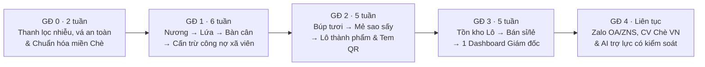

<!--
SPDX-License-Identifier: MIT
SPDX-FileCopyrightText: 2026 OpenTea Developers
-->
# Lộ trình Sản phẩm Chiến lược — OpenTea DX-OS cho HTX Chè Việt Nam

> **Vai trò tài liệu:** Kim chỉ nam PO/BA cho toàn bộ các đợt phát triển tiếp theo của OpenTea DX-OS (sau mốc nền tảng `v1.17.0`).
> **Căn cứ:** [Phân tích Nghiệp vụ (BA)](./business-analysis.md), [ADR 0005](./adr/0005-multi-tenant-tea-value-chain-dxos.md), khung kiến trúc **DX-OS Open-Core / HPDI** của TS. Tạ Tuấn Anh và kết quả kiểm toán sản phẩm ngày 2026-11-28.

---

## 1. Tuyên ngôn Định vị & North Star Metric

**Tuyên ngôn Định vị:**
> **OpenTea DX-OS** là **Hệ điều hành Chuỗi giá trị & Sổ cái Xã viên chuyên biệt cho Hợp tác xã Chè Việt Nam**, xây trên kiến trúc 3 tầng **DX-OS Open-Core** — biến mọi ghi nhận từ nương chè, bàn cân búp tươi và xưởng sao sấy thành **an toàn thực phẩm có thể kiểm chứng**, **công nợ xã viên minh bạch tự động**, và **hồ sơ chất lượng giúp HTX bán được chè giá cao**.

**Chỉ số Ngôi sao Bắc Đẩu (North Star Metric):**
> **`% sản lượng chè thương phẩm của HTX đi trọn một mạch số hóa khép kín`** *(từ Thửa đạt cách ly theo lứa → Phiếu cân búp tươi → Mẻ sao sấy → Lô QR thành phẩm → Bảng kê quyết toán cấn trừ công nợ xã viên)* **mà không phải nhập lại ra sổ giấy hay Excel.**

**Ba lời hứa cốt lõi với HTX Chè:**
1. **An toàn từ Bàn cân (`Zero-Residue Intake`):** Chặn tuyệt đối búp tươi còn trong thời gian cách ly thuốc BVTV ngay lúc cân thu mua.
2. **Chốt sổ Xã viên trong 30 phút (`Automated Cooperative Ledger`):** Tự động tổng hợp `Tiền búp tươi các lứa − Nợ phân/thuốc đã ứng = Thực lĩnh từng hộ`, xuất phiếu gửi tận tay xã viên.
3. **Truy xuất Thật có Cân bằng Khối lượng (`Mass-Balanced Traceability`):** Tem QR chứng minh lô chè khô đi ra từ phiếu cân búp nào, mẻ sao nào, tỷ lệ thu hồi tươi/khô hợp lý, kèm chứng nhận VietGAP/OCOP thật còn hiệu lực.

---

## 2. Chiến lược Triển khai Thương mại: SaaS Đa HTX Chủ lực + Cụm Cấp Tỉnh

Toàn bộ sản phẩm sử dụng **duy nhất 1 codebase Multi-Tenant (`htx_code`)** cho cả hai kênh thị trường:

| Kênh triển khai | Tỷ trọng mục tiêu | Chân dung khách hàng | Mô hình cung cấp & Tác động kiến trúc |
|---|---|---|---|
| **1. Cloud SaaS Đa HTX (`Multi-Tenant SaaS First`)** | **~90% số HTX** | HTX chè quy mô 15–150 hộ, không có nhân sự IT, ngân sách 300k–500k đ/tháng. | Tạo `htx_code` trong 30 giây trên hạ tầng Cloud chung (`≤ 8 GB RAM` gánh hàng chục HTX). Dùng chung **Zalo OA/ZNS nền tảng** và **Danh mục thuốc BVTV chuẩn** do `platform_admin` duy trì. |
| **2. Cụm Độc lập Cấp Tỉnh / Đầu chuỗi (`Sovereign-Cluster Ready`)** | **~10% hợp đồng giá trị cao** | Liên minh HTX Tỉnh, Sở NN&PTNT, dự án Nông thôn mới/OCOP hoặc DN bao tiêu 30+ HTX vệ tinh. | Đóng gói nguyên cụm Multi-Tenant `opentea-dx-os` cài trên Data Center của Tỉnh/DN (`Zero Vendor Lock-in`, 100% mã nguồn mở chuẩn DX-OS). |

**Khung Gói Sản phẩm Thương mại (3 Tầng Giá trị):**
1. **Gói Khởi Động (Miễn phí):** Hộ, Bản đồ nương chè, Nhật ký canh tác theo lứa, tối đa 5 Lô QR/năm.
2. **Gói Vận Hành Chuẩn (Chủ lực):** Mở khóa trọn bộ Bàn cân búp tươi chặn cách ly PHI + Sổ cái công nợ vật tư tự động + Mẻ sao sấy + Xuất tem QR không giới hạn + Bảng điều hành Giám đốc hợp nhất + Tin nhắn Zalo ZNS định kỳ.
3. **Gói Liên Minh / Vùng Nguyên Liệu (B2G / Doanh nghiệp):** Cụm cài riêng hoặc cổng quản trị vùng nguyên liệu nhiều HTX + Zalo OA thương hiệu riêng.

---

## 3. Hiệu chỉnh Kiến trúc theo Chuẩn DX-OS của TS. Tạ Tuấn Anh

Lộ trình giữ trọn 4 không gian **HPDI** và 3 tầng **DX-OS Open-Core**, nhưng chấm dứt tình trạng "lắp ghép ốc đảo" làm đứt mạch nghiệp vụ:

| Không gian DX-OS | Điều chỉnh Chiến lược Bắt buộc |
|---|---|
| **`[H]` Human Space** | - **Đa vai trò 1 tài khoản:** Dùng bảng `htx_memberships (user_id, htx_code, roles[])` + **Role Switcher** để Giám đốc kiêm Cán bộ KT kiêm Chủ hộ không phải tạo 3 số điện thoại. - **Tách `platform_admin`:** Gỡ màn hình cấu hình LLM key, ngân sách USD, cài container khỏi giao diện Giám đốc HTX. - **Chuẩn hóa P.A.R.A Chè:** Đổi mẫu P.A.R.A sang mùa vụ chè, quy trình sao sấy, danh mục thuốc BVTV, hồ sơ lô QR; nâng cấp RAG Chatbot đọc được file PDF. - **Kênh phổ cập:** Đưa **Zalo OA/ZNS** (qua gateway nền tảng) + Web PWA nhẹ thành kênh chính của nông dân; bỏ ép cài Google Authenticator (TOTP) và email bắt buộc đối với nông dân. |
| **`[P]` Process Space (`Poka-yoke`)** | Đưa 5 rào chắn **`Poka-yoke` (chống sai lỗi tại nguồn)** thành luật bất biến: 1. **Tách bạch Lứa hái (`cycle_id`):** Nhật ký, phiếu cân và lô gắn trực tiếp vào lứa; hái xong tự mở lứa mới. 2. **Danh mục thuốc chuẩn:** Chọn thuốc từ danh mục → tự điền ngày cách ly; kê đơn bệnh tự tạo nháp nhật ký phun. 3. **Chốt chặn bàn cân:** Khóa đỏ nếu nương còn trong ngày cách ly (`safe_harvest_date`). 4. **Cân bằng khối lượng:** Cảnh báo nếu tỷ lệ `kg tươi / kg khô` lệch khỏi biên độ chuẩn (~4,5–5 : 1). 5. **Chữ ký con người:** An toàn thực phẩm (`harvest.approve`) và Tiền bạc (thanh toán, giá, khuyến mãi) không bao giờ tự động chạy không có người duyệt. |
| **`[D]` Data Space (Single Source of Truth)** | - **Xóa ốc đảo Schema:** Đưa dữ liệu chủ và sổ cái chuỗi giá trị (*Hộ, Nương, Lứa, Nhật ký, Phiếu cân, Mẻ sao, Lô, Sổ cái công nợ*) vào **Single Source of Truth** của Lõi, gắn chuỗi băm bất biến `audit.events`. - **Chuẩn hóa Mini-app Tầng 3:** Giữ kiến trúc `app.yaml` / `./dxos` cho các phân hệ mở rộng và cổng thao tác, nhưng mọi đọc/ghi chạm tới dữ liệu chuỗi giá trị phải đi qua **Hasura RLS + APISIX Core Action API** thay vì giữ bảng cô lập. - **IT/OT & Kho lạnh Parquet/DuckDB:** Nối số đo cảm biến thật vào trang sức khỏe đất; mở rộng mô hình Bản sao số sang **Xưởng sao sấy chè** (nhiệt độ tôn sao diệt men, nhiệt/ẩm sấy, ẩm độ kho bảo quản gắn `Mẻ chế biến`). |
| **`[I]` Intelligence Space** | - Chuyển đầu vào Agent từ giá `Math.random()` / ngũ cốc sang **dữ liệu vận hành thật** (giá búp ngày của HTX, phiếu cân, tồn kho, nợ vật tư). - Ưu tiên các tác nhân AI giải nỗi đau thật: cảnh báo bất thường chéo *(nhận thuốc nhưng không ghi nhật ký phun; sản lượng nộp cân vượt định mức diện tích)*, dự báo sản lượng búp lứa tới cho xưởng sao, và Piper TTS đọc to hướng dẫn kỹ thuật. - Huấn luyện lại CV bệnh lá bằng ảnh thực địa Việt Nam (*rầy xanh, bọ cánh tơ, nhện đỏ, phồng lá chè, bọ xít muỗi*). |

---

## 4. Phán quyết Danh mục Tính năng (Portfolio Triage)

| Nhóm hành động | Hạng mục hiện tại | Quyết định PO & Hành động cụ thể |
|---|---|---|
| **HỢP NHẤT VÀO LÕI** | `miniapps/leaf-purchase` + `miniapps/farm-supply` | Hợp nhất mô hình dữ liệu về Core Single Source of Truth thành phân hệ **Thu mua búp, Vật tư & Sổ cái Xã viên** (gắn `parcel_id`, `cycle_id`, chốt chặn PHI, cấn trừ nợ). |
| **GỘP LÀM MỘT** | `/manager/dashboard` + `miniapps/htx-dashboard` `/q/[lot_code]` + `/lot/[lot_code]` | Gộp thành **1 Bảng Điều hành Giám đốc** duy nhất có đủ sản xuất + thu mua + tồn kho + công nợ; gộp thành **1 Trang Truy xuất QR** duy nhất (bỏ `?status=` giả mạo). |
| **NÂNG CẤP NỐI MẠCH** | `miniapps/tea-shop` + `/htx/[htx_code]` | Kết nối tồn kho bán hàng lẻ & sỉ trực tiếp vào `Lot` đã xuất QR; lưu `lot_id` trên từng dòng đơn để truy hồi. |
| **GIỮ Ở TẦNG 3 (NGOẠI VI)** | `miniapps/tea-tour` + `miniapps/custom-books` | Giữ làm Mini-app tùy chọn. Gỡ bỏ 4 mẫu trùng lõi khỏi `custom-books` (*phun thuốc, bón phân, sâu bệnh, chấm công hái*) để không tạo dữ liệu ngầm vượt rào cách ly. |
| **ĐÓNG BĂNG (FREEZE)** | `Autopilot` tự duyệt an toàn/tiền · `App Factory` (A12) · `MCP Bridge` · Agent Chiến lược `strategy` · `apps/staff-desktop` & `staff-mobile` (Windows/LAN) · `apps/hub-mobile` (Flutter mock) | Tắt khỏi cấu hình triển khai chuẩn (`Freeze, don't delete`). Chỉ mở lại có điều kiện khi hạ tầng HTX thực tế đáp ứng (ví dụ: mở lại cảm biến xưởng khi lắp PLC/MQTT thật; mở lại nhân sự khi HTX có nhà máy công nhân lương tháng). |
| **GỠ BỎ NGAY (KILL)** | `Reels` video TikTok (Web & Mobile) · 5 trang Gian hàng/Tour Sample của Officer · `CameraWatch` 4 camera giả · `/forgot-pin` giả · `SampleYieldChart` · 3 đối tác mẫu Cần Thơ · Workflow n8n giá `Math.random()`, `worldbank` ngũ cốc, `nasa` `28.5°C` | Xóa hoàn toàn khỏi giao diện chính thức vì là "nợ niềm tin" (Trust Debt) phá hủy uy tín sản phẩm trước người dùng thật. |

---

## 5. Lộ trình Thực thi 5 Giai đoạn

### Giai đoạn 0: Thanh lọc Nhiễu, Khóa Rủi ro Uy tín & Chuẩn hóa Ngôn ngữ Chè (2 tuần)
- **Mục tiêu:** Đưa hệ thống về trạng thái trung thực 100%, không còn dữ liệu mẫu trên menu thật và khóa các lỗ hổng bảo mật/tenant.
- **Việc phải làm:**
  1. Gỡ bỏ toàn bộ màn hình/widget giả khỏi menu của cả 3 vai trò; tắt các workflow cào dữ liệu giả và ngũ cốc; đóng băng các thành phần ngoài luồng lõi để stack chuẩn chạy gọn nhẹ (`≤ 6–8 GB RAM`).
  2. Vá các lỗ hổng khẩn cấp: xóa tham số `?status=` giả mạo thu hồi trên `/q/[lot_code]`; bổ sung `htx_profile_id` và kiểm tra role `manager` cho API đối tác; khóa quyền `GET /api/members` và `/api/search` với `farmer`; sửa lỗi nhật ký `REJECTED` bị tính vào ngày cách ly.
  3. Hoàn thiện bộ tài liệu định hướng chuẩn ngành chè (`business-analysis.md`, `product-roadmap.md`, `project-context.md`) và thay thuật ngữ *"Gieo sạ / Thửa ruộng / Ấp"* bằng thuật ngữ chè.
- **Tiêu chí hoàn thành (DoD):** 0 màn hình giả trên giao diện sản xuất; kiểm thử tenant & bảo mật xanh 100%.

### Giai đoạn 1: Khép kín Mạch Sống 1 — "Nương chè → Bàn cân → Sổ cái Xã viên" (6 tuần)
- **Mục tiêu:** Giải quyết 2 nỗi đau hàng ngày lớn nhất (kiểm soát dư lượng thuốc ngay tại bàn cân và tự động cấn trừ công nợ vật tư vào tiền bán búp tươi).
- **Việc phải làm:**
  1. **Vòng đời Lứa chè chuẩn:** Gắn `cycle_id` vào `JournalEntry` và `LotParcel`; sửa bẫy kẹt trạng thái sau thu hoạch để chăm sóc lứa mới tự mở `ParcelCropCycle` mới; bổ sung hoạt động `PRUNING` (Đốn chè).
  2. **Nhật ký 3 chạm & Danh mục thuốc BVTV chuẩn:** Cán bộ và nông dân chọn thuốc từ danh mục (ưu tiên thuốc hộ đã ứng) → tự tính `withdrawal_days`; thêm ô `kg búp hái` và `liều phân bón`; hỗ trợ lưu offline cho Nhật ký và nút `Sửa lại` khi `REQUEST_CHANGES`; đưa nút **Nghiệm thu Đạt Cách ly** lên Web.
  3. **Thu mua Búp tươi & Bảng giá Ngày:** Giám đốc công bố giá thu mua theo phẩm cấp búp trong 10 giây; tách vai **`accountant` (Kế toán/Bàn cân)** lập phiếu cân gắn `Hộ + Nương + Lứa` có trừ `% nước mưa/tạp chất` và **chốt chặn Poka-yoke đỏ khi nương đang cách ly**.
  4. **Vật tư ứng & Sổ cái Quyết toán Kỳ:** Ghi nợ phân/thuốc cấp ứng theo hộ → cuối kỳ tính tự động `Tiền búp − Nợ vật tư = Thực lĩnh`, xuất phiếu thanh toán có VietQR.
  5. **Đa vai trò & Đăng nhập thực tế:** Triển khai `htx_memberships` + Role Switcher 1 chạm; hỗ trợ `platform_admin` quản lý cụm SaaS; bỏ ép TOTP và email bắt buộc với nông dân/cán bộ cơ sở.
- **Tiêu chí hoàn thành (DoD):** HTX thí điểm vận hành trọn 1 lứa hái và 1 kỳ thanh toán có cấn trừ nợ trên hệ thống; **0 phiếu cân lọt qua khi thửa đang cách ly**; thời gian chốt kỳ giảm từ 2–3 ngày xuống **≤ 30 phút**.

### Giai đoạn 2: Khép kín Mạch Sống 2 — "Búp tươi → Xưởng Sao sấy → Lô Thành phẩm & Tem QR" (5 tuần)
- **Mục tiêu:** Nối liền hố đen chế biến chè và làm cho tem QR chứng minh được nguồn gốc cân bằng khối lượng.
- **Việc phải làm:**
  1. **Phân hệ Xưởng Chế biến (`ProcessingBatch`):** Gom các phiếu cân búp tươi chưa chế biến vào mẻ sao/vò/sấy; ghi nhận nghệ nhân/ca sao, sản lượng chè khô theo phẩm cấp (*Đinh, Tôm nõn, Móc câu, Bồm, Cám*) và cảnh báo tự động khi tỷ lệ thu hồi lệch khoảng chuẩn (~4,5–5 : 1).
  2. **Đóng Lô từ Mẻ sao & Chứng nhận Thật:** Tạo `Lot` từ tồn kho bán thành phẩm; thay `CertificateManager` giả bằng lưu trữ thật trên SeaweedFS S3 (có số chứng nhận, tổ chức cấp, ngày hết hạn).
  3. **1 Trang Truy xuất QR Duy nhất & In Tem:** Hiển thị trọn 4 tầng thông tin (Đồi chè – An toàn PHI – Mẻ sao chế biến – Chứng nhận thật); ẩn tên cá nhân hộ nông dân theo cấu hình bảo mật HTX; xuất PDF dàn trang tem QR in nhiệt.
- **Tiêu chí hoàn thành (DoD):** **100% Lô xuất QR truy ngược được về Mẻ sao và Phiếu cân đầu vào**. *(Đây đồng thời là bộ kịch bản Demo chuẩn mực cho hội đồng và đối tác).*

### Giai đoạn 3: Khép kín Mạch Sống 3 — "Tồn kho Lô → Bán Sỉ/Lẻ → 1 Dashboard Giám đốc" (5 tuần)
- **Mục tiêu:** Khép đầu ra thương mại và trao cho Giám đốc HTX một màn hình điều hành toàn diện.
- **Việc phải làm:**
  1. Liên thông `tea-shop` và đơn hàng B2B (thương lái/hợp đồng bao tiêu) với tồn kho thực của từng `Lot`; lưu `lot_id` trên từng dòng đơn; quản lý công nợ phải thu khách hàng gắn với Bản đồ đối tác riêng của từng HTX.
  2. Gộp `/manager/dashboard` và `htx-dashboard` thành **1 Bảng Điều hành Giám đốc duy nhất** trả lời 6 câu hỏi sáng sớm (*Kg thu hôm nay, Giá ngày, Tiền phải trả xã viên, Tồn kho chè khô theo hạng, Công nợ thương lái, Cảnh báo cách ly/hao hụt/tồn đọng*).
  3. Xuất báo cáo tổng kết vụ/năm phục vụ Đại hội thành viên theo Luật HTX 2023.
- **Tiêu chí hoàn thành (DoD):** Giám đốc kiểm tra xong toàn bộ tình hình hàng – tiền – rủi ro mỗi sáng trong **< 60 giây** trên 1 màn hình.

### Giai đoạn 4: Kênh Zalo Thực địa & Trí tuệ Nhân tạo Có Kiểm soát (Liên tục)
- **Mục tiêu:** Phủ sóng tới nông dân lớn tuổi qua Zalo và phát huy sức mạnh AI trên dữ liệu sạch.
- **Việc phải làm:**
  1. **Zalo OA/ZNS & Zalo Mini App dùng chung cấp Nền tảng:** Gửi tự động Giá ngày, Biên nhận cân búp, Cảnh báo hết cách ly, Phiếu quyết toán kỳ.
  2. **Bộ nhận diện Sâu bệnh Chè Việt Nam:** Thu thập ảnh ca bệnh đã được Cán bộ KT xác nhận tại GĐ1–GĐ3 để huấn luyện lại model nhận diện 5 dịch hại chủ lực (*Rầy xanh, Bọ cánh tơ, Nhện đỏ, Phồng lá chè, Bọ xít muỗi*); kết nối kê đơn với khóa cách ly tự động.
  3. **AI Trợ lực Đúng chỗ (Human-in-the-loop):** Cảnh báo bất thường chéo *(ứng thuốc không phun, cân búp vượt định mức diện tích)*, dự báo sản lượng búp lứa tới cho xưởng sao, RAG đọc PDF P.A.R.A, mở rộng TTS cho toàn bộ màn hình hướng dẫn nông dân, và mở lại cảm biến xưởng sao sấy khi HTX lắp đặt phần cứng thật.

---

## 6. Ma trận Màn hình Chính theo Vai trò (Role-Information Fit)

| Vai trò | Thông tin & Tác vụ Bắt buộc trên Màn hình Chính | Hạng mục Phải Gỡ bỏ |
|---|---|---|
| **`platform_admin`** *(Mới)* | Danh sách HTX (`htx_code`), cấp/khóa gói dịch vụ, cấu hình LLM/Zalo dùng chung, Danh mục thuốc BVTV chuẩn Bộ NN&PTNT, thống kê sản lượng vùng ẩn danh | (Vai trò quản trị SaaS mới) |
| **`manager`** (Giám đốc HTX) | Ô công bố Giá thu mua hôm nay (10s) · Kg búp tươi thu ngày/kỳ · Tồn kho chè khô theo hạng · Quỹ phải trả xã viên vs. Nợ vật tư · Công nợ thương lái · Cảnh báo đỏ (vi phạm PHI, hao hụt sao sấy, lô tồn lâu) | Chỉ số ngũ cốc/lúa mì FAO, biểu đồ mẫu, cấu hình model USD/CI code, Reels, nút tạo lô 403, đối tác mẫu miền Tây |
| **`accountant`** *(Mới — Kế toán/Bàn cân)* | Cân nhanh búp tươi (Hộ → Nương → Loại búp → Kg − % tạp chất, đèn báo PHI) · Cấp ứng vật tư · Bảng quyết toán kỳ (`Tiền búp − Nợ = Thực lĩnh`) · Thu tiền COD & công nợ sỉ | (Tách khỏi tài khoản Giám đốc) |
| **`officer`** (Cán bộ KT & Xưởng) | Cảnh báo cách ly & lứa sắp hái · Bản đồ GPS walk-track & hộ · Duyệt nhật ký hàng loạt & ghi hộ · Ca bệnh kèm kê thuốc khóa PHI · Lập Mẻ sao sấy & Đóng lô in tem QR | 5 trang Gian hàng/Tour/Doanh thu giả, Reels, 2 chatbot rời |
| **`farmer`** (Xã viên) | 4 tab chữ to: (1) Giá búp hôm nay + Thời tiết + Ngày được hái từng nương + Nút gọi Cán bộ KT; (2) Phiếu cân & Công nợ vật tư; (3) Nhật ký 3 chạm offline; (4) Chụp bệnh nén ảnh tự động + Nghe TTS | Khối 4 camera giả, việc cần làm mẫu, giá chè cố định giả, nút chatbot bị khóa cứng, chữ "Gieo sạ" |
| **Khách mua / Thương lái** | 1 Trang QR chuẩn: Nguồn gốc vùng trồng – An toàn 0 dư lượng – Mẻ sao chế biến – Chứng nhận thật còn hạn; Gian hàng trừ tồn kho thật theo Lô | Trang `/q/` giả mạo `?status=revoked`, lộ họ tên cá nhân hộ nông dân (mặc định ẩn) |

---

## 7. Bộ KPI & Cổng Gác Chống Trôi Định hướng (PO Governance)

### Bộ KPI Chuyển đổi số Thực chất
| KPI | Hiện trạng (v1.17.0) | Mục tiêu Đích |
|---|---|---|
| Số phiếu cân búp tươi lọt lưới khi nương đang cách ly PHI | Không kiểm soát (100% hở) | **0 phiếu** (từ GĐ1) |
| % sản lượng búp thu mua truy được tới đúng Thửa & Lứa | **0%** | **≥ 95%** (hết GĐ1) |
| Thời gian chốt kỳ thanh toán + cấn trừ công nợ vật tư | 2–3 ngày thủ công | **≤ 30 phút** (hết GĐ1) |
| % Lô xuất QR truy ngược khớp khối lượng về Mẻ sao & Phiếu cân | **0%** | **100%** (hết GĐ2) |
| Độ lệch cân bằng khối lượng tươi/khô không giải trình | Không đo được | **Cảnh báo 100%** lô vượt biên độ (từ GĐ2) |
| RAM tối thiểu chạy trọn bản lõi SaaS đa HTX | ~16–32 GB RAM | **≤ 6–8 GB RAM** (từ GĐ0) |

### "Cổng Gác 4 Câu Hỏi" cho Backlog
Mọi tính năng hoặc công nghệ mới chỉ được phép đưa vào kế hoạch xây dựng khi trả lời **"CÓ"** cho cả 4 câu hỏi:
1. **Đúng nỗi đau & đúng vai chưa?** Giải quyết việc thật hàng ngày của Giám đốc, Kế toán, Cán bộ KT, Xã viên hay Khách mua chè (không phải để trình diễn công nghệ)?
2. **Có nối vào Xương sống Dữ liệu Lõi không?** Có gắn vào mạch `Hộ – Nương – Lứa – Phiếu cân – Mẻ sao – Lô – Sổ cái` thay vì tạo thêm ốc đảo dữ liệu cô lập?
3. **Người không rành IT dùng nổi trong ≤ 3 bước không?** Nông dân 55 tuổi hoặc Kế toán HTX có thao tác được mà không phải cài app nặng hay cấu hình kỹ thuật?
4. **Có bảo vệ nguyên tắc `Poka-yoke` Con người chịu trách nhiệm về An toàn & Tiền bạc không?** AI chỉ gợi ý/kiểm chứng/tóm tắt; con người ký duyệt cuối cùng với an toàn thực phẩm và tài chính.
